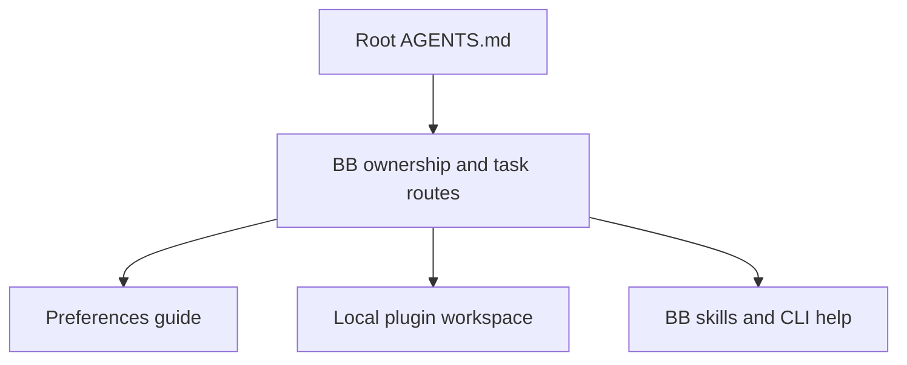

# BB

This guide owns local BB configuration rules and routes to plugin documentation.
Use BB's supplied skills and `bb guide` for platform commands and agent orchestration.

## Settings ownership

Check whether a local plugin manages a setting before changing it through the UI or CLI.
File-managed settings are authoritative. Change their tracked file, then verify the live setting.
Do not disable reconciliation to make a settings edit persist.

## Agent usage

The custom **Agent Switcher** plugin (`claude-profiles`) owns the usage badge and
`⌘⇧A` overlay. Read its [guide](../../src/bb-plugins/claude-profiles/README.md#usage).
The built-in `bb--provider-usage` plugin collects quota sources for Agent
Switcher.

Before choosing files, check `bb plugin list --json` and
`bb settings keyboard list --json`. The usage command is
`plugin:claude-profiles/show-usage`.

## Thread shortcuts

The Preferences plugin manages thread shortcuts from [preferences.json](./preferences.json).
Managed entries override UI and CLI edits. Other shortcuts remain unmanaged.
Read the [Preferences guide](../../src/bb-plugins/preferences/README.md) for ownership, installation and removal rules.

1. Edit [preferences.json](./preferences.json) for the requested command and platform.
2. Run `bb preferences apply` to apply the tracked file.
3. Run `bb settings keyboard list --json` to verify the live overrides.

## Automation backups

[Automation Backup](../../src/bb-plugins/automation-backup/README.md) exports live
automation definitions to a private Git repository and pushes changed snapshots.
Use `bb automation-backup run` after changing a task for an immediate backup.
Do not copy prompts or snapshots into public dotfiles. BB owns live task settings;
editing a snapshot does not change a task.

## Workflows

BB's built-in Workflows plugin supports provider-independent workflows, including Codex workers.
Enable it with `bb plugin enable workflows`. Verify its state with `bb plugin list --json`.
BB stores plugin enablement locally; dotfiles does not track that state.
Use the supplied `workflows` skill for authoring, validation, execution and inspection.

## Local plugins

Plugin source lives in [src/bb-plugins](../../src/bb-plugins/README.md), a shared pnpm workspace.
Read its guide and the affected plugin's README before changing source.
The workspace guide owns build, test, installation and reload procedures.

[Handsfree](../../src/bb-plugins/handsfree/README.md) owns Hex voice controls for the focused BB window.

## Platform operations

Use the supplied `bb-cli` skill for settings and state inspection.
Use the matching provider or plugin skill for its subsystem.
Check live command syntax with `bb <group> --help`.
Verify changes through live settings or behaviour before reporting success.
