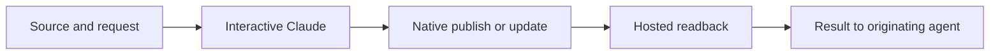

# Claude artifact handoff

> Which session can publish, and what proves the hosted page matches the request?

Use native artifact tools when the originating session exposes them.
Otherwise, hand the source to an interactive Claude Code session.
A skill supplies instructions; it does not supply Claude's publishing tools.

Default to publish, read back, and close the disposable session.
Persistent watching and forwarding comments to the originating agent are outside this recipe.

## Route the work

| When | Read |
| --- | --- |
| Preparing a publish, update, or readback | [references/contract.md](references/contract.md) |
| Running the handoff inside BB | [references/bb.md](references/bb.md) |
| Checking the recipe's tested scope or changing its commands | [references/evidence.md](references/evidence.md) |

A deck or presentation goes through Claude Slides, not an HTML page.
Start the interactive session with `/slides <brief>` as its prompt, and pass slide text and images as job files.
Publishing an HTML deck gives a web page that cannot be edited, presented, or exported as slides.

For feedback, votes, data, or comments, load `artifact-patterns` before building the page.
That skill owns interaction design; this skill owns publishing and returning the result.
For page runtime APIs, the publishing Claude session loads its built-in `artifact-capabilities` skill when needed.
Pass the complete capability requirements with the source rather than recreating that API here.

## Boundaries

Keep authentication inside Claude Code. Do not extract credentials or substitute an undocumented publishing API.
Use the user's existing permissions. Surface blocked prompts without weakening settings or permission modes.
State publishing intent in the terminal prompt itself; a request hidden in a brief failed the recorded spike.
Do not interpret a local file, a printed URL, or a successful process exit as hosted verification.

Check the [official availability requirements](https://code.claude.com/docs/en/artifacts#availability) when the tool is missing.
Do not assume a PTY alone enables publishing, or that SDK and interactive sessions expose identical tools.
