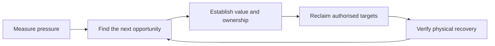

# Disk reclaim

Recover useful free space while preserving work the user still needs.
Keep finding candidates beyond familiar caches. A cleaner's target list is
one source of opportunities, not the boundary of the investigation.

## Choose the next useful action

Maintain a private working inventory across cleanup batches. For each large
root or candidate, record its measured size, contents, owner, recovery cost,
authorisation and outcome. Mark paths as unexplored, protected, selected or
cleared. A failed or blocked measurement stays unknown, never zero.

Start with current free space and the native cleaner's preview. On later
rounds, resume the inventory and follow the largest unexplored areas,
unexplained volume usage or recent growth. Repeat exhausted cache probes only
when there is evidence of new growth. Revisit protected candidates when their
ownership or recovery cost changes.

Compare disposable installations across projects, worktrees and scratch copies
in the same inventory. Group verified candidates into batches by recovery cost
and disruption, rather than stopping after cleaning one folder or tool cache.
Investigate independent roots separately so one slow scan does not block the rest.

Rank candidates by recoverable space, value retained, disruption and rebuild
cost. A smaller obsolete download can be a better target than a large active
build. Split mixed directories: preserve useful source and final reports while
proposing their disposable dependencies or intermediate recordings separately.

For a quick cleanup, act on verified opportunities without waiting for a full
audit. For a deep audit, inventory every direct child of the named roots and
report coverage and unknowns. Continue when asked for more. Finish when the
requested headroom is observed or further progress needs a specific user decision.
Do not invent a headroom target or treat one successful cleaner as completion.

## Measure the actual pressure

- Read `df -k /System/Volumes/Data` before and after each cleanup batch.
  Use consistent units; `du` and cleaner estimates are candidate sizes, not savings.
- Run `cleanup --dry-run --json` with the login PATH. Check `cleanup --help`
  for supported targets. A missing tool, timeout or failed probe leaves that
  target unknown even if the wrapper prints zero. Resolve installed tools with
  `command -v` or `mise ls --current --json`; discovery must not install tools.
- Size named roots with `du -xhd 1 <root>` and drill large children.
  Use `rg --files` or bounded listings to inspect contents. Avoid huge shell
  globs, interactive `ncdu`, and `xargs du -c | tail -1`, which can total only
  the last batch. Keep long inventories in private files with bounded summaries.
- A scan without a result leaves the path unmeasured. Privacy controls can
  stall `~/Library/Containers`; list it first and measure named third-party
  containers separately. Do not infer that a stalled directory is large or small.
- Reconcile directory totals with the Data volume's own usage using
  `diskutil info /System/Volumes/Data` or `diskutil apfs list`. `df` reports
  shared-container pressure, including other volumes. Data's decimal GB and
  `du`'s GiB need conversion. Probe `/private/tmp`, `/Library` and
  `/opt/homebrew` when home-directory totals leave substantial Data usage unexplained.
  A sandbox denial leaves volume accounting unknown; it does not block unrelated candidates.
- Shared hardlinks, APFS clones and sparse files invalidate sums of apparent
  sizes. Use one traversal for combined hardlink accounting. Physical recovery
  still requires a before/after `df` reading.

## Search beyond the default cleaner

Use measured size and missing coverage to choose among these areas. None of
the paths below is disposable merely because it appears in this list.

| Area | Where to look | What to separate |
|---|---|---|
| Project trees | `~/git`, `~/src`, managed worktrees and `.claude/worktrees` | Dependencies, build output and local package stores from source, captures and reports |
| Agent artefacts | `~/.bb/thread-storage` and each large run's children | Intermediate screenshots, recordings, test fixtures and downloaded runtimes from final evidence and harnesses |
| Temporary work | `/private/tmp/claude-<uid>`, `$TMPDIR` and named experiment roots | Package archives, comparison copies, alternate installs, failed backup staging and retained tests from modified checkouts |
| Application storage | `~/Library/Caches`, `~/Library/Application Support`, named containers and every configured profile | HTTP caches, stale updates and downloadable content from offline documents, databases and writable VM state |
| Tool installations | mise data, pnpm stores and package-manager versions, aube stores, Codex releases | Unreferenced versions and downloads from live dependencies and pinned tools |
| Personal storage | `~/Downloads`, recordings, model stores and games | Duplicate downloads or approved audio from authored material and transcripts |
| History and backups | Agent transcripts, rehearsal Git repositories and retained backups | Verified redundant copies from unique history, keys and the only surviving archive |

### Projects, stores and worktrees

For a broad audit, census installed dependencies and local package stores
across projects, nested subprojects and worktrees.
Global store pruning leaves installed dependency trees intact. Group candidates
by owning project so dormant installations can be reviewed together.
Before removing dependencies, inspect editable patches and local links.
Preserve unfinished edits and verify retained patch files can reproduce applied changes.
Check installed CLI shims, enabled plugins and retained hooks before classifying
dependencies as unused.

Prefer the project's native clean command. Check activity before cleaning a
build tree; forcing a concurrent rebuild is disruption even when files are
rebuildable. Git-untracked and gitignored paths can contain valuable captures.
Inspect contents; a directory named `coverage` inside `site-packages` is an
installed package, not test output.

Use `cleanup --target worktree-build --dry-run --json` for managed build
candidates and `cleanup --target cargo-target --dry-run --json` for Rust output.
Inspect exact candidates before executing either. The `cargo` target covers
registry cache, not project `target/`; `cargo-target` uses `CLEANUP_CARGO_ROOTS`.

For stores outside the global prune, inspect `storeDir` in
`node_modules/.modules.yaml`; its contents may be JSON. Verify
`pnpm --dir /private/tmp --store-dir <root> store path` resolves the intended
layout before `store prune`. An installed pnpm major can append a different
layout version. Store size is not unreferenced size.
A successful pnpm prune can skip shared-store cleanup when no project references
are found. Check installed-version behaviour before classifying retained content;
an empty reference set can mean unknown ownership.

For checkout removal, inspect clean status, ignored files, ownership and branch
tips. A clean checkout or idle thread does not establish completed work.
`git worktree remove` retains branches, but local deletion rules still apply.
`wt-status --all --pr --json` and `wt-clean --dry-run` classify managed trees.
`wt-clean` also deletes branches; `--force` can destroy unmerged commits.
Use branch-preserving removal where appropriate and verify retained tips.
Missing checkout registrations offer metadata cleanup, not checkout-sized savings.

Run roots under `~/.trees` can contain notes, evidence and nested worktrees.
Read `RUN.md` or `PAUSED.md` before classifying them. BB-managed environments
need their documented lifecycle, completion evidence and pending decisions
checked before retirement. Verify retirement separately from file removal.

### Agent runs, scratch and history

Rank BB thread directories by size. Refresh `bb thread show <id>` and final
output on each search; a previously protected thread may now be archived.
Read the run's harness to distinguish disposable fixture databases from real
application records. Select intermediate evidence separately from final
reports, harnesses and source. Retain exact private manifests for approved batches.

`cleanup --target claude-temp --dry-run --json` covers inactive UUID session
scratch, not every ad-hoc directory beneath `/private/tmp/claude-<uid>`.
Size that root separately. Live and hibernated sessions retain ownership;
unreadable ownership records leave protection unknown. For ad-hoc temporary
work, propose named targets rather than sweeping the root. A reboot can clear
temporary work but ends running jobs and needs approval.

Research clones can be downloadable; modified source is authored data.
For Git rehearsals, inspect with `git -C <checkout>` and account for ignored
files. Verify a retained backup contains HEAD and every local and rehearsal
remote ref tip, with object connectivity checked. A similarly named backup
or clean checkout alone does not prove redundancy.

Inspect backup-tool logs before proposing abandoned staging archives.
Verify retained originals or a verified archive can reproduce their contents.
Preserve keys and the only surviving copy.

`transcript-backup` owns Claude and Codex transcript pruning. Check
`~/.cache/transcript-backup.log` and redirect its `--dry-run` file listing to
private storage; report the summary. It archives idle sessions, verifies remote
storage and prunes unchanged originals. Hibernated sessions are protected.
Do not add manual transcript deletion or silently lower `cleanupPeriodDays`.
Resume support and cost reporting can depend on that history.

### Applications, runtimes and downloads

Inspect nested HTTP caches separately from `Service Worker/CacheStorage`,
`WebStorage`, `File System`, IndexedDB and VM disks. Offline copies require
approval even when their directory contains the word "cache".

For updater payloads under `*-updater` and `*.ShipIt`, preserve active staging.
Compare staged and installed app versions: equal or older is stale; newer is
pending. Say that removing a pending update forces another download.

Check installed tools and references before removing residual language caches.
A missing runtime can also prevent its native cleaner from working. Preserve
source and tool binaries when only caches are selected. Check installed model
managers' supported operations and loaded models before proposing model removal.

Inspect tool version stores with their owning manager. `mise prune` can leave
downloads beneath `~/.local/share/mise/downloads`; `mise cache clear` does not
cover that data directory. Check installed symlink targets before treating an
archive-named directory as a download. Embedded `node_modules/.mise` belongs
to the installed tool; use mise's lifecycle rather than removing it by hand.

Preserve aube's virtual-store root. Native pruning of one layout does not
classify legacy entries. For remaining candidates, trace installed tool and
package links transitively, check project and scratch references and open files,
and propose only an exact unreferenced manifest. Record existing dangling links.

`pnpm store prune` does not prune pnpm's own package-manager versions.
Check project `packageManager` pins before selecting those versions. For Codex
app-server releases, inspect the `current` symlink and running references.

Playwright browser revisions can all be required. Resolve `.links` to installed
`playwright-core` packages and their `browsers.json`, or use
`cleanup --target playwright --dry-run --json`. Age alone does not make a
revision unused. Probe the actual platform cache, including `~/Library/Caches`.

A VM bundle can contain both a downloadable base image and writable session
disks. Explain the selected bundle's data loss before removal. A stopped VM
is not an empty VM. Guest pruning may leave host allocation unchanged; inspect
sparse-file allocation and the manager's deletion or compaction operations.
Podman and Colima are separate managers. Colima can retain an unused named
Lima disk after VM deletion; inspect `LIMA_HOME=~/.colima/_lima limactl disk list`.
Resolve the installed Lima binary if it is not on PATH. Delete only an approved,
unreferenced disk through its manager.

Check Colima guest discard support and the Docker filesystem mount before trimming
already-free blocks with `colima ssh -- sudo fstrim -v /var/lib/docker`.
Measure host recovery separately from reported trimmed bytes.
Compare container, image and volume inventories before and after.

Check usage rather than bundle timestamps before proposing app removal. Null
Spotlight last-used data means unknown. An absent desktop bundle does not prove
its CLI is unused. Declaratively managed Homebrew apps return after uninstall;
change their owning configuration only when that change is requested. Uninstall
Steam games in Steam so manifests remain consistent.

For large Homebrew caches, use `cleanup --target brew`'s preview or
`brew cleanup --prune=all -n`; the default age policy can hide candidates.
Do not probe Yarn v1 `cache clean` with `--help`; use `yarn cache --help`.

### Recordings with transcripts

Ask before selecting anything in Downloads or removing original recordings.
For vox, inspect `vox compact` for an audio-preserving compaction route.

For MacWhisper, prefer supported audio-only operations. Inspect the installed
CLI and live database schema; check both Application Support and sandboxed app
storage. Select by verified database creation dates, converting the user's
strict calendar cutoff from their timezone. Filesystem mtimes are not recording dates.

Record exact audio paths, owning record IDs, creation dates, sizes, modification
times and file identities. Missing files contribute no savings.
Before removing approved audio, make a consistent SQLite backup including WAL
through the backup API and verify it with `PRAGMA quick_check`. Resolve direct
session and shared meeting, recording, voice-memo or podcast transcript links.
Export readable text and structured segments, speakers, summaries, translations
and dictation where present. Verify exports against the source and retain a
user-visible archive with the backup and exact audio manifest.

Revalidate database ownership, dates and file identity. Reject symlinks and
paths outside the media root; defer open audio or unknown usage. Remove only
approved audio, preserving transcript records, settings and unrelated media.
Verify retained records and files, then check transcripts in the app where
possible. Unchanged rows prove database preservation, not working in-app access.
Report unverified UI access and dangling media references without inventing a
schema migration. Keep private transcript text out of tool output.

## Decide and reclaim

| Recovery class | Authority |
|---|---|
| Rebuildable output or verified cache | Proceed where local rules permit, after checking active ownership |
| Downloadable packages, models, games or offline copies | Name the selected content and measured size; obtain a nod |
| Authored work, recordings, session state or unique history | Obtain explicit approval for the selected data loss |

Reusability and current ownership are separate questions. Age, PPID 1, clean
Git status and absence of open files do not prove abandonment. Check running
processes, owning tasks, hibernation records, shared consumers and dependency
references as relevant. Use `lsof -nP -Fpcn` with filtered private results;
recursive `lsof +D` on huge trees can stall. Defer candidates with unknown ownership.

Group verified candidates into a reviewable batch. Give exact paths or a private
manifest, measured size, recovery cost and what remains. Reuse approval for the
same batch; refresh identities and ownership immediately before execution.

Carry user exclusions into later batches and command recommendations. Check
wrapper defaults; use explicit targets when defaults include excluded areas.
Explain extra lifecycle effects, including removal of rollback generations.

Prefer native cleaners. Follow local deletion rules; do not run recursive-force
`rm` or substitute another permanent-deletion API. Outside permitted temporary
roots use `trash -v`. Leave agent-created temporary work unless the user approves
named targets. A rejected action is not permission to use another route.

Moving to Trash frees no space. Obtain explicit approval to empty all Trash,
including unrelated and mounted-volume contents. If available, use
`/usr/local/bin/empty-trash check`, then its `empty` command, without sudo.
Otherwise use authorised Finder emptying with an adequate timeout and verify
a complete Trash listing, including hidden items, before and after emptying.
Finder's normal item count can omit dot-directories. Reconcile the listing
with movement receipts before emptying. A timeout leaves the result unknown; inspect
progress before retrying. A sandbox denial or missing Automation consent is
not a successful cleanup. Keep movement receipts and report pending reclaim.

## Verify, report and continue

Check each approved path, the actual cache root and deliberately retained work.
If a cache path returns, compare recorded device/inode identities and Trash receipts.
Report new growth separately from removal of the approved instance.
A non-zero batch command can still remove some targets; inspect them individually.
Save each cleaner's exit status and output before verification. A removed cache
root can mean successful cleanup; a denied probe remains unknown.
A verification failure does not justify rerunning cleanup.
Keep chat concise and link a private detailed receipt. Record per-target outcomes,
retained work, recovery cost and native cleaner output. For package pruning,
capture package names and versions before pruning when the tool omits them.
Explain the native classifier and its limits; do not invent per-package disuse reasons.
Measure immediate before/after free space and report candidate size, observed
interval change and current free space separately. Concurrent activity means
neither session-wide change nor cleaner estimates establish attributable savings.

If deletion succeeds without physical recovery, inspect Trash, open references,
APFS shared blocks and snapshots. `du ~/.Trash` can return zero despite contents
because of privacy controls. Chrome `.code_sign_clone` trees can share app-bundle
blocks and running processes can depend on them. Read the KB's APFS accounting
note before treating their apparent size as a recovery opportunity.

Use `tmutil listlocalsnapshots /` to inspect snapshots that can pin deleted
blocks. Snapshot thinning is an intervention, not promised reclaim. `/nix/store`
is mostly live; trust the dead-path probe rather than quoting the whole store
or deleting rollback generations as routine cleanup.

For a stalled cleaner, identify the current step and compare its size over time.
Flat size plus sustained work can identify a stuck operation; elapsed time alone
cannot. Obtain stop approval where needed, then run the unaffected targets
explicitly. Keep missing or skipped probes visible.

If the user still needs space, return to the largest unexplored opportunities.
Preserve the inventory so the next batch builds on the investigation.

When pressure recurs, attribute growth before repeating cleanup. Compare root
sizes and opt-in cleaner previews; inspect large recently modified files.
Check `diskutil apfs list` and `sysctl vm.swapusage` to separate Data growth from
swap on the VM volume. Never delete swapfiles. Use the process-cleanup skill
for stopping jobs; a reboot or closing live work needs approval.

Inspect the actual producer in both main and active scratch checkouts before
proposing prevention. Cleanup may already handle successes while retaining
failures. Count overlapping runs as well as workers per run. Recommend the
smallest change that addresses the observed writer, such as bounded failure
retention, shared dependency storage or a shared limit on heavy jobs. Keep a
one-off reclaim separate from configuration or workflow changes.
