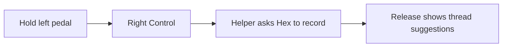

# The left pedal holds command recording

> Trigger superseded by [0023](0023-command-pedal-emits-f18.md). Recording behaviour remains in force.

The left PCsensor pedal emits Right Control while held. The command helper asks
Hex to record on press and transcribe on release. The user clicks a thread
suggestion to navigate. The centre pedal emits Right Option for dictation;
the right pedal emits Enter.

`pedal-flash` writes `r_ctrl`, `r_alt`, and `enter`, then verifies firmware readback.
The helper requires Input Monitoring for recording outside its focused browser window.

## Alternatives considered

- Retain Escape on the left pedal. The user chooses command recording instead of its Escape action.
- Bind command recording to Escape. That also makes ordinary keyboard Escape presses start recording.

