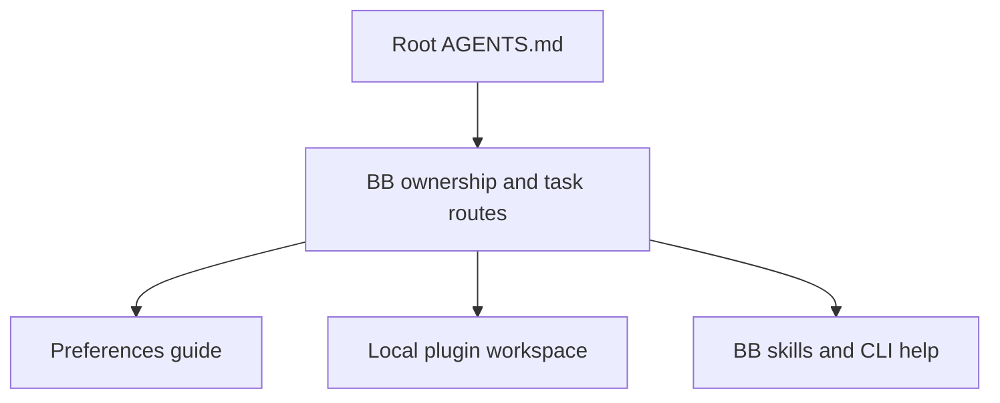

# BB

This guide owns local BB configuration rules and routes to plugin documentation.
Use BB's supplied skills and `bb guide` for platform commands and agent orchestration.



## Settings ownership

Check whether a local plugin manages a setting before changing it through the UI or CLI.
File-managed settings are authoritative. Change their tracked file, then verify the live setting.
Do not disable reconciliation to make a settings edit persist.

## Agent usage

The custom **Agent Switcher** plugin (`claude-profiles`) owns the usage badge and
`⌘⇧A` overlay. Read its [guide](../src/bb-plugins/claude-profiles/README.md#usage).
The built-in `bb--provider-usage` plugin collects quota sources for Agent
Switcher.

Before choosing files, check `bb plugin list --json` and
`bb settings keyboard list --json`. The usage command is
`plugin:claude-profiles/show-usage`.

## Claude account connectors

BB's global machine environment sets `ENABLE_CLAUDEAI_MCP_SERVERS=false`.
This default applies across this BB server's machines and projects. It prevents
Claude Code from fetching connectors attached to the selected Claude account.
It leaves separately configured MCP servers and Executor connections available.

[Agent Switcher](../src/bb-plugins/claude-profiles/README.md#account-connectors)
owns the global block, saved-account preferences and thread restrictions. Its
provider environment contribution applies the combined policy over the machine
default. Accounts start off. If the plugin is unavailable or its contribution fails, a new
Claude process uses the global off value.

Provision the default on each BB server:

```sh
printf 'false\n' | bb machine env set ENABLE_CLAUDEAI_MCP_SERVERS \
  --note 'BB default: Claude account connectors off; Agent Switcher owns connector policy.'
```

Keep this variable outside the telemetry declaration, which also writes shell
exports. A project environment override can replace the global value. Removing
or overriding the default removes protection when Agent Switcher is unavailable.
Existing Claude processes keep their launch environment until restarted.

## Thread shortcuts

The Preferences plugin manages thread shortcuts from [preferences.json](../.config/bb/preferences.json).
Managed entries override UI and CLI edits. Other shortcuts remain unmanaged.
Read the [Preferences guide](../src/bb-plugins/preferences/README.md) for ownership, installation and removal rules.

1. Edit [preferences.json](../.config/bb/preferences.json) for the requested command and platform.
2. Run `bb preferences apply` to apply the tracked file.
3. Run `bb settings keyboard list --json` to verify the live overrides.

## Automation backups

[Automation Backup](../src/bb-plugins/automation-backup/README.md) exports live
automation definitions to a private Git repository and pushes changed snapshots.
Use `bb automation-backup run` after changing a task for an immediate backup.
Do not copy prompts or snapshots into public dotfiles. BB owns live task settings;
editing a snapshot does not change a task.

## Plugin setup

Desired plugin states live in [plugins.json](../.config/bb/plugins.json).
Desired plugin settings live in [plugin-config.json](../.config/bb/plugin-config.json), keyed by plugin ID then setting key.
The [workspace setup recipe](../src/bb-plugins/README.md#setup) installs enabled local plugins and applies these states and settings.
Run `bb-plugins check` to inspect differences and `bb-plugins apply` to apply them.
Unlisted plugins and settings retain their current values. Removing an entry stops managing it.
BB must be running. The command requires zsh and jq, and honours `BB_CLI`.
Exit codes are 0 for matching state, 1 for drift during check, and 2 for errors.
Apply validates every listed plugin and setting key before writing, skips unchanged values and verifies the result.
Changes are sequential. On failure, earlier changes remain applied; rerun to finish.
The command manages enablement and settings only; install missing plugins separately.

## Workflows

BB's built-in Workflows plugin supports provider-independent workflows, including Codex workers.
Its enabled state is managed by [plugins.json](../.config/bb/plugins.json).
Use the supplied `workflows` skill for authoring, validation, execution and inspection.

## Local plugins

Use stock BB with plugins. Do not build, install or switch to a patched BB core
without explicit user authorisation. The discarded account-routing spike at
`src/bb-plugins/spikes/bb-patched/` is ignored historical research, not the
running installation or an approved delivery route.
Plugin content scripts may decorate BB's DOM without modifying its core.
Use the [DOM decoration method](../src/bb-plugins/docs/dom-decorations.md)
for additions like account badges, message times and link icons.

Plugin source lives in [src/bb-plugins](../src/bb-plugins/README.md), a shared pnpm workspace.
Read its guide and the affected plugin's README before changing source.
The workspace guide owns build, test, installation and reload procedures.
Record SDK gaps and workarounds in [SDK frictions](../src/bb-plugins/docs/sdk-frictions.md) as you find them.

[Handsfree](../src/bb-plugins/handsfree/README.md) owns Hex voice controls for the focused BB window.

## Global instructions and feedback

[Native global instructions](../.bb/AGENTS.md) supply personal rules to provider-backed sessions across projects.
BB reads `<dataDir>/AGENTS.md` when assembling a session. The local data directory is `~/.bb`.
Restoring the tracked `.bb/AGENTS.md` through dotfiles installs the instructions at BB's native path.
No plugin build, settings import or application restart is required for a newly assembled session.
Existing conversation text can retain earlier instructions.

Keep session-wide preferences in that file and maintenance procedures in this guide.
The Custom instructions plugin remains empty to avoid duplicate rules.
`bb instructions get` reads only that plugin's text, not the native file.
Use `bb guide agent-configuration` to inspect supported instruction locations.

The feedback log is [SDK frictions](../src/bb-plugins/docs/sdk-frictions.md).
It covers SDK gaps, app bugs, provider issues and CLI problems.
Global BB instructions point agents to this log. Search for a matching entry before adding feedback.
Keep private workspace metadata and security reports out of this public file.

## Platform operations

Use the supplied `bb-cli` skill for settings and state inspection.
Use the matching provider or plugin skill for its subsystem.
Check live command syntax with `bb <group> --help`.
Verify changes through live settings or behaviour before reporting success.

The Mini's system daemon uses local deployment pins. Follow [BB deployments](../../docs/remote-access.md#bb-deployments-on-the-mini) for preparation, activation and recovery.
