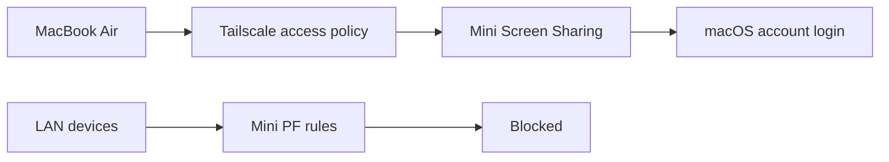
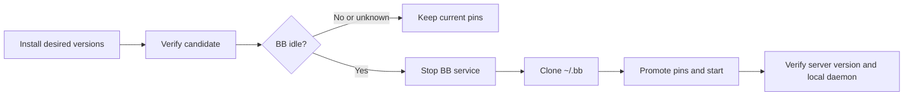
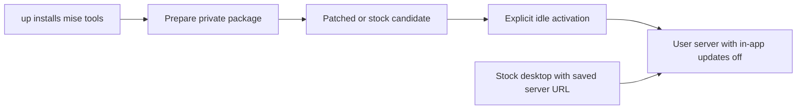
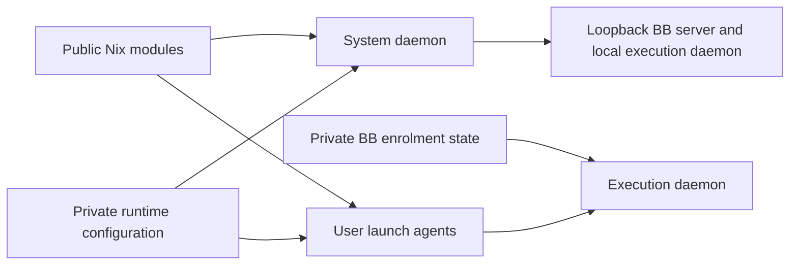

# Remote access

## Tailscale

**Always use `ts` wrapper, never raw `tailscale`** - it handles socket paths across platforms:

```bash
ts status                    # List devices
ts ssh connor@rpi5 'cmd'     # SSH via Tailscale
tsp ls                       # Show active serve/funnel status (+ stale targets)
tsp up [port]                # Serve port on Tailnet
tsp down [https-port]        # Tear down a served port
tsp prune --dry-run          # Preview stale served routes
```

### Mac mini Screen Sharing

[darwin-server.nix](../.config/nix/modules/darwin-server.nix) blocks inbound Screen Sharing on the mini's Ethernet, Wi-Fi, Thunderbolt and peer-to-peer LAN interfaces.
The rules cover TCP 5900 and UDP 5900-5902, for standard and High Performance sharing, across IPv4 and IPv6.
Loopback and VPN interfaces are unaffected. Add new LAN interfaces to the rules before using them.
Activation validates and reloads the existing PF anchor. Its launchd service loads the anchor at boot.



Initial setup requires macOS approval. Nix does not enable Screen Sharing or grant screen-control permission.
Apple restricts command-line enablement on modern macOS. See [Apple's remote-management guidance](https://support.apple.com/en-gb/guide/remote-desktop/apd8b1c65bd/mac).

1. On the mini, run `drs` and confirm the rebuild succeeds before enabling Screen Sharing.
2. On the mini, open System Settings > General > Sharing and enable Screen Sharing.
3. In the mini's Screen Sharing settings, select "Only these users" and allow only the account you use for remote access.
4. Leave permission requests and generic VNC-password access disabled on the mini.
5. On the Air, open Screen Sharing and connect to the mini's MagicDNS name with its account credentials.

The Tailscale policy controls which peers can reach the mini. This example grant uses documentation addresses. Look up the actual values in the private machine runbook.

```json
{
  "src": ["192.0.2.10/32", "2001:db8::10/128"],
  "dst": ["192.0.2.20/32", "2001:db8::20/128"],
  "ip": ["tcp:5900", "udp:5900-5902"]
}
```

Grants are additive. Narrow other matching grants or ACLs to restrict sharing to the Air; preserve required SSH and other service access.
Verify device addresses with `ts status --json` before editing the policy. See [Tailscale's grant syntax](https://tailscale.com/docs/reference/syntax/grants).

Verify actual pointer and keyboard control from the Air through Tailscale.
From a second LAN machine, check that `nc -vz <mini-LAN-address> 5900` fails while sharing is enabled.
Test both IP families where available. A failed connection while sharing is disabled does not verify the firewall.
After restricting the policy, confirm another Tailscale device cannot reach TCP 5900.
Confirm High Performance sharing works when selected; a TCP check does not test its UDP traffic.
Repeat the connection checks after reboot. FileVault requires local unlock after an unplanned restart.

### Local dev servers

When writing or updating scripts that start local dev servers, bind them explicitly to loopback instead of relying on tool defaults.

- Prefer `127.0.0.1` / `localhost`, not `0.0.0.0`
- Many tools default to all interfaces (`0.0.0.0`), which can make the dev server itself bind the Tailscale interface and appear to collide with a port already served via Tailscale
- Tailscale exposure is still fine, and usually desired here. Bind the app to loopback first, then expose that local port via `tsp` / `svc`
- This keeps one owner per socket: the app owns `127.0.0.1:PORT`, Tailscale Serve owns the Tailnet-facing listener for that port

Examples:

```bash
next dev -H 127.0.0.1
storybook dev --host 127.0.0.1
http-server -a 127.0.0.1
```

### Serve port registry

BB can use a machine's apex HTTPS endpoint:

| Service | Local port | External HTTPS |
| ------- | ---------- | -------------- |
| BB | 38886 | **443** (apex) |

Use `ts serve --bg --https=443 http://127.0.0.1:38886` and set BB's `BB_APP_URL` to the machine's HTTPS URL.
`svc up remobi` replaces the BB route on port 443.

For mobile access, connect Tailscale on the phone and open the required BB server's HTTPS URL.

### BB service ownership

[darwin-server.nix](../.config/nix/modules/darwin-server.nix) declares the BB system daemon. It runs independently of desktop login.
[bb-services.nix](../.config/nix/modules/bb-services.nix) declares the other macOS user services.
mise owns Node and BB server installations. Servers resolve exact deployed versions from local mise pins.
Worker services resolve the global mise configuration.
Server launchers disable BB's in-app updater. Startup never installs packages.
The desktop app owns its local server when the declarative server service is disabled.

Each service reads `~/.config/bb/services.local.json` at runtime. This file is untracked and must have mode `0600`.
Missing configuration disables both services. A worker also requires an existing BB enrolment.

```json
{
  "server": { "enabled": false },
  "worker": { "enabled": false, "dataDir": "/absolute/private/enrolment/directory" }
}
```

Set `server.enabled` for a standalone server. Set `worker.enabled` only after deliberate enrolment with a trusted server.
Restart the relevant service after changing this file. The system daemon starts at boot after FileVault unlock.
User services start at login. The server launcher starts both the BB server and its local execution daemon.
Server URLs, enrolment credentials and BB state stay outside Nix and Git.

Keep the competing user server disabled on hosts that run the system daemon.
See the private machine runbook for host assignments.
Provider authentication needs verification outside a desktop login. Desktop automation still needs a desktop session.

```bash
sudo launchctl print system/org.nixos.bb-server
sudo launchctl kickstart -k system/org.nixos.bb-server
```

Verify remote BB access and an agent task after logout. Restarting WindowServer ends GUI services and desktop applications.
It does not test the system daemon until that daemon owns the running BB instance.

The `bb-watchdog` system daemon runs [bb-watchdog](../.config/zsh/functions/agents/bb-watchdog) every minute on the Mini.
It records evidence when the host daemon log is silent for five minutes while threads run, or while thread state is unavailable.
Each capture holds a five-second `sample` of every daemon thread, open files, processes, memory and disk state.
Captures go to `~/.local/state/bb-watchdog/`, at most one per 30 minutes. The watchdog never signals or restarts BB.

### BB deployments on the Mini

`bb-deploy` separates desired versions in the shared mise lock from the Mini's deployed versions.
The Air keeps its interactive mise workflow.
Private pins live in `~/.config/bb/deployment/{current,candidate,previous}/mise.toml`, outside Git.
Mise tracks these configurations and retains their installed BB and Node versions during pruning.
Keep all three directories until deployment and recovery checks finish. Direct `mise uninstall` bypasses this protection.



Initial setup records the running release without restarting:

```bash
mise install --locked node npm:bb-app
bb-deploy prepare
bb-deploy adopt
```

`adopt` requires the candidate version to match the running BB server. It refuses existing current pins.
Apply the Nix system configuration only after these pins exist and BB is idle.
Nix activation can restart the daemon when its launch configuration changes.

For a release update:

1. Run `up` to install desired versions and prepare the Mini's candidate without activating it.
2. For a targeted update, run `mise install --locked node npm:bb-app`, then `bb-deploy prepare`.
3. Run `bb-deploy status` to inspect current, candidate and previous pins.
4. Authenticate with `sudo -v`, then run `bb-deploy activate` when BB is idle.

Activation returns 75 when tasks are running or their state is unavailable.
Retry activation explicitly. No scheduled process activates pending releases.
Unchanged pins require no restart.
The task check covers BB's `starting` and `active` threads, including hidden threads.
It cannot prevent new work arriving between the final check and the stop, or detect every plugin background operation.

Activation stops the BB service and waits until no process holds `~/.bb/bb.db`.
It then clones `~/.bb` into `~/.local/state/bb-deploy/snapshots/<time>-<pid>/` with APFS `cp -c`, and starts the candidate.
A clone takes no space when created. It grows as the new release rewrites data, up to the size of `~/.bb`.
A stop or snapshot failure restarts the deployed release with unchanged pins.
Snapshots must share a volume with `~/.bb`, and they contain credentials and conversation data.
The command keeps snapshots. Move each one to Trash after its release has run correctly.
A snapshot is a rollback copy on the same disk, not a disaster-recovery backup.

The health check requires the selected BB version, a healthy HTTP server and its connected primary execution daemon.
It does not prove provider authentication or task execution. Verify a provider task after activation.
If verification fails, the candidate stays selected as current, and previous pins remain available.
Inspect `~/Library/Logs/bb-server{,-error}.log` before recovery.
Never select an older executable against a migrated database without checking compatibility.

To roll back to the previous release with its pre-update data:

1. Stop BB with `sudo launchctl bootout system/org.nixos.bb-server`.
2. Move `~/.bb` aside, then move the snapshot directory to `~/.bb`.
3. Copy `~/.config/bb/deployment/previous/mise.toml` over `current/mise.toml`, then run `mise trust` on it.
4. Start BB with `sudo launchctl bootstrap system /Library/LaunchDaemons/org.nixos.bb-server.plist`.

Work done after the update is lost on rollback.

Deployment commands use an exclusive directory lock. After an interrupted command, confirm no deployment is running before removing its empty `.lock` directory.
The ownership decision and rejected alternatives are recorded in [ADR 0024](./adr/0024-bb-service-uses-local-mise-deployment-pins.md).
The snapshot decision is recorded in [ADR 0026](./adr/0026-bb-deploy-snapshots-data-with-apfs-clones.md).

### BB user-server deployments

A deployed user server uses mise for its runtime and the stock desktop as a client.
The user service is `gui/<uid>/org.nix-community.home.bb-server`.
Its deployed configuration stores `BB_DEPLOY_SERVICE = "user"` and an absolute `BB_DEPLOY_PACKAGE` under `[env]`.
The package path names a private release prepared by [the patcher](../src/bb-plugins/workflows-patch/README.md#private-server-packages).
Configurations without these keys retain the Mini's system-service deployment behaviour.



For initial preparation, run `bb-deploy prepare --user`.
It checks installed native modules, attempts each requested patch and records exact runtime pins.
Patch incompatibility warns and retains stock files. Failed package copying or native checks blocks preparation.
Preparation never switches the running server.

Initial handover requires a maintenance window:

1. Install a quarantined BB version compatible with the existing data. Never select an older executable without compatibility evidence.
2. Run `bb-deploy prepare --user`, then `bb-deploy adopt`. Adoption requires the running version to match the candidate.
3. In the desktop Server menu, save `http://127.0.0.1:38886` as a custom server target.
4. Quit the desktop when no work is running. Wait until nothing answers on port 38886 or holds `~/.bb/bb.db`.
   Clone `~/.bb` into `~/.local/state/bb-deploy/snapshots/` with `cp -cR`, as [ADR 0026](./adr/0026-bb-deploy-snapshots-data-with-apfs-clones.md) describes.
5. Enable `server.enabled` in the private service configuration and activate the Nix user-service configuration.
6. Open the desktop and verify the saved target, provider task execution and native features.

Never run two servers against the same data directory.
The saved custom target avoids starting a desktop-owned replacement when the managed server is unavailable.
The desktop shows a connection error instead. Desktop client updates remain independent of server updates.
Folder selection, browser controls and plugin windows require live checks during handover.

For later updates, `up` prepares a candidate from installed mise tools and preserves user deployment mode.
Review its patch warnings, then run `bb-deploy activate` when idle.
Activation uses the user launch agent without sudo. It retains the existing backup and health checks.
It refuses an older candidate or a service-owner change. Changing service owners requires a separate explicit handover.
An unchanged candidate requires no restart. Failed health checks retain the selected pins for inspection.
Retained release packages and mise pins support investigation; they do not establish database rollback compatibility.
The design and rejected alternatives are recorded in [ADR 0025](./adr/0025-bb-server-patches-use-private-candidates.md).



### Public access options

- **Tailscale funnel** (public internet): `tsp up --public [port]`
- **Cloudflared quick tunnel** (unauthenticated, ephemeral): `cloudflared tunnel --url http://localhost:PORT`

## Remote Shell Execution

When executing commands on remote hosts (SSH, codespaces) where mise tools are needed:

### Pattern for non-interactive commands

```bash
ssh host 'zsh -c "source ~/.zshrc; your-command"'
gh codespace ssh -c name -- 'zsh -c "source ~/.zshrc; tmux capture-pane -t session -p"'
```

### Pattern for interactive sessions (needs TTY)

```bash
ssh host -t 'zsh -ilc "tmux attach -t session"'
gh codespace ssh -c name -- -t 'zsh -ilc "tmux attach -t session"'
```

**Why**: Default shell is often bash which doesn't have mise in PATH. Sourcing `~/.zshrc` activates mise shims.

**Avoid**: `zsh -lc` on its own can hang on some systems.

### Pattern for dotfiles git commands over SSH

```bash
# Dotfiles commands on remote hosts (works in non-interactive SSH)
ssh host 'git --git-dir=$HOME/git/dotfiles --work-tree=$HOME <cmd>'
ts ssh connor@rpi5 'git --git-dir=$HOME/git/dotfiles --work-tree=$HOME pull'
```
