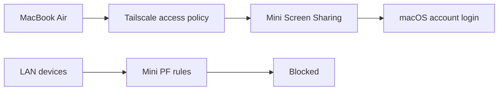
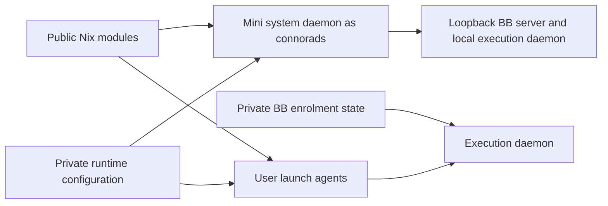

# Remote access

## Tailscale

**Always use `ts` wrapper, never raw `tailscale`** - it handles socket paths across platforms:

```bash
ts status                    # List devices
ts ssh connor@rpi5 'cmd'     # SSH via Tailscale
tsp ls                       # Show active serve/funnel status (+ stale targets)
tsp up [port]                # Serve port on Tailnet
tsp down [https-port]        # Tear down a served port
tsp prune --dry-run          # Preview stale served routes
```

### Mac mini Screen Sharing

[darwin-server.nix](../.config/nix/modules/darwin-server.nix) blocks inbound Screen Sharing on the mini's Ethernet, Wi-Fi, Thunderbolt and peer-to-peer LAN interfaces.
The rules cover TCP 5900 and UDP 5900-5902, for standard and High Performance sharing, across IPv4 and IPv6.
Loopback and VPN interfaces are unaffected. Add new LAN interfaces to the rules before using them.
Activation validates and reloads the existing PF anchor. Its launchd service loads the anchor at boot.



Initial setup requires macOS approval. Nix does not enable Screen Sharing or grant screen-control permission.
Apple restricts command-line enablement on modern macOS. See [Apple's remote-management guidance](https://support.apple.com/en-gb/guide/remote-desktop/apd8b1c65bd/mac).

1. On the mini, run `drs` and confirm the rebuild succeeds before enabling Screen Sharing.
2. On the mini, open System Settings > General > Sharing and enable Screen Sharing.
3. In the mini's Screen Sharing settings, select "Only these users" and allow only `connorads`.
4. Leave permission requests and generic VNC-password access disabled on the mini.
5. On the Air, open Screen Sharing and connect to `mac-mini.goose-rohu.ts.net` with the mini's account credentials.

The Tailscale policy controls which peers can reach the mini. The Air's Screen Sharing grant has this shape:

```json
{
  "src": ["100.90.109.86/32", "fd7a:115c:a1e0::e135:6d56/128"],
  "dst": ["100.125.154.87/32", "fd7a:115c:a1e0::9235:9a58/128"],
  "ip": ["tcp:5900", "udp:5900-5902"]
}
```

Grants are additive. Narrow other matching grants or ACLs to restrict sharing to the Air; preserve required SSH and other service access.
Verify device addresses with `ts status --json` before editing the policy. See [Tailscale's grant syntax](https://tailscale.com/docs/reference/syntax/grants).

Verify actual pointer and keyboard control from the Air through Tailscale.
From a second LAN machine, check that `nc -vz <mini-LAN-address> 5900` fails while sharing is enabled.
Test both IP families where available. A failed connection while sharing is disabled does not verify the firewall.
After restricting the policy, confirm another Tailscale device cannot reach TCP 5900.
Confirm High Performance sharing works when selected; a TCP check does not test its UDP traffic.
Repeat the connection checks after reboot. FileVault requires local unlock after an unplanned restart.

### Local dev servers

When writing or updating scripts that start local dev servers, bind them explicitly to loopback instead of relying on tool defaults.

- Prefer `127.0.0.1` / `localhost`, not `0.0.0.0`
- Many tools default to all interfaces (`0.0.0.0`), which can make the dev server itself bind the Tailscale interface and appear to collide with a port already served via Tailscale
- Tailscale exposure is still fine, and usually desired here. Bind the app to loopback first, then expose that local port via `tsp` / `svc`
- This keeps one owner per socket: the app owns `127.0.0.1:PORT`, Tailscale Serve owns the Tailnet-facing listener for that port

Examples:

```bash
next dev -H 127.0.0.1
storybook dev --host 127.0.0.1
http-server -a 127.0.0.1
```

### Serve port registry

BB can use a machine's apex HTTPS endpoint:

| Service | Local port | External HTTPS |
| ------- | ---------- | -------------- |
| BB | 38886 | **443** (apex) |

Use `ts serve --bg --https=443 http://127.0.0.1:38886` and set BB's `BB_APP_URL` to the machine's HTTPS URL.
`svc up remobi` replaces the BB route on port 443.

For mobile access, connect Tailscale on the phone and open the required BB server's HTTPS URL.

### BB service ownership

[darwin-server.nix](../.config/nix/modules/darwin-server.nix) declares the Mac mini's BB system daemon.
It runs as `connorads` in the system launchd domain, independently of desktop login.
[bb-services.nix](../.config/nix/modules/bb-services.nix) declares the other macOS user services.
mise owns Node and BB installations. Services resolve installed versions at startup without installing packages or enabling BB auto-updates.
The desktop app owns its local server when the declarative server service is disabled.

Each service reads `~/.config/bb/services.local.json` at runtime. This file is untracked and must have mode `0600`.
Missing configuration disables both services. A worker also requires an existing BB enrolment.

```json
{
  "server": { "enabled": false },
  "worker": { "enabled": false, "dataDir": "/absolute/private/enrolment/directory" }
}
```

Set `server.enabled` for a standalone server. Set `worker.enabled` only after deliberate enrolment with a trusted server.
Restart the relevant service after changing this file. The mini's server starts at system boot after FileVault unlock.
User services start at login. The server launcher starts both the BB server and its local execution daemon.
Server URLs, enrolment credentials and BB state stay outside Nix and Git.

The mini uses `system/org.nixos.bb-server`. Keep the competing `gui/501/app.getbb.server` agent disabled.
The mini's Home Manager server agent is disabled in Nix. Its worker remains a user service.
Provider authentication needs verification outside a desktop login. Desktop automation still needs a desktop session.

```bash
sudo launchctl print system/org.nixos.bb-server
sudo launchctl kickstart -k system/org.nixos.bb-server
```

Verify remote BB access and an agent task after logout. Restarting WindowServer ends GUI services and desktop applications.
It does not test the system daemon until that daemon owns the running BB instance.



### Public access options

- **Tailscale funnel** (public internet): `tsp up --public [port]`
- **Cloudflared quick tunnel** (unauthenticated, ephemeral): `cloudflared tunnel --url http://localhost:PORT`

## Remote Shell Execution

When executing commands on remote hosts (SSH, codespaces) where mise tools are needed:

### Pattern for non-interactive commands

```bash
ssh host 'zsh -c "source ~/.zshrc; your-command"'
gh codespace ssh -c name -- 'zsh -c "source ~/.zshrc; tmux capture-pane -t session -p"'
```

### Pattern for interactive sessions (needs TTY)

```bash
ssh host -t 'zsh -ilc "tmux attach -t session"'
gh codespace ssh -c name -- -t 'zsh -ilc "tmux attach -t session"'
```

**Why**: Default shell is often bash which doesn't have mise in PATH. Sourcing `~/.zshrc` activates mise shims.

**Avoid**: `zsh -lc` on its own can hang on some systems.

### Pattern for dotfiles git commands over SSH

```bash
# Dotfiles commands on remote hosts (works in non-interactive SSH)
ssh host 'git --git-dir=$HOME/git/dotfiles --work-tree=$HOME <cmd>'
ts ssh connor@rpi5 'git --git-dir=$HOME/git/dotfiles --work-tree=$HOME pull'
```
