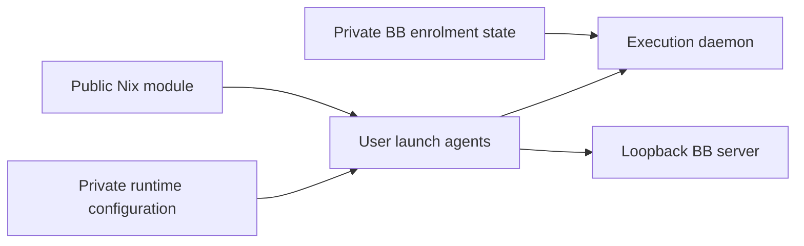

# Remote access

## Tailscale

**Always use `ts` wrapper, never raw `tailscale`** - it handles socket paths across platforms:

```bash
ts status                    # List devices
ts ssh connor@rpi5 'cmd'     # SSH via Tailscale
tsp ls                       # Show active serve/funnel status (+ stale targets)
tsp up [port]                # Serve port on Tailnet
tsp down [https-port]        # Tear down a served port
tsp prune --dry-run          # Preview stale served routes
```

### Local dev servers

When writing or updating scripts that start local dev servers, bind them explicitly to loopback instead of relying on tool defaults.

- Prefer `127.0.0.1` / `localhost`, not `0.0.0.0`
- Many tools default to all interfaces (`0.0.0.0`), which can make the dev server itself bind the Tailscale interface and appear to collide with a port already served via Tailscale
- Tailscale exposure is still fine, and usually desired here. Bind the app to loopback first, then expose that local port via `tsp` / `svc`
- This keeps one owner per socket: the app owns `127.0.0.1:PORT`, Tailscale Serve owns the Tailnet-facing listener for that port

Examples:

```bash
next dev -H 127.0.0.1
storybook dev --host 127.0.0.1
http-server -a 127.0.0.1
```

### Serve port registry

BB can use a machine's apex HTTPS endpoint:

| Service | Local port | External HTTPS |
| ------- | ---------- | -------------- |
| BB | 38886 | **443** (apex) |

Use `ts serve --bg --https=443 http://127.0.0.1:38886` and set BB's `BB_APP_URL` to the machine's HTTPS URL.
`svc up remobi` replaces the BB route on port 443.

For mobile access, connect Tailscale on the phone and open the required BB server's HTTPS URL.

### BB service ownership

[bb-services.nix](../.config/nix/modules/bb-services.nix) declares macOS user services.
mise owns Node and BB installations. Services resolve installed versions at startup without installing packages or enabling BB auto-updates.
The desktop app owns its local server when the declarative server service is disabled.

Each service reads `~/.config/bb/services.local.json` at runtime. This file is untracked and must have mode `0600`.
Missing configuration disables both services. A worker also requires an existing BB enrolment.

```json
{
  "server": { "enabled": false },
  "worker": { "enabled": false, "dataDir": "/absolute/private/enrolment/directory" }
}
```

Set `server.enabled` for a standalone server. Set `worker.enabled` only after deliberate enrolment with a trusted server.
Restart the relevant launch agent after changing this file. Services start at user login, not before FileVault unlock.
Server URLs, enrolment credentials and BB state stay outside Nix and Git.



### Public access options

- **Tailscale funnel** (public internet): `tsp up --public [port]`
- **Cloudflared quick tunnel** (unauthenticated, ephemeral): `cloudflared tunnel --url http://localhost:PORT`

## Remote Shell Execution

When executing commands on remote hosts (SSH, codespaces) where mise tools are needed:

### Pattern for non-interactive commands

```bash
ssh host 'zsh -c "source ~/.zshrc; your-command"'
gh codespace ssh -c name -- 'zsh -c "source ~/.zshrc; tmux capture-pane -t session -p"'
```

### Pattern for interactive sessions (needs TTY)

```bash
ssh host -t 'zsh -ilc "tmux attach -t session"'
gh codespace ssh -c name -- -t 'zsh -ilc "tmux attach -t session"'
```

**Why**: Default shell is often bash which doesn't have mise in PATH. Sourcing `~/.zshrc` activates mise shims.

**Avoid**: `zsh -lc` on its own can hang on some systems.

### Pattern for dotfiles git commands over SSH

```bash
# Dotfiles commands on remote hosts (works in non-interactive SSH)
ssh host 'git --git-dir=$HOME/git/dotfiles --work-tree=$HOME <cmd>'
ts ssh connor@rpi5 'git --git-dir=$HOME/git/dotfiles --work-tree=$HOME pull'
```
