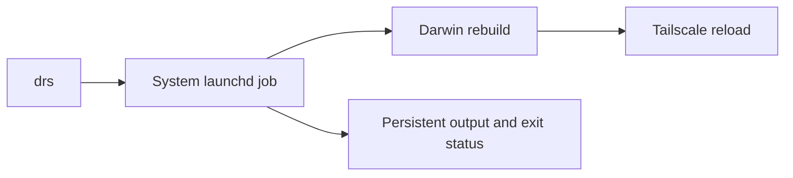

# System platforms

## Nix Targets

```text
darwinConfigurations."Connors-Mac-mini"     # macOS Mac mini via nix-darwin + home-manager
darwinConfigurations."Connors-MacBook-Air"  # macOS MacBook Air via nix-darwin + home-manager
homeConfigurations."connor@penguin"         # Chromebook Linux
homeConfigurations."connor@dev"          # Remote x86_64 Linux (bare name = live box's arch)
homeConfigurations."connor@dev-aarch64-linux"  # Remote dev box, aarch64 variant
homeConfigurations."connor@dev-x86_64-linux"   # Remote dev box, x86_64 variant
homeConfigurations."connor@rpi5"         # Raspberry Pi 5 (aarch64, server packages, user env only)
homeConfigurations."codespace"           # GitHub Codespaces (minimal)
# RPi5 NixOS system config: github.com/connorads/rpi5
```

### Hybrid NixOS (rpi5)

The rpi5 uses a hybrid setup - two repos, two rebuilds:

- **System** (`nrs`): NixOS config from `~/git/rpi5` (set via `NIXOS_FLAKE` in `.zshrc.local`)
- **User env** (`hms`): shell, tools, git, tmux etc. from dotfiles (`~/.config/nix`)

The `up` function runs both on NixOS. An agent on rpi5 can modify the system config (rpi5 repo) without touching dotfiles.

## Darwin rebuilds over SSH

`drs` submits `darwin-rebuild switch` to a system launchd job after sudo authentication.
The job runs independently of the calling terminal. Restarting Tailscale can disconnect SSH without stopping activation.



`drs` streams output and returns the rebuild's exit status while the terminal stays connected.
Each run prints its log path under `~/.local/state/drs/run.*/output.log`.
After reconnecting, read that log and the adjacent `result` file. A result of `0` means success.
A missing result means completion is unconfirmed. Inspect `launcher.log` if the rebuild log is empty.
Logs remain available after completion. Do not start another rebuild until the running job finishes.
`drsr` runs its rollback directly in the calling terminal; use a local terminal or tmux for remote rollbacks.

## Xcode

Nix does not install Xcode. MAS serves latest only, so a `masApps` entry is a
standing upgrade across majors with no pinning and no way to hold one back.
When a project needs Xcode, add `xcodes` to mise (`aqua:XcodesOrg/xcodes`,
macOS-only via `os = ["macos"]` - its release assets are all Homebrew bottles)
and let it manage versions side by side; that route authenticates against the
developer portal rather than the App Store.

`brew bundle cleanup` only uninstalls formulae, casks and taps, so `cleanup =
"uninstall"` never removes a MAS app. An Xcode installed while it was a `masApps`
entry stays on disk until deleted by hand.

The Command Line Tools stay installed as the baseline: `xcode-select -p` points
at `/Library/Developer/CommandLineTools` until something moves it. Two
derivations compile against whatever `xcrun --show-sdk-path` returns -
[imagepaste.nix](../.config/nix/modules/imagepaste.nix),
[voxtap.nix](../.config/nix/modules/voxtap.nix) - so
selecting an Xcode changes their SDK on the next `drs`. Each falls back to the
CLT SDK path when `xcrun` fails, which is why the CLT must not be removed.

First run of a fresh Xcode needs `sudo xcodebuild -license accept` and
`xcodebuild -runFirstLaunch`. Simulator runtimes are a separate ~7-10 GB each
(`xcodebuild -downloadPlatform iOS`); install them only when a project needs one.

## Dependency ownership: Nix, mise, Homebrew

[Telemetry controls](./telemetry.md) describes shell, agent and desktop opt-outs.

- **Nix** owns the machine layer: base shell tools, services, fonts, native libraries, patched builds, tools mise needs, and GUI apps that are healthy in nixpkgs.
- **mise** owns the developer-tool layer: runtimes, package managers, project tools, npm/pipx/aqua/github/cargo CLIs, fast-moving vendor CLIs like Claude and Codex.
- **Homebrew** is the macOS app lane: casks, MAS apps, vendor bundles, self-updating apps, drivers, and anything whose signing or app-bundle integration works better through brew.

Rule of thumb: host-global and well-packaged -> Nix; project/version-selected ->
mise; macOS vendor bundle -> Homebrew.

Prefer cached Nix packages or verified upstream binaries on the MacBook Air.
Ask before starting a substantial local source compile during updates.
Check planned Nix builds before a rebuild; a cache miss can trigger compilation.
Small configuration and file-copy derivations can build locally.
On the MacBook Air, `up` displays the Nix build plan before authentication and
rebuilding. Planned local builds require terminal approval, including small
configuration builds. Failed planning, rejection or unavailable terminal input
blocks rebuilding and leaves the flake lock uncommitted.
The review uses the updated inputs, including during frozen recovery.
It does not prevent compilation after a later cache miss.
Atuin uses the upstream Apple Silicon release binary through Nix. Home Manager
owns its shell integration and settings. The version and checksum are pinned in
[atuin.nix](../.config/nix/packages/atuin.nix); flake updates do not change them.

Claude Code is mise-owned. Do not install it natively or re-enable its self-updater. Why: [docs/adr/0011](../docs/adr/0011-claude-binary-is-not-patched-and-mise-owns-the-install.md).

## Mouse buttons

The desktop declares LinearMouse as a Homebrew cask and starts it at login through
launchd. Its menu bar icon stays hidden. Home Manager writes its mutable JSON
configuration on activation.
UI edits last until the next rebuild. macOS requires Accessibility approval.
The Evoluent VerticalMouse 4 Left maps Button 5 to Forward. Other devices use
their existing button behaviour.

## Cleanup

Homebrew manages automatic cleanup during upgrades. On non-NixOS Linux with APT, `up` runs autoremove after a successful upgrade; frozen mode skips this phase. `up` does not prune mise versions or caches, and its summary does not report what cleanup removed.

Nix garbage collection runs each day at 03:15 with `--delete-older-than 14d`. macOS also schedules store optimisation at 03:30. Linux home-manager schedules collection for user profiles; the rpi5 repo owns its system collection policy. See [macOS policy](../.config/nix/modules/darwin-shared.nix) and [Linux policy](../.config/nix/modules/linux-base.nix).

## sudo with Touch ID and YubiKey

[darwin-desktop.nix](../.config/nix/modules/darwin-desktop.nix) configures macOS `sudo`:

- Touch ID is enabled on both Macs.
- `pam_reattach` makes Touch ID work inside tmux.
- `pam_u2f` stays in the stack for YubiKey auth.

The MacBook Air tries Touch ID first, with YubiKey as fallback. The Mac mini falls through to YubiKey unless it has a Touch ID keyboard.

The YubiKey mapping file is per machine and untracked:

```sh
mkdir ~/.config/Yubico
pamu2fcfg > ~/.config/Yubico/u2f_keys
pamu2fcfg -n >> ~/.config/Yubico/u2f_keys   # optional second key
```
