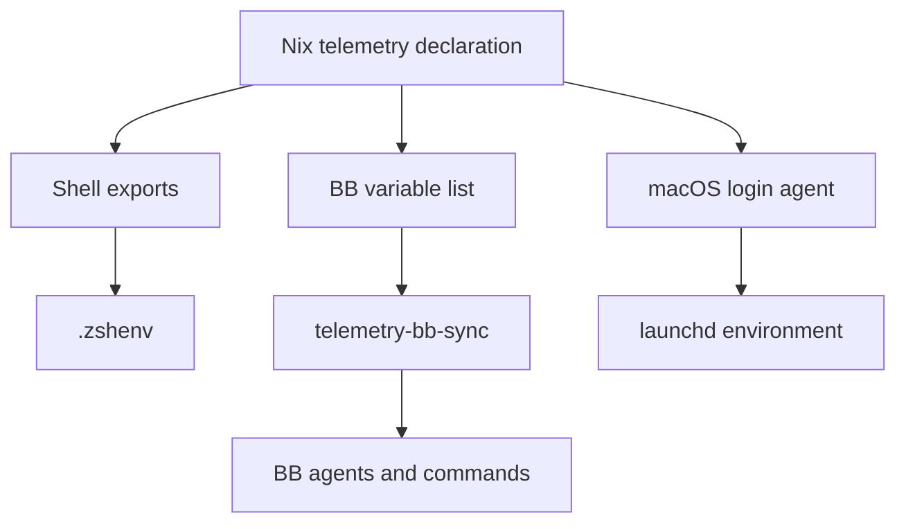

# Telemetry controls

CLI opt-outs live in [the Nix telemetry module](../.config/nix/modules/telemetry.nix).
It renders shell exports and BB's variable list from one declaration.



## Shells and BB

`.zshenv` loads `~/.config/telemetry/environment.sh` for interactive and
non-interactive zsh. Home Manager installs the rendered files during activation.

1. Apply Nix configuration with `drs` on macOS or `hms` on Linux.
2. Run `telemetry-bb-sync` to copy the declared variables into BB's global environment.
3. Start fresh shells and provider sessions to check the effective variables.

The sync command updates declared names only. It does not delete other BB variables.
Removed declarations need an explicit `bb machine env unset NAME` when retiring
their BB overrides. BB project variables and provider contributions can override
global values. Cached provider processes can retain their launch environment.

Targeted installations protect their Nix outputs with indirect garbage-collection
roots under `~/.local/state/telemetry/nix-roots`.

BB discovers the shell's `PATH`; its shell discovery does not copy other exports.
Use `bb machine env` to manage agent variables.
BB's own telemetry switch lives in its native settings.

The macOS login agent sets the declared variables in the user launchd environment.
Existing applications retain their launch environment. Check environment-only
desktop controls after relaunch; a shell export alone does not prove GUI coverage.

`cspy` removes `DISABLE_TELEMETRY` and `DO_NOT_TRACK` for its Claude process.
It refreshes cached feature flags. Claude's native settings do not duplicate
these opt-outs, so the explicit exception remains effective.

## Grok CLI

Mise owns Grok Build and pins its release in
[config.toml](../.config/mise/config.toml). Its self-updater stays disabled.
[Grok's native configuration](../.grok/config.toml) disables product telemetry,
feedback, session-trace uploads, external OpenTelemetry exports, and workspace snapshots.
The shell's `DISABLE_ERROR_REPORTING=1` disables error uploads.

Run `grok login` to sign in with the SuperGrok account, then run `grok`.
Authentication files, logs and session state stay untracked.

The opt-outs do not stop prompts and tool results reaching the inference service.
The [official configuration reference](https://github.com/xai-org/grok-build/blob/main/crates/codegen/xai-grok-pager/docs/user-guide/26-config-reference.md)
defines the native controls.

## Desktop settings

| Application | Persistent control | Verification |
| --- | --- | --- |
| Zed | [Native settings](../.config/zed/settings.json) disable metrics and diagnostics | Inspect effective settings |
| VS Code | [Native settings](../.config/vscode/settings.json) disable telemetry | Relaunch after changing settings |
| Firefox | [Profile preferences](../.config/firefox/user.js) disable uploads, studies and automatic crash uploads | Relaunch each profile |
| BB | Native `telemetryEnabled=false` setting | `bb settings show --json` |
| Chrome | Native usage-reporting preference | Inspect browser settings |
| Brave | Nix activation disables analytics, usage-ping and crash reporting | Three native preferences verified false |
| Discord | Account-level improvement-data switch | Inspect Data & Privacy |
| Android Studio | Native Data Sharing consent | Inspect application settings |
| T3 Code | Launch environment variables | Inspect the desktop server's environment after relaunch |

The desktop Nix module links VS Code's native settings path to its tracked file.
Its Firefox activation links existing profiles to the tracked `user.js`.
An existing conflicting `user.js` stops activation rather than losing its preferences.
New Firefox profiles receive the link on the next activation.

Brave activation merges three opt-outs into its existing `Local State`.
It preserves other preferences and refuses to write while Brave runs.
Firefox controls passed a disposable headless-profile check. Running Firefox
policy recognition and VS Code profile settings need separate checks. Discord
and Android Studio remain manual checks.

Browser profiles and application databases stay untracked. Account settings need
manual checks where applications expose no supported declarative control.

## Sources

- [Turbo telemetry](https://turborepo.dev/docs/telemetry)
- [Vercel telemetry](https://vercel.com/docs/cli/about-telemetry)
- [Claude environment variables](https://code.claude.com/docs/en/env-vars)
- [VS Code telemetry](https://code.visualstudio.com/docs/configure/telemetry)
- [Firefox telemetry preferences](https://firefox-source-docs.mozilla.org/toolkit/components/telemetry/internals/preferences.html)
- [Firefox daily usage ping](https://support.mozilla.org/en-US/kb/usage-ping-settings)
- [Brave privacy controls](https://support.brave.app/hc/en-us/articles/360017989132-How-do-I-change-my-Privacy-Settings)
- [Discord improvement data](https://support.discord.com/hc/en-us/articles/21864805694999-Data-Used-to-Improve-Discord)

Amp and Droid opt-outs remain unverified. Droid's customer-exporter settings
do not disable its vendor collector.

## Additional CLI collectors

The Nix map declares these product-specific controls. Generic variables do not
replace them.

| Consumer | Control | Support evidence |
| --- | --- | --- |
| Comfy Desktop | `COMFY_DESKTOP_POSTHOG_ENABLED=0` | [PostHog initialisation](https://github.com/Comfy-Org/Comfy-Desktop/blob/main/src/main/lib/telemetry.ts) |
| Pi | `PI_TELEMETRY=0` | [Pi 1.2.0 resolver](https://github.com/earendil-works/pi/blob/v1.2.0/packages/coding-agent/src/core/telemetry.ts) |
| PowerShell | `POWERSHELL_TELEMETRY_OPTOUT=1` | [PowerShell 7.6.4 implementation](https://github.com/PowerShell/PowerShell/blob/v7.6.4/src/System.Management.Automation/utils/Telemetry.cs) |
| Slack CLI | `SLACK_DISABLE_TELEMETRY=1` | [Slack 4.2.0 environment reader](https://github.com/slackapi/slack-cli/blob/v4.2.0/internal/config/dotenv.go) |
| EAS CLI | `DISABLE_EAS_ANALYTICS=1` | [EAS 24.14.0 analytics](https://github.com/expo/eas-cli/blob/v24.14.0/packages/eas-cli/src/analytics/AnalyticsManager.ts) |
| cf CLI | `CF_SEND_TELEMETRY=false` | [Official telemetry policy](https://github.com/cloudflare/cf/blob/main/packages/cli/telemetry.md) |

Comfy Desktop's variable disables its PostHog client at startup. Its native
usage-metrics consent and independent diagnostic paths require separate checks.
Pi's control suppresses install reporting and default provider attribution.
Its separate analytics setting and OpenCode session headers have separate paths.
Slack CLI's control does not configure Slack desktop.
EAS analytics has a separate collector from Expo CLI.
The installed cf 0.15.0 resolver reads its environment control before stored consent.
Its reviewed dispatcher prepares payloads and prints debug output; transmission remains unverified.
The declaration is a defensive gate. Invoked tools retain independent controls.
These variables require inheritance before startup. Existing processes can retain
earlier values. Support in older installed copies requires separate verification.

Stored settings and fresh-child environment checks establish configuration only.
They do not establish absence of outbound collection. Browser policies, account
training consent, extensions and separately hosted services require separate checks.

## Native tool consent

Homebrew's native analytics consent is disabled with `brew analytics off`.
The Nix environment also declares `HOMEBREW_NO_ANALYTICS=1`.
Check native consent without the masking shell controls:

```sh
env -u HOMEBREW_NO_ANALYTICS -u HOMEBREW_NO_ANALYTICS_THIS_RUN brew analytics state
```

A disabled result with inherited exports alone does not establish stored consent.
[Homebrew documents both controls](https://docs.brew.sh/Analytics).

Go's native telemetry mode is `off`. [Go telemetry](https://go.dev/doc/telemetry)
distinguishes `off`, `local` and `on`. Local mode collects counters without uploads.
`go telemetry off` persists consent independently of the shell environment.
`go telemetry` checks the mode. A mise shim without a selected Go version can fail;
query the installed toolchain directly rather than changing the global version.
These native settings affect future tool operations without restarting services.

## Tailscale client logs

The macOS daemon declaration includes `--no-logs-no-support` in
[darwin-shared.nix](../.config/nix/modules/darwin-shared.nix).
[Tailscale documents this opt-out](https://tailscale.com/docs/features/logging)
for its open-source macOS daemon. It suppresses client log uploads and limits
support that requires those logs. Required control-plane requests and server
audit logs remain separate.

Declaration evaluation confirms the flag. Deployment remains pending a normal
Nix activation during a maintenance window. Activation restarts the daemon and
can interrupt remote work. Check installed launch arguments and connectivity
through `ts` after that activation. No running-daemon opt-out is established by
an unapplied declaration.

## Desktop policy delivery

Firefox's native user preferences declare `EnterprisePoliciesEnabled=true` and
`DisableTelemetry=true` in the desktop Nix module. Both named stored values
are verified. The [policy gate](https://firefox-admin-docs.mozilla.org/reference/policies/enterprisepoliciesenabled/)
accepts current-user macOS preferences since Firefox 63.
[DisableTelemetry](https://firefox-admin-docs.mozilla.org/reference/policies/disabletelemetry/)
also disables local telemetry storage since Firefox 83.
After a normal browser startup, check `DisableTelemetry` and errors in
`about:policies`. Stored values alone do not establish policy recognition.

Nix owns a removable [configuration profile](../.config/nix/modules/optional-collection.mobileconfig)
at `~/.config/telemetry/optional-collection.mobileconfig`. It contains only these
optional collection controls:

| Payload | Values |
| --- | --- |
| Apple application restrictions | `allowDiagnosticSubmission=false`, `allowApplePersonalizedAdvertising=false` |
| Chrome | `MetricsReportingEnabled=false`, `UrlKeyedAnonymizedDataCollectionEnabled=false` |
| Brave | `BraveP3AEnabled=false`, `BraveStatsPingEnabled=false`, `MetricsReportingEnabled=false` |

The profile is prepared, XML-validated and uninstalled. Generating or linking it
does not install restrictions. Installation requires the supported
[System Settings profile procedure](https://support.apple.com/en-gb/guide/mac-help/mh35561/mac).
Review its payloads before installation. Removal remains allowed.

[Apple's schema](https://github.com/apple/device-management/blob/release/mdm/profiles/com.apple.applicationaccess.yaml)
supports diagnostic submission restrictions from macOS 10.13 and advertising
personalisation restrictions from macOS 12. These controls leave required Apple
service requests separate.
[Chrome's deployment guide](https://support.google.com/chrome/a/answer/9020077)
uses profiles. Ordinary defaults do not establish mandatory policy enforcement.
Brave's [P3A policy](https://github.com/brave/brave-core/blob/v1.91.180/components/policy/resources/templates/policy_definitions/BraveSoftware/BraveP3AEnabled.yaml)
and [stats policy](https://github.com/brave/brave-core/blob/v1.91.180/components/policy/resources/templates/policy_definitions/BraveSoftware/BraveStatsPingEnabled.yaml)
require mandatory delivery and a normal restart.

After installation and normal startup, verify recognised mandatory values without
errors in `chrome://policy` and `brave://policy`. Verify Apple's installed
restrictions and named privacy controls separately. Existing browser native
preferences remain independent evidence. Account consent and extension collection
require separate checks.
