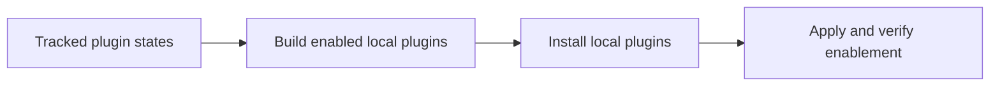

# BB plugins

One pnpm workspace with one directory per BB plugin. Each plugin keeps its own
`package.json`, tests and SDK pin. The workspace shares one lockfile and the
pnpm quarantine settings. Decisions that span plugins are recorded in
[docs/adr/](docs/adr/).

## Setup

[plugins.json](../../.config/bb/plugins.json) declares the selected plugins and their enabled states.
Enabled entries with a local `package.json` select plugins for installation from this workspace.
Other entries refer to installed plugins, including BB's built-in plugins.
[plugin-config.json](../../.config/bb/plugin-config.json) declares managed plugin settings; `bb-plugins apply` applies both files.
Unlisted plugins keep their current state. Focus, Vox Recorder, Automation Backup and prototypes require separate selection and setup.



1. In zsh, resolve installed runtimes and the BB CLI. BB must be running.
   `mise which` resolves installed paths without installing missing tools.
   If a tool is missing, install that named tool before continuing.
   `mise exec` and `mise env` can install unrelated configured tools.

   ```zsh
   node_bin=$(mise which node) || exit
   pnpm_bin=$(mise which pnpm) || exit
   bb_cli=${BB_CLI:-$(mise which bb)}
   test -x "$bb_cli" || exit 1
   export BB_CLI="$bb_cli"
   export PATH="${node_bin:h}:${pnpm_bin:h}:${bb_cli:h}:$HOME/.local/bin:$PATH"
   ```

2. With those paths loaded, install workspace dependencies and selected local plugins.
   Stop on the first failure. Repeating installation reloads existing plugins and keeps their configuration.

   ```zsh
   (
     set -e
     cd "$HOME/src/bb-plugins"
     pnpm install --frozen-lockfile
     while IFS= read -r plugin; do
       if [[ -f "$plugin/package.json" ]]; then
         pnpm --dir "$plugin" build
         "$BB_CLI" plugin install "path:$PWD/$plugin" --yes
       fi
     done < <(jq -r 'to_entries[] | select(.value) | .key' "$HOME/.config/bb/plugins.json")
     bb-plugins apply
     bb-plugins check
     "$BB_CLI" preferences apply
   )
   ```

3. Verify live plugin status with `"$BB_CLI" plugin list` and inspect any reported errors.
   Install missing non-local plugins separately before rerunning the recipe.

## Add a plugin

1. Run `bb plugin new <name>` here. Rename `bb-plugin-<name>/` to `<name>/`.
   Delete any lockfile or `pnpm-workspace.yaml` it creates.
2. Run `pnpm install` in this directory.
3. Run `pnpm build` in `<name>/`.
4. Install it: `bb plugin install path:~/src/bb-plugins/<name>`.

After an edit, run `pnpm build` and `bb plugin reload <id>`. Or run `pnpm dev`
to rebuild and reload on save.

## SDK frictions

Record each BB SDK gap and its workaround in [docs/sdk-frictions.md](docs/sdk-frictions.md)
when you find it. Each entry is a candidate BB feature request.

## Checks

- `pnpm -r test` and `pnpm -r typecheck` run every plugin.
- The `ts-tests-scoped` and `ts-typecheck-bb-plugins` hooks gate commits.
- Each `tsconfig.json` must also pass the global `tsc` 7 that the hook runs.

## Header chips

Every thread-header action uses the shared [chip](chip/README.md) package. After a
change to `chip/`, run `pnpm build:chip` to rebuild each plugin that depends on
it, then reload them.
[ADR 0002](docs/adr/0002-shared-header-chip-package.md) records why. A chip's
pop-up uses the package's `ChipPopover`;
[ADR 0003](docs/adr/0003-shared-chip-popover.md) records why.

## Agent Switcher

[Agent Switcher](claude-profiles/README.md) chooses the model, saved effort and
Claude Code account for a thread, and shows agent usage. Its plugin ID is
`claude-profiles`. [ADR 0001](docs/adr/0001-consolidate-agent-switcher.md)
records why it absorbs Model Favourites and Agent Usage.

## File-managed preferences

[Preferences](preferences/README.md) applies tracked keyboard settings from
`~/.config/bb/preferences.json`. Its guide covers installation and ownership.

## File navigation

[File History](file-history/README.md) adds Previous file and Next file controls
to thread file previews. Mouse Back and Forward use file history while the
pointer is over the file panel.

## Shortcut reference

[Shortcut Guide](shortcut-guide/README.md) opens with `Alt+/` or the keyboard
chip. It groups a curated selection of commands, shows their bindings and saves
personal favourites. Escape returns to the draft. It records no usage counts.

## Automation backups

[Automation Backup](automation-backup/README.md) exports live task definitions to a
private Git repository, commits changes and pushes every hour while enabled.
BB remains authoritative; snapshots never activate or modify scheduled work.

## Voice controls

[Handsfree](handsfree/README.md) connects Hex commands to the focused BB window.
It provides thread navigation, draft creation, model selection and a command card.

## Composer keys

[Composer Keys](composer-keys/README.md) gives BB's text fields terminal-style
keys. Alt+Enter adds a newline in the composer and question box, and Enter
submits a typed question answer. Escape stops the running agent. Escape twice
on an empty composer opens a picker that rewinds or forks from an earlier
message.

## Fork threads

[Fork](fork/README.md) forks a thread with its whole conversation. `Alt+B` opens
the fork in a right split. Messages get **Fork from here**, and the thread menu
offers split, sidebar-only and new-worktree forks.

## Keep awake

[Caffeine](caffeine/README.md) keeps this Mac awake from BB: indefinitely, for a
set time, with the lid closed, or while agents run. Alt+K opens it. It drives the
tmux caffeine lib, so the BB chip and the tmux pill always agree.

## Focus view

[Focus](focus/README.md) shows only the sidebar projects you tick and moves the
rest into More. `⌘⇧F` turns the view on or off, keeping your ticks, and the
footer eye button picks projects. Turning it off restores the sidebar.

## Chat links

[External Links](external-links/README.md) adds an arrow beside chat web links.
The arrow opens the system browser. Link text follows BB's browser preference.
Default file links and inline preview headers show a side-panel icon.
Labelled browser and generic editor controls use distinct destination icons.

## Chat timestamps

[Chat Timestamps](chat-timestamps/README.md) shows muted gap markers after
ten-minute pauses, date changes and the confirmed start of a conversation.
Assistant times represent the message start.

UI decorations use [plugin content scripts](docs/dom-decorations.md) with stock BB.

## Run commands from chat

[Run in Terminal](run-in-terminal/README.md) pastes shell commands from a chat
message into the thread's terminal. You press Enter to run them.

## Executor tools

[Executor](executor/README.md) gives threads the tools from your Executor scoped
connections. BB signs in once per connection, and each thread picks which
connection it uses, so no agent needs its own MCP config.

## Mobile start screen

[Mobile Home Spacing](mobile-home-spacing/README.md) places recent threads below
the compact toolbar and fills the space above the pinned composer.
