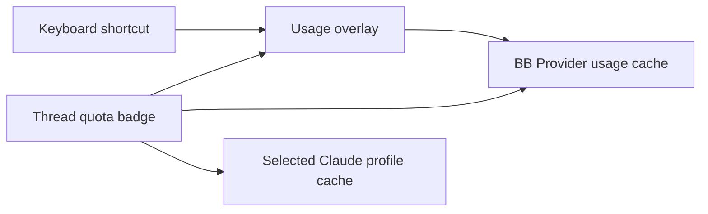

# Agent usage for BB

Show the limit most likely to stop the current thread in its header. Open an
account usage overlay with `⌘⇧A`. Press `Q` or `Esc`, click outside, or click
Close to dismiss it. The shortcut is rebindable under **Agent usage: show all
accounts** in BB's keyboard settings. Clicking the header badge opens the same overlay.
On desktop, the contents receive focus so Page Down and Page Up scroll the panel.

## Pace

Each timed window compares use with even spending across the window. The bar's
marker shows where steady use would be by now. Fill past the marker means the
window is being used faster than it refills.

| Status | Meaning |
| --- | --- |
| Under pace / On pace | Use is more than 5 points below, or within 5 points of, even spending |
| Ahead of pace | Use is more than 5 points above even spending, under 1.2× |
| At this pace, out HH:MM | At 1.2× even spending or faster; the time assumes the rate so far continues |
| Limit reached | The window is full until its reset |
| Reset since last check | The reading predates its reset, so no percentage is shown |

Amber marks 1.2× pace or 70% used. Red marks 1.4× pace, 90% used or a full window.
Projections wait for 10 minutes or 5% of the window, whichever is longer.
Windows are 5-hour, daily, weekly or monthly (one calendar month before the reset).
Allowances with a dollar limit show as credits with their expiry and have no pace.

## Overlay

The overlay opens with one sentence on the worst window across all accounts. When
an account needs attention, it names the same provider's account with the most room.
Accounts are grouped by provider, and by machine when more than one reports.
**Refresh** requests fresh measurements. A failed refresh keeps previous figures
and reports the failure. Missing measurements appear as unavailable.

Each account shows its source reading age. A reading becomes stale after 4%
of its shortest known window, with a 15-minute minimum. Stale bars use stripes
and omit pace projections. Unknown reading times stay visible and omit projections.
Only fresh quota readings supply the account comparison summary.

Codex reset credits sit beneath its accounts as a separate CLI reading.
The section shows held and usable counts, the nearest expiry and expandable
expiry dates. Expiries within three days appear amber. Zero held credits hide
the section; unavailable readings stay explicit. Credit readings older than
15 minutes request a refresh. `Refresh` collects quotas and reset credits;
opening the panel only reads the existing reset-credit cache.

The default Claude profile reads the same login as BB's native Claude source.
The overlay shows it once, as **Default**, with the native plan and email and any
windows only the profile reports.

## Header

The header follows the thread's provider and host. Claude threads with the
Claude Profiles plugin use their selected profile. The badge shows the binding
window: the worst tone first, then the highest use. A ring shows its use. The
text adds the run-out or reset time when the window needs attention. The badge
refreshes when thread state changes, when the window gains focus, and every two
minutes. Hover over it for every window.



Enable BB's built-in **Provider usage** plugin. Its sources supply the available
providers and accounts. Agent usage delegates collection to that plugin and
Claude Profiles. It does not read credentials or create accounts.

## CLI and SDK

```sh
bb agent-usage
bb agent-usage --refresh
bb agent-usage --thread THREAD_ID
```

The plugin publishes the `overview` and `header` RPC methods through
[rpcContract](contracts.ts). Call them with `bb.sdk.plugins.callRpc` using
`pluginId: 'agent-usage'`. `overview` takes `{ refresh: boolean }`;
`header` takes `{ threadId: string }`. Every window carries a normalised `label`
(`5-hour`, `Weekly`, `Weekly · Fable`, `Credits`) and its `period`
(`five-hour`, `day`, `week`, `month` or `null`).

`inspection` takes `{ refresh: boolean }` and returns the overview as `snapshot`,
source observation times as `readings`, and host-local Codex `resetCredits`.
The `overview` and `header` response shapes remain independent of inspection metadata.
Missing observation times stay unknown. The merged default Claude account uses
the oldest source time because its windows can come from both sources.

The host entry reads the tmux collector's `~/.cache/codex-usage.json`.
An explicit refresh runs `~/.config/zsh/functions/codex-usage` with its cache,
lock and backoff rules. The plugin does not read credentials or redeem credits.
Reset credits identify the CLI login separately from BB's quota account.
The cache timestamp describes the credit reading; loading it does not make it fresh.

## Development

```sh
pnpm test
pnpm typecheck
pnpm build
bb plugin reload agent-usage
```

Install with `bb plugin install path:~/src/bb-plugins/agent-usage`.
The shared pnpm workspace owns dependencies and its lockfile.
The `components`, `hooks` and `lib` directories contain BB-scaffolded responsive
UI primitives. Compact layouts use BB's persistent responsive drawer.
