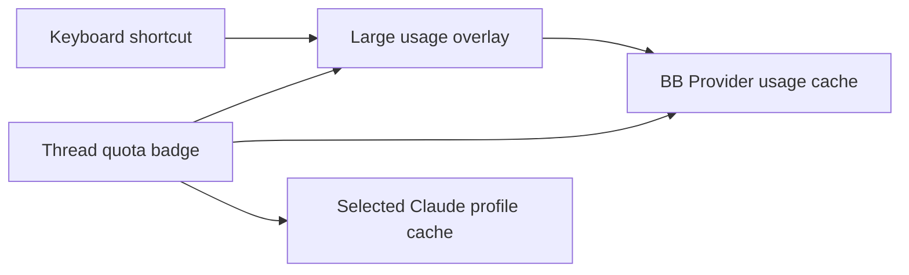

# Agent usage for BB

Show the current provider's quota in the thread header. Open a large account
usage overlay with `⌘⇧U`. Press `Esc`, click outside, or click Close to dismiss it.
The shortcut is rebindable under **Agent usage: show all accounts** in BB's keyboard settings.
Clicking the header badge opens the same overlay.

The overlay groups all reported providers and accounts by machine or shared
source. Each account shows its plan, percentages used and reset times.
**Refresh** requests fresh measurements. A failed refresh keeps previous figures
and reports the failure. Missing measurements appear as unavailable.

The header follows the thread's provider and host. Claude threads with the
Claude Profiles plugin use their selected profile. The badge refreshes when
thread state changes, when the window gains focus, and every two minutes.
Hover over it for account and reset details.



Enable BB's built-in **Provider usage** plugin. Its sources supply the available
providers and accounts. Agent usage delegates collection to that plugin and
Claude Profiles. It does not read credentials or create accounts.

## CLI and SDK

```sh
bb agent-usage
bb agent-usage --refresh
bb agent-usage --thread THREAD_ID
```

The plugin publishes the `overview` and `header` RPC methods through
[rpcContract](contracts.ts). Call them with `bb.sdk.plugins.callRpc` using
`pluginId: 'agent-usage'`. `overview` takes `{ refresh: boolean }`;
`header` takes `{ threadId: string }`.

## Development

```sh
pnpm test
pnpm typecheck
pnpm build
bb plugin reload agent-usage
```

Install with `bb plugin install path:~/src/bb-plugins/agent-usage`.
The shared pnpm workspace owns dependencies and its lockfile.
The `components`, `hooks` and `lib` directories contain BB-scaffolded responsive
UI primitives. Compact layouts use BB's persistent responsive drawer.
