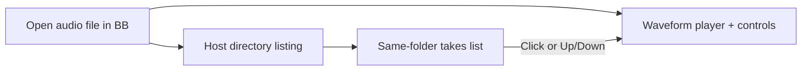

# Audio Preview

Preview audio files inside BB's file panel with waveform scrubbing, playback
controls and same-folder take switching.

## Supported formats

Registers a BB `fileOpener` for `mp3`, `wav`, `m4a`, `ogg`, `oga`, `opus`,
`flac`, `aac`, `aiff` and `aif`. Leaves `webm` unassigned so BB's native video
preview keeps video files.

Audio streams from BB's authenticated file endpoints across workspaces,
worktrees, remote hosts and thread storage. Waveform decoding uses the browser's
Web Audio API for files up to 50 MB and caches decoded peaks in memory per file
URL. Larger files or codecs unsupported by `decodeAudioData` still play and
scrub on the timeline.

## Same-folder takes

When an audio file opens, the host entry reads its parent directory once
(non-recursively, capped at 500 audio files) and lists sibling audio files below
the player.

- **Auto-play** starts the newly selected take immediately.
- **Keep pos** preserves the current playback timestamp when switching takes for
  A/B comparison.
- **A-Z / Newest** toggles between natural filename order and newest modified
  time first.

## Keyboard shortcuts

Shortcuts apply while focus is inside the audio preview panel:

| Key | Action |
| --- | --- |
| `Space` | Play or pause |
| `←` / `→` | Seek back or forward 5 s (`Shift` for 1 s) |
| `↑` / `k` and `↓` / `j` | Previous or next take in folder |
| `L` | Toggle loop |
| `M` | Toggle mute |
| `0` | Jump to start |

## Development

Build, test, install and reload through the [workspace guide](../README.md).
Run `pnpm test`, `pnpm typecheck` and `pnpm build` in this directory.
