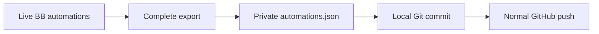

# Automation Backup

Back up live BB automation definitions to a dedicated private GitHub repository.
BB owns live configuration. The plugin never changes or activates automation tasks.

## Operation

The server background service runs on plugin startup and every five minutes.
It runs while BB is running and the plugin is enabled. Manual and background
backups share one operation; a checkout lock excludes another plugin process.
The service exports every project, including Personal.

Snapshots retain IDs, project references, names, schedules, timezones, enabled
state, prompts, script contents and execution settings. They exclude run counters,
results and timestamps. Script environment settings also enter the private snapshot.
Unchanged configuration creates no commit. Each successful cycle attempts a normal
push, including local commits left by an earlier failed push.

The plugin checks GitHub privacy before every export and requires exactly one
push URL matching the configured repository. It refuses a dirty checkout, a
non-main branch or another writer lock. Failed reads preserve the previous snapshot.
An atomic rename publishes complete exports. Failed hooks preserve Git state.
Rejected pushes preserve local commits. The plugin never forces, resets or rebases.

## Setup

1. Create a private GitHub repository with a dedicated local checkout on `main`.
2. Configure Git identity and authentication on the BB server machine.
3. Install the plugin from this directory after running `pnpm build`.
4. Set `repository` with `bb plugin config automation-backup set repository owner/name`.
5. Set `directory` with `bb plugin config automation-backup set directory /absolute/checkout`.
6. Run `bb automation-backup run` and verify the private remote commit.

The checkout needs an initial commit and an `origin` remote. The plugin uses `gh`
to verify privacy and `git` to commit and push. These tools run on the BB server.
It uses `BB_CLI` when available and `bb` otherwise. Settings live in BB; prompts
and snapshots stay outside the public plugin source and dotfiles repository.

## Commands

- `bb automation-backup run` exports, commits and pushes immediately.
- `bb automation-backup status` reports the latest process-local outcome.
- `bb plugin logs automation-backup` reports failed commands.
- `bb plugin disable automation-backup` stops background backups.

A failed cycle retries after five minutes. Fix dirty state or failed hooks before
retrying. A stale `.git/automation-backup.lock` requires explicit inspection;
the plugin does not clear another owner's lock. Git history preserves deleted tasks.

## Recovery

Inspect `automations.json` at the desired commit. Use the saved ID to update an
existing task with `bb automation update`. Rebind project, environment and thread
references when restoring on another installation. Create missing tasks with
`bb automation create --disabled`, then review before enabling them.
Cloning the repository does not activate tasks. The plugin has no automatic restore.

## Checks

Run `pnpm test`, `pnpm typecheck` and `pnpm build` in this directory.
Tests use disposable Git repositories and real commits and pushes. BB and GitHub
are substituted at the external boundary. Live verification checks the private
remote and an unchanged second export.
