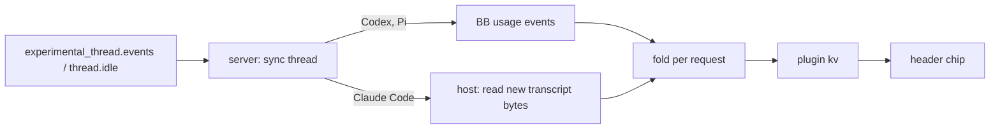

# Cache Hits for BB

Show each thread's prompt-cache state in the thread header.

## Use

`Cmd+Shift+A` opens BB's full-page Provider usage settings. The command palette
also lists **Open agent usage**. Rebind it in Settings → Keyboard.

The header chip shows the share of the last request read from cache, and a
miss count once the thread has one. Claude Code threads also count down to cache
expiry, then show `cold`. The dot follows time left (green over 50%, yellow
over 20%, then red). Without a lifetime, as on Codex, it follows the hit rate
(green 80%+, yellow 50%+, then red).

Hover the chip for last read and write tokens, the thread-wide hit rate, and
the size and idle gap of the last miss.

## How it reads usage



| Provider | Source | Prompt size | Lifetime |
| --- | --- | --- | --- |
| Codex | `thread/tokenUsage/updated` | `inputTokens` (includes cached tokens) | not reported |
| Pi | `thread/tokenUsage/updated` | `inputTokens + cachedInputTokens` | not reported |
| Claude Code | `~/.claude/projects/*/<session>.jsonl` | `input + cache read + cache write` | `cache_creation.ephemeral_5m/1h` |

BB sums Claude Code usage per turn, so the plugin reads per-request usage from
Claude Code's own transcript instead. The host component reads only bytes added
since the last read. It finds the session from `thread/identity` and the
config directory from `CLAUDE_CONFIG_DIR` in `provider.env-resolved`. Claude
Code logs one line per content block, so each message id counts once. Subagent
entries and other entry types are skipped. The transcript format is internal
to Claude Code and can change in any release.

A request misses when `min(previous prompt, this prompt) - cache reads` is
over 1024 tokens. This is Pi's rule (`core/cache-stats.js`). Compaction and
context clears reset the baseline.

Expiry is the last request time plus its cache lifetime, because Anthropic
refreshes a cache entry each time a request reads it. The transcript stamps
the response, not the request start, so the countdown runs a few seconds long.

BB keeps only recent usage events, so Codex and Pi turns from before
installation are not counted. Pi's event granularity in BB is unverified.

## Develop

```sh
pnpm test
pnpm typecheck
pnpm build && bb plugin reload cache-hits
```
