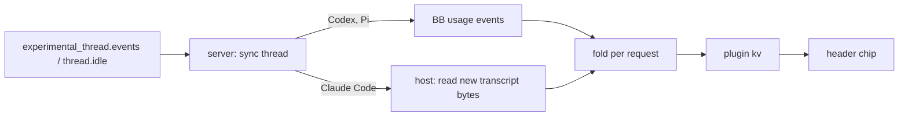

# Cache Hits for BB

Show each thread's prompt-cache state in the thread header.

## Use

The header chip counts down to cache expiry in whole minutes, with seconds in
the last two, then shows `cold`. Without a lifetime, as on Codex, it shows the
share of the last request read from cache. A miss count sits beside the dot once
the thread has one. The dot follows time left (green over 50%, yellow
over 20%, then red). Without a lifetime, as on Codex, it follows the hit rate
(green 80%+, yellow 50%+, then red).

Hover the chip for last read and write tokens, the thread-wide hit rate, and
the size and idle gap of the last miss.

Click the chip for the detail popover:

- A countdown with a draining meter and the clock time the cache goes cold.
- The tokens the next request rewrites if the cache goes cold, and the write
  price: 1.25× input for the 5-minute lifetime, 2× for the 1-hour one. Read
  prices vary by model, so the popover does not quote them.
- Thread, last-request and miss totals.
- One bar per request for the last 48: cached, written, and re-sent on a miss.
  Use Request details to select its tokens and miss cause with touch or keyboard. A gap before a bar marks
  compaction.
- The four most recent misses with their cause.

Threads keep history from the first request after installation.

## How it reads usage



| Provider | Source | Prompt size | Lifetime |
| --- | --- | --- | --- |
| Codex | `thread/tokenUsage/updated` | `inputTokens` (includes cached tokens) | not reported |
| Pi | `thread/tokenUsage/updated`, last request of each turn | `inputTokens + cachedInputTokens` | not reported |
| Claude Code | `~/.claude/projects/*/<session>.jsonl` | `input + cache read + cache write` | `cache_creation.ephemeral_5m/1h` |

BB sums Claude Code usage per turn, so the plugin reads per-request usage from
Claude Code's own transcript instead. The host component reads only bytes added
since the last read. It finds the session from `thread/identity` and the
config directory from `CLAUDE_CONFIG_DIR` in `provider.env-resolved`. Claude
Code logs one line per content block, so each message id counts once. Subagent
entries and other entry types are skipped. The transcript format is internal
to Claude Code and can change in any release.

A request misses when `min(previous prompt, this prompt) - cache reads` is
over 1024 tokens and over 25% of that shared prefix. The token floor is Pi's
rule (`core/cache-stats.js`). The share drops partial hits: OpenAI often
serves part of a warm prefix, and Claude Code trims old tool results
mid-prefix. Without it, about 70% of Codex misses came within a minute of the
previous request and lost a median 6% of the prefix. Compaction and context
clears reset the baseline.

Each miss gets the likeliest cause, most certain first:

| Cause | Signal |
| --- | --- |
| model switched | the request's `message.model` differs from the previous one; each model has its own cache |
| expired | the idle gap is longer than the cache lifetime |
| account switched | the `invalidate` RPC, or a `credential_org` transcript attachment |
| tools, skills or MCP changed | `deferred_tools_delta`, `mcp_instructions_delta` or `skill_listing` attachments |
| prompt prefix changed | a `thinking_drop` attachment with reason `prefix_mismatch`, Claude Code's own detection |
| after N idle | nothing else explains it |

Expiry outranks the transcript signals because a resumed session re-sends its
account and tool list whether or not the cache was warm. Over 300 real
transcripts (17k requests, 222 misses): 180 expired, 27 account, 5 tools, 5
model, 5 unexplained. Only Claude Code transcripts carry them; Codex and Pi
misses show the idle gap.

Anthropic keeps each account's prompt cache separate. After an account switch,
[Claude Profiles](../claude-profiles/README.md) calls this plugin's `invalidate`
RPC. The chip shows `cold` at once.

Expiry is the last request time plus its cache lifetime, because Anthropic
refreshes a cache entry each time a request reads it. The transcript stamps
the response, not the request start, so the countdown runs a few seconds long.

BB keeps only recent usage events, so Codex and Pi turns from before
installation are not counted.

BB emits Pi usage once per turn, at `agent_end`, from the turn's last
request only. Pi hit rates are exact for that request. Pi misses are
undercounted: a turn that starts cold rebuilds the cache on its first request,
so its last request reads cache again.

## Develop

```sh
pnpm test
pnpm typecheck
pnpm build && bb plugin reload cache-hits
```
