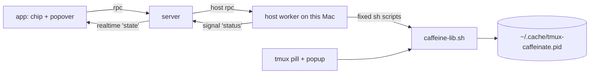

# Caffeine

Keep this Mac awake from BB. The plugin drives the tmux caffeine subsystem, so
the BB chip and the tmux pill read one pidfile and always agree.

## Use

Press **Alt+K** (rebind it in Settings → Keyboard). The popover opens even when
the chip is hidden, including on the new-thread screen.

| Screen | Keys |
| --- | --- |
| Off | `i` indefinitely · `1`-`5` for 30m, 1h, 2h, 4h or 8h · `t` jump to the timed rows · `a` while agents run · `l` lid closed · `c` clear a stuck flag |
| Lid closed | `1`-`5` start, press twice unless BB knows the Mac is on mains · `Esc` back |
| On | `1`-`4` add 30m, 1h, 2h or 4h to what is left · `+` jump to them · `o` off · `c` clear a stuck flag |
| While agents run | `o` off · `c` clear a stuck flag |
| Everywhere | `↑` `↓` `j` `k` move · `Enter` or `Space` choose · `q` or `Esc` close |

Every timed row shows the time it ends. A start, extend or off closes the
popover, and the chip appearing or going is the confirmation. An error stays on
screen.

The chip hides while keep-awake is off, like the tmux pill:

| Chip | Meaning |
| --- | --- |
| peach `☼ ∞` | on until you turn it off; closing the lid still sleeps the Mac |
| peach `☼ 42m` | on for 42 more minutes |
| maroon `✷ 42m` | lid mode: the Mac cannot sleep at all, lid included, for 42 minutes |
| peach `☼ A2` | held while 2 agents run |
| peach `☼ A·4m` | no agents running; stops in 4 minutes |

The tmux pill shows `☼ A` for an agents session.

## While agents run

Choose it from the Off screen. It keeps the Mac awake while any BB thread on
this Mac runs, then stops 5 minutes after the last one goes idle. It is one-shot:
after that stop it is off until you choose it again.

- **Busy** means a thread that is starting or active, or idle with a background
  agent still running. A thread waiting on a permission or a question is not
  busy, so a forgotten prompt cannot keep the Mac awake. Background commands do
  not count, because a dev server never ends. Threads on other machines do not
  count.
- **The hold is a lease.** BB starts `caffeine_start 3600 bb-agents` and renews it
  to an hour whenever less than 30 minutes are left. If BB quits for good, the
  lease ends within the hour.
- **Manual changes win.** A start, extend or off from tmux or BB rewrites the
  pidfile without the `bb-agents` owner. BB then lets go and never stops a
  session it does not own. To change an agents session, turn it off first.
- **Restarts adopt.** A new BB server, or a plugin reload, finds the owned
  session and starts a fresh 5-minute grace that the next busy count can cancel.

## Design



- **The lib is the only source of truth.** The host runs fixed `sh` scripts that
  source `~/.config/tmux/scripts/caffeine-lib.sh` and pass values as positional
  arguments. No caffeinate or pmset handling lives in TypeScript, so lid mode
  keeps its sudoers rule, supervisor trap and launchd reconciler.
- **Agents mode lives in the pidfile.** Field 4, `bb-agents`, is the only record
  that it is armed. The renew and stop scripts check that owner first and exit 9
  otherwise.
- **Detached spawn.** Each script runs in its own process group, so a host worker
  that is idle-stopped does not take the caffeinate with it.
- **One queue, no timeouts on writes.** Every call runs through one queue in the
  host worker: two overlapping `caffeine_start` calls would each stop the
  other's pid and orphan one. Killing a start between its `nohup` and the
  pidfile write would also orphan one, so only reads time out.
- **Checked starts.** The lib returns 0 even when caffeinate died at once, so a
  start reads the state back after 250 ms.
- **Live updates.** The host rescans every 15 s, the tmux status interval, and
  signals only on a change. Each action signals at once. The app re-reads on
  reconnect and window focus, because realtime messages are not replayed.

## Dependencies

- `~/.config/tmux/scripts/caffeine-lib.sh`. Without it the popover says so.
- The `20-caffeine-pmset` sudoers rule and the
  `dev.connorads.tmux-caffeine-reconcile` launchd agent, for lid mode.

See [the tmux caffeine guide](../../../.config/tmux/docs/caffeine.md) for the
pidfile contract and the lid-mode safety model.

## Known limits

- Each split pane mounts its own chip; they share one store.
- The tmux pill lags a BB action by up to 15 s, its status interval.
- Threads on remote hosts are not counted, by design.
- A pending prompt counts as idle.
- Grace restarts from zero after a BB restart or plugin reload, so the worst
  case is 5 extra minutes.
- BB caps the header slot width; the chip is two glyphs and a short figure.
- No macOS, no caffeinate or no lib: the popover explains and offers nothing.

## Develop

```sh
pnpm build                       # then: bb plugin reload caffeine
pnpm dev                         # rebuild and reload on save
pnpm test                        # node --test; lib and host tests use stand-ins
pnpm typecheck
bb plugin logs caffeine
```

The lib and host tests run the real `caffeine-lib.sh` in a temp `HOME`, with
`caffeinate`, `pmset` and `sudo` stand-ins first on `PATH`. They never touch
the real pidfile or the kernel flag.
