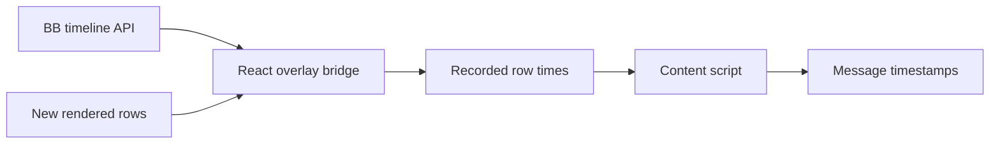

# Chat Timestamps

Show a muted local time beneath chat messages in the selected thread.
Older messages include their date. Hover shows the full date and timezone.
Assistant times mean message start, not completion or last edit.
Existing visible timestamps retain their native display.

The bridge reads deferred timeline metadata through `useSdk`, pages backwards
for rendered older messages, and refreshes after connection changes.
The content script observes new rows and requests missing metadata. It uses
`data-timeline-row-id`, `data-message-column` and thread-prefixed row IDs.
These are BB internals. Markup changes can break decoration after a BB update.
Embedded chats for other threads are outside this plugin's scope.

Disabling the plugin removes its labels, listeners, observers and pending requests.
It modifies no BB application files or stored conversations.

Build, test, install and reload through the [workspace guide](../README.md).
The shared [DOM decoration guide](../docs/dom-decorations.md) describes the method.
