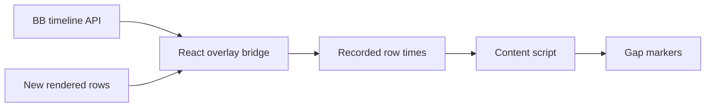

# Chat Timestamps

Show muted, centred gap markers before messages after a ten-minute pause,
a local date change, or the confirmed start of the conversation. Closely spaced
messages have no added timestamp footer. Hover a marker for the full local date
and timezone. Exact times appear to the right of each message's existing action
buttons on hover, keyboard focus, or while its menu is open. They remain visible
on touch devices. Full dates remain in the tooltip and native message menu.
Messages without an action bar retain their gap markers without an extra footer.
Assistant times mean message start, not completion or last edit.
Existing visible timestamps retain their native display.

Gaps compare consecutive recorded messages, including messages absent from the
rendered DOM. Unknown predecessors produce no marker. The bridge reads another
page when needed to establish a predecessor or the start of history.

The bridge reads deferred timeline metadata through `useSdk`, pages backwards
for rendered older messages, and refreshes after connection changes.
The content script observes new rows and requests missing metadata. It uses
`data-timeline-row-id`, `data-message-column` and thread-prefixed row IDs.
These are BB internals. Markup changes can break decoration after a BB update.
Embedded chats for other threads are outside this plugin's scope.

Disabling the plugin removes its labels, listeners, observers and pending requests.
It modifies no BB application files or stored conversations.

Build, test, install and reload through the [workspace guide](../README.md).
The shared [DOM decoration guide](../docs/dom-decorations.md) describes the method.
