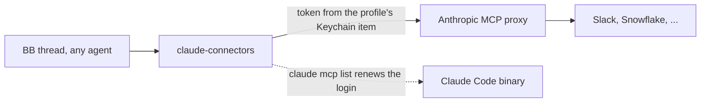

# Claude Connectors

Use a Claude profile's claude.ai connectors (Slack, Snowflake, HubSpot, ...) from any
BB thread, whichever account or agent runs it. Pick the profile per thread or per
project, or turn it off.

## Use

1. Sign in to Claude Code in the profile, for example `~/.claude-profiles/code/<name>`.
2. Set a default: `bb claude-connectors default work`, or per project with
   `bb claude-connectors use work --project`, or per thread with
   `bb claude-connectors use work`.
3. Ask the agent to use Slack. It calls `claude_connectors_list` and then
   `claude_connectors_call`.
4. Allow a write tool when you want it: `bb claude-connectors allow Slack slack_send_message`.

## Model

- The profile resolves from the thread's choice, then the project default, then the
  global default. Choices live in plugin storage.
- The token stays on this Mac. The plugin reads Claude Code's Keychain item and never
  refreshes the token itself. When it nears expiry, the plugin runs `claude mcp list`
  in that profile so Claude Code renews it.
- Read-only tools (MCP `readOnlyHint`) are allowed by default; others stay off until
  allowed. A 401 renews the login and retries once; other failures are never retried.
- The connector list and the MCP proxy are undocumented Anthropic endpoints. They can
  change without notice. Anthropic's credential policy covers OAuth use outside Claude
  Code, so keep this personal and local.
