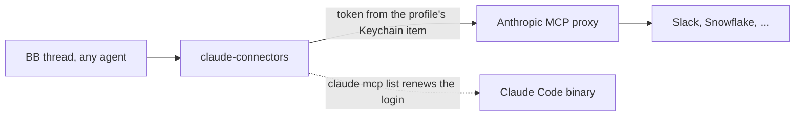
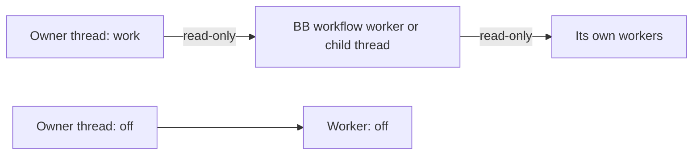
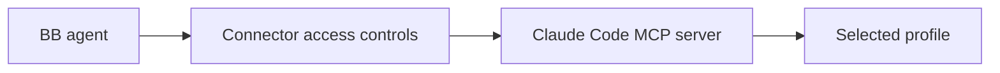

# Claude Connectors

Use a Claude profile's claude.ai connectors (Slack, Snowflake, HubSpot, ...) from any
BB thread, whichever account or agent runs it. Pick the profile per thread or per
project, or turn it off.

## Use

1. Sign in to Claude Code in the profile, for example `~/.claude-profiles/code/<name>`.
2. Set a default: `bb claude-connectors default work`, or per project with
   `bb claude-connectors use work --project`, or per thread with
   `bb claude-connectors use work`.
3. Ask the agent to use Slack. It calls `claude_connectors_list` and then
   `claude_connectors_call`.
4. Allow a write tool when you want it: `bb claude-connectors allow Slack slack_send_message`.

## Model



- The profile resolves from the thread's choice, then its owner, then the project
  default, then the global default. Choices live in plugin storage.
- The token stays on this Mac. The plugin reads Claude Code's Keychain item and never
  refreshes the token itself. When it nears expiry, the plugin runs `claude mcp list`
  in that profile so Claude Code renews it.
- Every thread gets `claude_connectors_list` and `claude_connectors_call`, and each
  call checks the thread's choice. A Codex thread keeps its start-time tool list for
  life, so a thread turned on later still has the tools.
- Read-only tools (MCP `readOnlyHint`) are allowed by default; others stay off until
  allowed. A 401 renews the login and retries once; other failures are never retried.
- The connector list and the MCP proxy are undocumented Anthropic endpoints. They can
  change without notice. Anthropic's credential policy covers OAuth use outside Claude
  Code, so keep this personal and local.

## Workers

A thread started by another thread uses that thread's connectors, read-only. The
owner is the parent thread, or the origin thread of a BB workflow run. A worker gets
what its owner resolves to and never more. Write tools stay with the owner, even
when allowed for the profile. A pick made on the worker itself replaces this.

The popover of a thread narrows what it holds and passes on:

| Control | Effect |
| --- | --- |
| Connector tags | Click a tag to turn that connector off for the thread. A new profile pick turns every connector on. |
| Workers toggle, `w` | On by default. Off passes nothing to the threads this one starts. |

A worker takes its owner's connector list. A new-thread draft has neither control
until its first message.



The tools answer only during a thread's own turn. A Claude Code background sub-agent
or built-in Workflow worker shares its parent's thread, so its calls fail once that
turn ends. The agent instruction says to call connectors in the turn, or to use a BB
workflow. See [SDK frictions](../docs/sdk-frictions.md).

Unit tests cannot reach the worker wiring: owner lookup, the inherited profile and
turn routing. After changing it, run the live check from a thread that has a profile
picked. It starts a one-worker BB workflow that calls one read-only tool, and it exits
non-zero unless the worker sees the tool allowed and the call succeeds:

```bash
pnpm selftest Slack slack_search_emojis '{"query":"tada"}'
```

## Claude Code artefacts

The `Claude Code Artifacts` connector exposes the available native artefact tools
through the selected profile's `claude mcp serve`. These can include `Artifact`,
`ArtifactComments` and `ArtifactData`. Some native configurations combine them in `Artifact`.
Claude Code handles authentication and account policy. No model request is made.

```sh
bb claude-connectors tools "Claude Code Artifacts"
bb claude-connectors allow "Claude Code Artifacts" Artifact
```

Each tool combines read and write actions, so each starts off.
Allow only the tools you need. The agent must confirm content before writes.
Use `claude_connectors_list` with this connector to read the native input schemas.
Publish inputs use absolute local file paths. Files must exist on the BB server's machine.



Each request starts and closes its own native process. Background watches and
comment notifications do not persist between calls. Calls time out after two minutes.
The adapter allows only these artefact tool names, even when the native server lists other tools.

The adapter uses the undocumented `CLAUDE_CODE_ARTIFACT=1` switch.
Claude Code settings and account restrictions still apply. Native tool names
and schemas depend on the installed Claude Code version.
