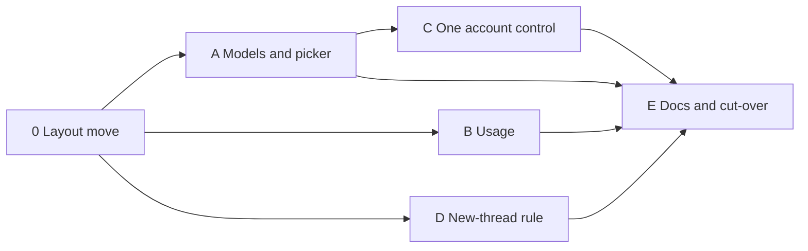

# Agent Switcher consolidation plan

This plan grows Claude Profiles into the Agent Switcher plugin. It absorbs
Model Favourites and Agent Usage. The decision and the rejected options are in
[ADR 0001](../docs/adr/0001-consolidate-agent-switcher.md).

Rules for every step:

- The plugin ID stays `claude-profiles`. The `thread:<id>`, `guard:<id>`,
  `next-thread-profile` and `inventory:*` KV keys do not move or change shape.
- Do not edit `model-favourites/` or `agent-usage/`. Copy code from them.
- Do not build in this directory. `dist/` here is what live BB loads. To test a
  build, copy the plugin to a new `$TMPDIR` directory and build there.
- Write the failing test first. Test through RPC handlers, the dispatch hook,
  the CLI and rendered slots with the SDK testing helpers. Fake only the BB
  boundaries: `sdk`, `experimental_callHostRpc` and other plugins' RPC.
- Every step ends with `pnpm test`, `pnpm typecheck` and `dhk check <paths>`.



## Target layout

```text
claude-profiles/
  package.json        bb.name "Agent Switcher"; one server, host and app entry
  contracts.ts        composes module contracts into rpcContract and hostContract
  server.ts           composition root: settings, then registerAccounts and registerModels
  host.ts             one host entry: account and usage handlers spread together
  app.tsx             registers every slot, overlay and command
  src/accounts/       bindings, routing, guard, handover, quota (node:test)
  src/accounts/usage/ overview reader, pace, format, reset credits (node:test)
  src/models/         favourites store, effort rules, migration (node:test)
  ui/picker/          Alt+F picker: models section and account section (vitest)
  ui/usage/           header badge and overview overlay (vitest)
  ui/components/      responsive dialog primitives copied from agent-usage
```

## Step 0. Move account code into `src/accounts/`

**Status: done**, after step A. Step A had already made the `test:core` and
tsconfig `include` changes, so this step only moves files and updates
imports. The test count is the same before and after: 46 core, 32 UI.
The `claude-profile-leak-guard` hook allowlists `claude.ts` by path, so the
hook and its Bats cases name `src/accounts/claude.ts`.

This commit only moves files. Behaviour does not change.

| From | To |
| --- | --- |
| `src/claude.ts`, `src/claude.test.ts` | `src/accounts/claude.ts`, `.test.ts` |
| `src/guard.ts`, `src/guard.test.ts` | `src/accounts/guard.ts`, `.test.ts` |
| `src/session.ts`, `src/session.test.ts` | `src/accounts/handover.ts`, `.test.ts` |
| `src/usage.ts`, `src/usage.test.ts` | `src/accounts/quota.ts`, `.test.ts` |
| `src/usage-source.ts`, `src/usage-source.test.ts` | `src/accounts/usage-source.ts`, `.test.ts` |
| `src/server.test.ts` | `src/accounts/server.test.ts` |

- Update the imports in `contracts.ts`, `server.ts` and `host.ts`.
- Change `test:core` to `node --experimental-strip-types --test 'src/**/*.test.ts'`.
- Change the tsconfig `include` to `["*.ts", "*.tsx", "src/**/*.ts", "ui/**/*.ts", "ui/**/*.tsx"]`.
- Verify: the test count is the same before and after.

The `ts-tests` hook finds the project from the nearest `package.json`, so the
new subdirectories stay covered.

## Step A. Models module, saved effort and one picker

**Status: done.** Deviations from the plan below:

- Step 0 had not landed. Step A makes only its config changes: the
  `test:core` glob and the tsconfig `include`. The account files stay in
  `src/`, so step 0 still has to move them. `test:ui` runs
  `vitest run app.test.tsx ui/`, so vitest does not collect the node:test files.
- `contracts.ts` exports `accountsContract` and composes
  `rpcContract = { ...accountsContract, ...modelsContract }` for the UI.
  `server.ts` registers `accountsContract`, and `registerModels` registers
  `modelsContract`. `app.test.tsx` types its handlers against `accountsContract`.
- `migrate-favourites` checks `plugins.list` for an enabled Model Favourites
  before it calls `list`. A failed `list` call also exits 1 with "Nothing changed."
- `favourites.add` for a model that is already a favourite returns the list
  unchanged, as before. The list schema refuses a stored duplicate.
- The star saves a favourite with no effort. The row effort select sets it.
- The account select is disabled while running or submitting. The composer
  API has no queued state, so `choose` gives the queued refusal.
- The account section stays beside the old account chip until step C.
- The picker test reads the composer commands from the untyped
  `commandPaletteActions` field of `loadPluginApp`.

### Files

| Create | Source |
| --- | --- |
| `src/models/contract.ts` | Copy of `model-favourites/contracts.ts` schemas. Add a rule: provider and model are unique in the list. |
| `src/models/store.ts` | Copy of `model-favourites/store.ts`. Add `setEffort(id, level \| null)` and `importLegacy(list)`. |
| `src/models/favourites.ts` | Copy of `model-favourites/favourites.ts`. Change `availability` and add `planSelection`. See the effort rules. |
| `src/models/migrate.ts` | Pure function `mergeLegacy(existing, legacy)` that returns `{ list, imported, skipped }`. |
| `src/models/server.ts` | `registerModels(bb)`: store on KV, RPC handlers and the `migrate-favourites` CLI branch. |
| `ui/picker/picker.tsx` | Copy of `ModelPicker`, `Overlay`, `Trigger` and `CommandOwner` from `model-favourites/app.tsx`. |
| `ui/picker/controller.ts` | Copy of `model-favourites/controller.ts`. Apply the saved effort. |
| `ui/picker/store.ts` | The `open`, `close` and `subscribe` overlay state from `model-favourites/app.tsx`. |
| `ui/picker/picker.css` | Copy of `model-favourites/picker.css`. Keep the `mf-` prefix. |

Delete `profiles.ts` in the copy. The account section calls this plugin's own
`accounts` and `choose` through `useRpc`, not `sdk.plugins.callRpc`.

### Storage

- KV key `favourites` in Claude Profiles storage. Shape:
  `{ id, slot, name, providerId, model, reasoningLevel?, serviceTier? }[]`,
  with a maximum of nine items.
- `reasoningLevel` is the saved effort. `serviceTier` is kept from migration.
  It is not applied. Whether to apply a saved tier is open question 1.
- Realtime channel `favourites-changed`. It replaces Model Favourites' `changed`.

### RPC additions to `rpcContract`

| Method | Input | Output |
| --- | --- | --- |
| `favourites.list` | `{}` | list |
| `favourites.add` | `{ providerId, model, name, reasoningLevel? }` | list |
| `favourites.remove` | `{ id }` | list |
| `favourites.rename` | `{ id, name }` | list |
| `favourites.move` | `{ id, direction: -1 \| 1 }` | list |
| `favourites.setEffort` | `{ id, reasoningLevel: effort \| null }` | list |

Live Model Favourites and Agent Usage call `accounts`, `choose` and `usage`
until the cut-over. Their names and shapes do not change.

### Effort rules

| Case | Behaviour |
| --- | --- |
| Saved effort that the model supports | Selection sets that effort. |
| Saved effort that the model does not support | The row is disabled with the reason "Saved effort `<level>` is not available for this model". The row's effort select stays enabled. |
| No saved effort | Selection uses `model.defaultReasoningEffort`. It ignores the composer's current effort. |
| Footer effort select changed | Only the composer changes. `favourites.setEffort` is not called. |
| Row effort select changed | Only `favourites.setEffort` is called. The composer does not change. |
| Cycle (`Alt+Shift+F`) | Skips rows that are disabled. |

The row effort select lists **Default** and the model's supported efforts.
If the saved value is not supported, the select also lists it, marked
unavailable.

### Picker (Alt+F)

- `app.slots.experimental_appOverlay({ id: 'picker' })`.
- `app.composer.customize({ id: 'agent-switcher', scopes: ['thread', 'new-thread'] })`.
  It contains the `CommandOwner` banner, the star `Trigger` action and a
  **Switch model** plus-menu item.
- Commands, all titled `Agent Switcher: …`:

  | ID | Default shortcut |
  | --- | --- |
  | `open-picker` | Alt+F |
  | `next-favourite` | Alt+Shift+F |
  | `previous-favourite` | none |
  | `select-favourite-1` to `select-favourite-9` | none |

- Account section: shown while Claude Code is the selected provider.
  - Thread composer: `accounts({ threadId })` and `choose({ threadId, profileId })`.
    Disabled while running, submitting or queued.
  - New-thread composer: `accounts({ threadId: null })`. The choice writes
    `next-thread-profile`. Model Favourites hid this case.
  - Label: **Default**. "Native login" is the old label for the same state.

### Migration CLI

Command: `bb claude-profiles migrate-favourites`, with no arguments.

The CLI currently requires a thread ID. Change the parser so that it selects a
branch by `argv[0]` first.

1. Call `sdk.plugins.callRpc({ pluginId: 'model-favourites', method: 'list', input: {} })`.
   Parse the result with a copy of the legacy list schema.
2. If Model Favourites is missing or disabled, exit 1 with "Enable Model
   Favourites to migrate. Nothing changed." Do not write anything.
3. Merge in one store mutation:
   - Same `id` already present: skip with "already imported".
   - Same provider and model under another ID: skip with "model already a
     favourite". Legacy duplicates keep the lowest slot.
   - Slot taken: keep the ID and take the lowest free slot.
   - Nine favourites already saved: skip with "no free slot".
   - Keep `id`, `slot`, `name`, `reasoningLevel` and `serviceTier` when present.
4. Print `{ imported, skipped: [{ id, reason }] }` as JSON. Exit 0.

A second run imports nothing and changes nothing.

### Tests

Core tests (node:test):

- `src/models/store.test.ts`: the store cases from
  `model-favourites/favourites.test.ts`. Also: `setEffort` keeps the slot,
  `setEffort(null)` clears the effort, and a duplicate provider and model is
  refused.
- `src/models/favourites.test.ts`:
  - Availability gives the unsupported-effort reason.
  - `planSelection` uses the saved effort, else the model default, and never
    the current effort.
  - Cycling skips favourites with an unsupported saved effort.
- `src/models/server.test.ts`, with `createFakePluginHost` and a stub for
  `sdk.plugins.callRpc`:
  - The migrate CLI imports `id`, `slot`, `name`, effort and tier.
  - A second run reports `imported: 0` and leaves `favourites.list` the same.
  - When Model Favourites is absent, the CLI exits 1 and storage is empty.
  - A legacy duplicate is skipped with its reason.
  - A taken slot moves to the lowest free slot.

UI tests (vitest), in `ui/picker/picker.test.tsx`:

- Port all cases from `model-favourites/app.test.tsx`. The account cases use
  this plugin's `accounts` and `choose` RPC handlers.
- A saved effort is applied on selection.
- Without a saved effort, the model default is applied even when the composer
  has another effort.
- With an unsupported saved effort, the row is disabled with its reason and the
  row effort select is enabled.
- The footer effort select does not call `favourites.setEffort`.
- The row effort select does not call `composer.setSelection`.
- The new-thread account section calls `accounts({ threadId: null })` and
  `choose({ threadId: null, … })`.
- The `open-picker` command has the default shortcut Alt+F.

Commit: models module, effort rules, picker and migration CLI together.

## Step B. Usage module

**Status: done.** Core tests go from 46 to 80, UI tests from 32 to 45.
Deviations from the plan below:

- The reader's ports name what it needs, not the accounts functions.
  `claudeAccount(threadId)` returns the bound profile's label and its
  `hostUsage` reading, or null when the thread has no environment.
  `claudeResource(resourceId, refresh)` is the `getResource` handler body.
  The `listPlugins` port is gone.
- Two more files: `src/accounts/usage/contract.ts` holds the Agent Usage
  schemas, `usageContract` and `usageHostContract`. `src/accounts/usage/server.ts`
  has `registerUsage(bb, ports)`, which registers the `usage.*` RPCs and
  returns the reader for the CLI. `ui/usage/use-now.ts` holds the shared
  `useNow` hook.
- The UI copies Agent Usage as committed. Its work tree has an uncommitted
  move of the badge to `@bb-plugins/chip`. That change is not in
  `ui/usage/badge.tsx`.
- The picker test checks for one `picker` overlay, not for an overlay list
  of only `picker`.
- The `bb plugin build` check in a copy did not run.

### Files

| Create | Source |
| --- | --- |
| `src/accounts/usage/overview.ts` | `createUsageReader` from `agent-usage/server.ts` |
| `src/accounts/usage/pace.ts`, `format.ts`, `reset-credits.ts` | Same names in `agent-usage/` |
| `src/accounts/usage/reset-credits-host.ts` | `readResetCredits` and `collect` from `agent-usage/host.ts` |
| `ui/usage/badge.tsx` | `ThreadUsage` and `Ring` from `agent-usage/app.tsx` |
| `ui/usage/overlay.tsx` | `UsageOverlay` and its parts from `agent-usage/app.tsx` |
| `ui/usage/overlay-store.ts`, `ui/usage/usage.css` | `agent-usage/overlay-store.ts`, `app.css`. Keep the `au-` prefix. |
| `ui/components/**`, `ui/lib/**`, `ui/hooks/**` | `agent-usage/components`, `lib`, `hooks` |

Add these exact dev dependency versions from `agent-usage/package.json`:
`@radix-ui/react-dialog` 1.1.19, `@radix-ui/react-slot` 1.3.0, `clsx` 2.1.1 and
`tailwind-merge` 3.4.0. Add `sonner` 1.7.4 from Model Favourites in step A.
`pnpm install` updates the shared workspace lockfile. Commit only this
plugin's importer hunk.

### In-plugin calls

The reader keeps its `UsagePorts` interface. `server.ts` supplies these ports:

| Port | Before (agent-usage) | After |
| --- | --- | --- |
| Header account for a Claude thread | `callRpc('claude-profiles', 'accounts')` after a `plugins.list` enabled check | The accounts module's `threadAccount(threadId)` |
| Header quota | `callRpc('claude-profiles', 'usage')` | The accounts module's `hostUsage(hostId, config, profileId, false)` |
| Reading time of a `claude-profiles:` resource | `callRpc('claude-profiles', 'provider-usage.v1.getResource')` | `measurement(hostUsage(...))` directly |
| Other providers' readings | `callRpc(<source plugin>, 'provider-usage.v1.getResource')` | Unchanged |
| Overview snapshot | `callRpc('bb--provider-usage', 'getUsage')` | Unchanged. The collector calls this plugin's usage source again, as it does now. |
| Reset credits | Own host client | The merged host client |

To support this, extract `hostUsage` and the cache from `server.ts` into
`src/accounts/quota-cache.ts`. Then the RPC handlers and the reader share one
one-minute cache.

### Contracts

- Add `resetCredits` to `hostContract`. Spread each module's method map into
  one `defineRpcContract` call. A plugin has one host entry, so `host.ts`
  spreads both handler maps into one `experimental_defineHostEntry`.
- Add `usage.overview { refresh }`, `usage.header { threadId }` and
  `usage.inspection { refresh }` to `rpcContract`. Use the Agent Usage output
  schemas.
- Keep `usage { threadId, profileId, refresh }` until the cut-over. Live Agent
  Usage calls it. Removing it later is open question 2.

### App registrations

- `app.slots.experimental_threadHeaderAction({ id: 'usage', title: 'Usage' })`
- `app.slots.experimental_appOverlay({ id: 'usage-overview' })`
- `app.commands.register({ id: 'show-usage', title: 'Agent Switcher: show usage', defaultShortcut: { key: 'a', mod: true, shift: true } })`

### CLI

`bb claude-profiles overview [--refresh]` and `bb claude-profiles header THREAD`
replace `bb agent-usage`.

### Tests

Convert the ported tests from vitest `expect` to `node:assert`, so that one
runner owns `src/`.

- `src/accounts/usage/overview.test.ts`: the cases from
  `agent-usage/server.test.ts`. The Claude header case uses the in-plugin ports.
  Its fake ports must not receive a `claude-profiles` RPC call.
- `src/accounts/usage/{pace,format,reset-credits,reset-credits-host}.test.ts`:
  copies of the matching `agent-usage` tests.
- `src/accounts/server.test.ts`:
  - `usage.header` for a bound thread returns that profile's windows. Use
    `experimental_callHostRpc` to answer `profiles` and `usage`.
  - Two calls within a minute make one host `usage` call.
- `ui/usage/usage.test.tsx`: the cases from `agent-usage/app.test.tsx`, with
  `rpc` handlers for `usage.header` and `usage.inspection`.

Commit: usage module, header badge, overlay and the merged host entry.

## Step C. One account control

**Status: done.** Core tests stay at 80. UI tests go from 45 to 42: nine
account menu cases give way to six status and picker cases. Deviations from
the plan below:

- The status styles move to `ui/account-status.css`. `app.css` is deleted.
- The status stays clickable during a turn. The picker's account select is
  disabled then and says "Available when this turn finishes."
- The status keeps its own `claude-account` customisation. Only the popup goes.
- `ui/picker/store.ts` exports `openedState()`, which holds the key and focus.
  It replaces `openedKey()`. The picker focuses the account select once the
  account list loads.
- The `app.test.tsx` cases render every composer action and the picker
  overlay together. One more case checks the `open-switcher` title, its
  missing shortcut and its account focus.
- The README use section names the status and the picker. Step E still
  rewrites the README.

### Changes

- In `app.tsx`, delete `AccountMenu`, the `accounts` popup and the
  `cp-menu`/`cp-item` CSS rules.
- Rename `AccountButton` to `ui/account-status.tsx`. It shows the dot and,
  when the composer is expanded, the account label. It shows only while Claude
  Code is selected.
- Clicking the status opens the picker with focus on the account select.
  `ui/picker/store.ts` gets `open(composer, { focus: 'account' })`.
- The `open-switcher` command becomes `Agent Switcher: switch account`. It
  opens the same picker with account focus. It has no default shortcut.
- Account number keys 1-9 go away. In the picker, 1-9 select favourites.

### Tests (rewrite `app.test.tsx`)

- The status shows the remembered account in a new-thread Claude composer.
- The status is hidden when the new-thread composer selects another provider.
- Clicking the status opens the picker overlay, and the account select has
  focus.
- The composer customisation registers no popups.
- In the rendered composer and picker, exactly one control can change the
  account.

Commit: replace the account menu with a status that opens the picker.

## Step D. New-thread account rule

**Status: done.** Core tests go from 80 to 90. UI tests stay at 42.
Deviations from the plan below:

- A Claude parent with no binding gives the composer account, not `default`.
  This follows the decided rule. A parent bound to Default passes Default on
  and the child gets an explicit Default binding, so its own children stay on
  Default too. The `parentIsClaude` input is gone: only Claude threads have a
  binding, so a non-Claude parent is unbound.
- `routing.ts` has two functions. `startingThreadId(thread, parentThreadId)`
  picks the dispatch `parentThreadId`, else `sourceThreadId` for a fork.
  `newThreadAccount(startingBinding, composerProfileId)` gives the result.
- The refusal names the thread that started the child, not only the parent,
  and does not suggest the composer, because the composer choice does not
  apply to an inheriting thread.
- `README.md` states the new rule and the fork limit below. Step E still
  rewrites the README.

### Investigation answers

Read from `~/git/getbb` at the 0.46 pin `9c4f3e6` and at `4d49814b2`. Both
give the same answers.

- **A Claude fork copies the source's native session.** The Claude bridge's
  `handleThreadFork` calls the Agent SDK `forkSession(sourceProviderThreadId)`
  and resumes the copy. So the fork branch stays. But `forkSession` runs in
  the shared bridge process and finds sessions under that process's
  `CLAUDE_CONFIG_DIR`. Plugin env reaches only the session options
  (`config.envVars`), and the bridge process key does not include env. So on
  stock BB a fork works only when the source and the fork both run on
  Default. A fork of a thread on a named account cannot find its source
  session, whatever this plugin binds. See open question 5.
- **Agent-delegated children carry `parentThreadId` only when the agent asks.**
  `bb thread spawn` sets it with `--parent-self` or `--parent-thread`. BB's
  thread guide says "Parenting is opt-in". A bare spawn has no parent, no
  source and no `startedOnBehalfOf`, so it uses the composer account. On this
  machine 71 of 164 threads have a `parentThreadId`.

### Thread fields (BB 0.46.0)

These facts come from source pin `9c4f3e6`, the base of the patch spike:

| Field | Meaning |
| --- | --- |
| Dispatch `parentThreadId` | Copied from `thread.parentThreadId` (`dispatch-attempt.ts`). Set only for a hierarchical child. |
| Hierarchical child | Created with `--parent-thread`, `--parent-self` or the SDK `parentThreadId` with no `originKind`. |
| Fork | Has `originKind: 'fork'` and `sourceThreadId`. Its `parentThreadId` is null (`thread-create.ts`). |
| `senderThreadId` | `startedOnBehalfOf` requires a parent or a source, so this field adds no thread that the two fields above miss. |
| `origin` | `app`, `cli`, `plugin` or `sdk`. It names the requester type, not a thread. |
| `lifecycleOwnerThreadId` | Controls archive and stop only. Not a parent signal. See open question 3. |

### Rule

Add a pure function in `src/accounts/routing.ts`:

```ts
function newThreadAccount(input: {
  parentId: string | null;          // dispatch parentThreadId, else sourceThreadId when originKind is 'fork'
  parentBinding: Selection | null;  // KV thread:<parentId>
  parentIsClaude: boolean;
  composerProfileId: string | null; // KV next-thread-profile
}): { kind: 'inherit'; profileId: string } | { kind: 'composer'; profileId: string } | { kind: 'default' }
```

| Parent | Result |
| --- | --- |
| Claude, bound to a named profile | `inherit` that profile ID |
| Claude, unbound (runs on Default) | `default`, even if the composer shows a named account |
| Not Claude | `composer`. See open question 4. |
| None | `composer` |

`claimNext` becomes `claimBinding` in the `message.dispatch` hook, for pending
Claude threads with no binding:

1. Resolve the profile ID on the dispatching host with the `profiles` host call.
2. If an inherited profile is missing, reject with this message: "This thread
   inherits the `<label>` account from its parent. That account does not exist
   on this machine. Start it from a thread on this machine, or choose its
   account in the composer." Write no binding.
3. Keep the current behaviour for composer choices.

### Investigation before coding

These checks are read-only.

- Confirm that a Claude fork resumes the source's native session. If it does,
  the session transcript is in the source account's directory. Read the Claude
  provider's fork path in `spikes/bb-patched-source`. If a fork starts a new
  session instead, drop the fork branch. Record that in a new ADR that
  supersedes the fork clause of ADR 0001.
- Confirm that agent-delegated children have `parentThreadId`. Check the
  thread row from `bb thread show <child-id> --json` for a known delegated child.

### Tests (`src/accounts/server.test.ts`)

Use `makeMessageDispatchHookContext` and `experimental_callHostRpc`:

- A child of a bound parent binds to the parent's profile.
  `next-thread-profile` is ignored.
- A fork, with `originKind: 'fork'` and `sourceThreadId`, inherits.
- A missing parent profile on the child's host rejects the dispatch and
  writes no binding.
- A child of an unbound Claude parent stays unbound when the composer shows
  `work`.
- A thread without a parent uses `next-thread-profile`. This is the current
  behaviour.
- A child that is already bound is not changed.

Add `routing.test.ts` with table cases for `newThreadAccount`.

Commit: inherit the parent's account for threads started by threads.

## Step E. Documentation and cut-over

**Status: done.** Core tests stay at 93, UI tests at 42. Deviations from the
plan below:

- This file stays until the cut-over. It holds the cut-over and rollback
  steps, which the user still has to run. Delete it after step 6 of the
  cut-over passes.
- `package.json` also changes `bb.description`. The guard's stop notice says
  "Agent Switcher" instead of "Claude Profiles", so it names the plugin that BB
  shows.
- The engine pin is `bb >=0.46`, as Model Favourites declared. See open
  question 6.
- Cut-over step 1 links the workspace `node_modules` beside the copy. A plain
  `cp -R` breaks pnpm's relative links. The check ran: 93 core and 42 UI tests
  pass, `tsc` passes and `bb plugin build` writes `dist/` with plugin ID
  `claude-profiles`.

### Documentation

- `claude-profiles/README.md` is the Agent Switcher guide: use, shortcuts,
  new-thread rule, design, CLI, scope and development.
- The workspace `README.md` has an Agent Switcher section and links
  `docs/adr/`.
- `cache-hits` documents a call from `claude-profiles`. The ID does not change,
  so it needs no edit.

### Cut-over (for the user to run)

Migration reads Model Favourites over RPC, so Model Favourites must still be
enabled when it runs. Alt+F and ⌘⇧A are registered twice between step 3 and
step 5.

1. Check the build in a copy:

   ```sh
   d=$(mktemp -d "$TMPDIR/agent-switcher-check.XXXX")
   rsync -a --exclude dist ~/src/bb-plugins/claude-profiles/ "$d/claude-profiles/"
   ln -s ~/src/bb-plugins/node_modules "$d/node_modules"
   cd "$d/claude-profiles" && pnpm test && pnpm typecheck && bb plugin build .
   ```

2. `cd ~/src/bb-plugins/claude-profiles && pnpm build`
3. `bb plugin reload claude-profiles`
4. `bb claude-profiles migrate-favourites`. Check that `imported` plus the
   `skipped` count equals the legacy count. Run it again and check that
   `imported` is 0.
5. `bb plugin disable model-favourites` and `bb plugin disable agent-usage`.
6. Smoke check:
   - BB lists the plugin as **Agent Switcher**.
   - Alt+F opens one picker. It has favourites with efforts and the account
     section.
   - ⌘⇧A opens the usage overlay.
   - A bound thread's header badge names its profile.
   - `bb claude-profiles list THREAD` shows the existing binding.

### Rollback

Bindings never moved, so rollback restores only code and UI.

1. `bb plugin enable model-favourites` and `bb plugin enable agent-usage`.
   Their storage is untouched.
2. Restore the pre-consolidation source. `46da5dfb` is the last commit before
   step A. `restore` also removes files that the commit does not have:

   ```sh
   cd ~ && dotfiles restore --source=46da5dfb --worktree -- src/bb-plugins/claude-profiles
   cd ~/src/bb-plugins/claude-profiles && pnpm build && bb plugin reload claude-profiles
   ```

3. The `favourites` key in Claude Profiles storage stays. The old code ignores it.
4. The restore leaves uncommitted changes. To keep it, also restore the
   `claude-profile-leak-guard` hook and its Bats cases, which name
   `src/accounts/claude.ts` since step 0.

## Open questions

1. Apply a migrated `serviceTier` when a favourite is selected, or only keep it?
   Answered: only keep it.
2. After the cut-over, remove the `usage` RPC and the `bb claude-profiles usage`
   subcommand that only Agent Usage used? This changes an exposed surface.
   Answered: keep both until the user decides on the cut-over.
3. Should `lifecycleOwnerThreadId` without `parentThreadId` count as "started
   by another thread"? Answered in step D: no.
4. A Codex parent that starts a Claude child: use the composer account (as
   planned) or refuse? Answered in step D: the composer account.
5. A fork of a source with no binding while the composer shows a named
   account binds that account. A source bound to Default passes Default on,
   so only a source with no binding hits this. BB writes the forked session in the bridge's config directory,
   so the fork then resumes under the named account and cannot find it. Bind
   forks of an unbound source to Default, or copy the forked session with the
   `transfer` host call?
   Answered: bind them to Default.
6. Should `engines.bb` be `>=0.46`? The picker code comes from Model
   Favourites, which declared `>=0.46`. `bb --version` reports 0.45.0 for the
   CLI that builds the plugin.
   Answered: yes. The picker needs 0.46, and the live server runs 0.46.
