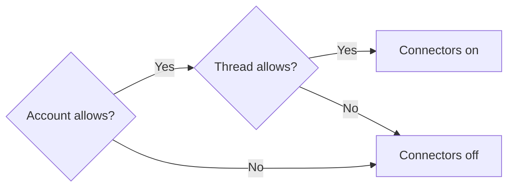
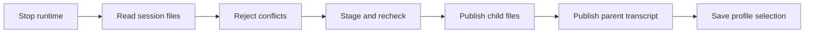

# Agent Switcher for BB

Choose the model, its effort and the Claude Code account for a thread from one
switcher. Keep the native conversation when switching accounts. Show each
account's quota in the thread header and in an all-account overlay.

The plugin ID is `claude-profiles`, so its CLI is `bb claude-profiles`. BB
shows it as **Agent Switcher**. [ADR 0001](../docs/adr/0001-consolidate-agent-switcher.md)
records why it absorbs Model Favourites and Agent Usage.

## Use

### Switcher

Press **⌘⇧M**, click the model chip in the composer, or choose **Switch model**
in the composer's plus menu. The switcher opens on the focused composer, in a
thread or a new-thread composer. It changes the next turn and keeps the draft.
It never sends a prompt. Queued-message editors cannot open it.

The plugin hides BB's own model, effort and mode trigger in the composer, so
the chip is the only model control. No SDK slot hides just that trigger, so a
content script adds one CSS rule matched to BB 0.49's composer markup. A BB
markup change brings the native trigger back beside the chip; it hides nothing
else. Disabling the plugin removes the rule.

```text
 1  ◎ Sol            ●○○
 2  ✳ Opus           ●●○   ✓
 3  O DeepSeek Flash ●○○
 ────────────────────────
  (S) Summit  (T) Trove  ...   account row, Claude only
 ────────────────────────
  ⌕ All models            /
```

| Key | Action |
| --- | --- |
| **1-9** | Use that favourite |
| **Up / Down** | Use the next or previous favourite |
| **Left / Right** | Lower or raise the effort |
| A letter | Use the account with that letter |
| **⌘S** | Star or unstar the current model |
| **/** | Search every model |
| **Enter** or **Escape** | Close |

Each row shows its slot, provider, name and effort as dots, one per level the
model supports. **auto** means the model's default effort. A model supplied
by an unavailable provider is dimmed; hover over it for the reason.

The current model leads the list when it is not a favourite. It shows **⌘S to
keep**. **Fast** and **Daybreak** appear on the current row only when its
model offers them.

The account row shows when the current provider has more than one account.
Each account shows its letter inside a ring. The ring fills with the fullest
allowance window. It turns amber at 70% and red at 90%. Hover for each window.
**⌁** marks an account whose connectors are on.

#### Search

Type to filter by model, provider or route, such as **OpenCode Go**. **Up /
Down** moves, **Enter** uses the highlighted model and **⌘S** stars it.
**Escape** returns to the favourites. A provider whose catalogue fails shows
only when you search for its name. The catalogue does not verify account
access; Go plan and workspace settings apply.

### Favourites and effort

Up to nine favourites fit in numbered slots. Removing one leaves the other slot
numbers unchanged. **Alt+1-9** uses a favourite without opening the switcher.

A favourite remembers the last effort and tier used with it. Changing either
while a favourite is current saves it to that favourite.

| Case | Behaviour |
| --- | --- |
| Remembered effort that the model supports | Selecting the favourite sets that effort. |
| Remembered effort that the model no longer supports | Selecting the favourite uses the model's default effort. |
| No remembered effort | Selecting the favourite uses the model's default effort, not the composer's current one. |
| Remembered **Fast** the model no longer offers | Selecting the favourite uses the default tier. |

Favourites persist in plugin storage and update across open views.

### Daybreak

Search **Daybreak** to find the models that advertise the programme. Each result
names the model and **Daybreak**. Selecting it sets the model and programme for
the next turn. Models that require Daybreak off have no Daybreak result. In a
thread, the **Daybreak** toggle on the current row switches the programme.

A favourite saves its Daybreak setting with the model. Standard and Daybreak
choices for the same model can occupy separate slots. Selecting a favourite
checks that its model supports its saved programme before changing the thread.

BB's composer SDK cannot read or set session options before thread creation.
New-thread drafts use BB's native model picker for Daybreak. Save and apply
Daybreak favourites after starting the thread. A cross-provider handoff must
reach Codex before a Daybreak favourite can apply.

### Account connectors

Connectors are apps connected through a Claude account, such as Slack. Each
saved account has one connector preference on its machine. Accounts start off.
Executor keeps its own connection control.

| Control | Choices | Where |
| --- | --- | --- |
| Account | Off / On | **Claude account connectors** in Agent Switcher's settings |
| Thread | Use account setting / Off | `bb claude-profiles connectors THREAD` |

A thread can restrict access but cannot enable an account that is off.



Account changes recalculate access. Forks copy the thread restriction; child
threads start off. New threads follow account settings. Draft account changes
configure the saved profile rather than a one-shot new-thread choice.

A policy change stops affected idle sessions and preserves queued messages. A
running turn keeps its launch access; its restart waits until the thread is
idle. The next message that starts a turn waits with **Applying connector
settings…** while the session stops beside the dispatch hook, then proceeds.
A steer into the running turn proceeds unchanged. Pending restarts persist
across plugin reloads. A thread restriction change requires an idle thread with
no queued messages or background agents.

The composer marks **connectors still on** when an old launch still allows
access that the current policy blocks. Claude settings and organisation
policies can also block access requested at launch. Masked launch values remain
unknown and require a restart before another send.

The [BB-wide default](../../../docs/bb.md#claude-account-connectors) must be
provisioned on each BB server. It keeps connectors off for new processes even
if Agent Switcher is unavailable. The switch leaves profile, project and plugin
MCP servers available.

Existing thread choices migrate when read. Off remains a thread restriction;
On follows account settings without enabling an account. The legacy decoder
can be removed after every stored `connectors:` entry has a `mode` field.

```sh
bb claude-profiles connectors THREAD
bb claude-profiles connectors THREAD account
bb claude-profiles connectors THREAD off
```

### Accounts

Press the account's letter in the switcher, or click it. Letters stay with
their accounts; see the sidebar badges below.

A thread reads quota on its own machine. A new-thread draft reads it on the
connected machine that lists its accounts.

New thread:

1. Open the switcher and press the account's letter.
2. Send the first message. The thread starts on that account.

The new-thread choice is remembered. A new Claude thread starts on it until
you choose another, unless another thread starts it. See the
[new-thread rule](#new-thread-rule).

Existing thread:

1. Open the switcher and press the account's letter.
2. Send the next message. Claude resumes the same native conversation.

During a turn the account shows **next turn**. The switch runs when the turn
ends. Choosing the current account again cancels it. The next message waits
with **Moving to <account>…** until the conversation transfers.

Account selection in a cross-provider handoff is unavailable before its first
message. The switcher says so. New Claude threads use the remembered account;
switch accounts after the first message.

**Default** means the thread has no named account. It uses the native default
configuration.

In the sidebar, a Claude thread on a named account shows the account's letter
on its Claude icon. Each account keeps one letter and one colour. The letter is
the first letter of its name that no earlier account holds, so a new account
never changes an existing letter. Hover over the row's icon for the account
name. Threads on Default show no letter. The badge decorates BB's
own thread list by DOM selector, so a BB markup change can hide it; see
[SDK frictions](../docs/sdk-frictions.md).

Workflow previews and the right panel show each named Claude account beside the worker's
model details, using its sidebar colour. The label follows the worker thread's
binding. Run data refreshes every five seconds while the page is visible.
Default and unbound accounts have no label. Duplicate worker labels within one
run have no account label because the rendered rows expose no worker ID.
The panel resolves its shortened run ID from active runs or recorded preview
directives, including when the inline card is outside the rendered chat.
Both views use the same decoration and preserve worker navigation.

Profiles come from `~/.claude-profiles/code/` on the thread's host. Plugin
settings accept another profile root and Claude executable.

### Usage

The thread header shows the limit most likely to stop the thread. A ring shows
its use. The text adds the run-out or reset time when the window needs
attention. Hover over it for every window. A Claude thread shows its bound
account's quota.

Click the badge or press `⌘⇧A` to open the usage overlay. It groups every
account by provider, and by machine when more than one reports. Each window is
one row: its bar, use and time to reset, or its run-out time when use will
outlast it. Hover over that text for the full reset time. **Refresh** requests
fresh readings. A light sweep marks pending requests. Changed figures roll into
place with their bar fills when readings arrive. Reduced motion disables these
animations. Saved resets show beneath their account's quota rows. Claude groups
them by reset type and expiry; Codex groups its reset credits by expiry. Deadlines
within three days show in amber. Hover over an expiry for its date and local time.
Held Claude resets stay visible when they are paused or cannot be used yet.

Claude adds limits without notice, often under internal codenames. A Claude account
lists **Unread usage fields** when Claude reports a field with a value that
[quota.ts](src/accounts/quota.ts) neither reads nor ignores on purpose. A limit may be
missing from that account. Read the field or add it to the parser's ignore list.

A Claude profile row shows the account email and plan cached in the profile's
`.claude.json`. Team seats read as Team Standard or Team Premium with the
premium multiplier.

Each timed window compares use with even spending across the window.

| Status | Meaning |
| --- | --- |
| Under pace / On pace | Use is more than 5 points below, or within 5 points of, even spending |
| Ahead of pace | Use is more than 5 points above even spending, under 1.2× |
| At this pace, out HH:MM | At 1.2× even spending or faster |
| Limit reached | The window is full until its reset |
| Reset since last check | The reading predates its reset, so no percentage is shown |

Amber marks 1.2× pace or 70% used. Red marks 1.4× pace, 90% used or a full
window. A reading becomes stale after 4% of its shortest window, with a
15-minute minimum. Stale bars use stripes and omit projections.

Expired or signed-out Claude and Codex accounts show **Sign in again**.
OpenCode shows **Connect Go**. The button
opens **Agent sign-in**, a BB page with a terminal on that account's machine. Claude
runs `claude auth login`. OpenCode runs
`opencode auth login opencode --method device`. Open its terminal link in a
browser on any device, choose the Go workspace and approve the code. Credentials
stay on the selected machine, including when it is a remote server. Claude Default uses the machine's native configuration;
named accounts use their profile directory. Codex uses the machine's one CLI login
and starts `codex login --device-auth`: open the printed link on any device and
enter the code. Device codes need device code sign-in turned on in ChatGPT security
settings. **Use browser instead** switches to `codex login`, whose callback reaches
only a browser on the account machine. Switching closes the running Codex login.
Concurrent clicks reuse the active login terminal. Offline accounts require their machine to reconnect first.
Successful login refreshes usage and reopens the overlay when usage is available.
OpenCode reports successful authorisation independently of the allowance check.
If Go usage is unavailable, the sign-in page offers **Open Go usage in Console**
and **Refresh Go usage** without starting another sign-in. An unavailable Go
allowance does not establish that OAuth failed. Failed login keeps the
terminal available with **Try again**. The **Agent sign-in** sidebar page also
provides **Agent usage** to return to the account list.

The overlay reads BB's built-in **Provider usage** plugin. Enable it for
providers other than Claude.

Grok quota comes from the native CLI billing extension. Its allowance is shared
across Grok products. The overlay shows the reported period, use and reset.
Collection uses native CLI authentication and sends no model prompt.

Amp presents the native `amp usage` account and credit balances as labelled
amounts, with a link to credit settings. Unrecognised provider text stays visible.
The overlay requests Amp and quotas in parallel. Quotas appear as soon as they
are ready; Amp stays below them. The refresh indicator tracks both requests.
Refresh requests a new reading; a failed refresh retains the previous text with the failure.
Balances have no invented percentage or pace projection.

## Shortcuts

| Action | Shortcut |
| --- | --- |
| Open the switcher | ⌘⇧M |
| Use favourite 1-9 | Alt+1-9 |
| Show usage | ⌘⇧A |

BB's own model picker also defaults to ⌘⇧M. A default that conflicts stays
unbound, so the dotfiles BB preferences unbind BB's model picker shortcuts and
bind ⌘⇧M to the switcher. Keys inside the switcher are listed under
[Switcher](#switcher).

## New-thread rule

A thread that another thread starts takes that thread's account, Default
included:

- A child created with `--parent-self`, `--parent-thread` or an SDK
  `parentThreadId` takes its parent's account.
- A fork takes its source thread's account. A fork of a thread with no
  account chosen stays on Default, where BB writes the forked session.
- A workflow worker takes the account of the run's origin thread. A worker
  of a Claude origin with no account chosen stays on Default, where the
  origin runs.
- A parent that never had an account chosen, a non-Claude parent or workflow
  origin and a `bb thread spawn` without a parent use the remembered composer
  choice.

If the inherited account does not exist on the new thread's machine, the first
send is refused. The plugin never falls back to another account.

On stock BB a native send carries no plugin data, so the plugin cannot read an
account chosen for one draft. It reads the remembered choice when the first
message dispatches.

## Design

```mermaid
sequenceDiagram
    participant User
    participant Plugin as BB plugin server
    participant Host as Plugin host worker
    participant Claude as Native Claude Code
    User->>Plugin: Select profile in an idle thread's composer
    Plugin->>Host: Check target native login
    Host->>Claude: auth status --json
    Plugin->>Plugin: Stop and release thread runtime
    Plugin->>Host: Transfer this session transcript
    Host->>Host: Reject conflicting history; copy atomically
    Plugin->>Plugin: Persist thread profile selection
    User->>Claude: Next message through BB
    Claude->>Claude: Resume session under selected config directory
```

The plugin has two modules. `src/accounts/` owns bindings, routing, the guard,
transcript handover, quota and usage. `src/models/` owns favourites and their
saved effort. The switcher and the usage overlay in `ui/` own no data. They call
the modules through the plugin's typed RPC.

The server owns thread selection and checks BB state. The host worker owns local
directory discovery, transcript copying, native CLI calls and Codex reset
credits.

The plugin reuses BB's Claude Code provider. It contributes `CLAUDE_CONFIG_DIR`
and clears API-key and alternate-provider overrides for threads on a named
profile. Default and unselected threads receive no environment contribution:
Claude resolves an empty `CLAUDE_CONFIG_DIR` against the working directory.
`HOME` stays unchanged.

`CLAUDE_CONFIG_DIR` hides the shared `~/.claude` config. So before each launch
on a named profile, the host runs the dotfiles
[`claude-profile-materialise`](../../../.config/zsh/functions/claude-profile-materialise)
on the profile directory, as `ccp` does. The profile gets the shared settings,
memory, skills and commands. A host without the materialiser skips this step.
A failure or a run over 3.5 seconds is logged, and Claude starts on the profile
as it is.

BB starts Claude anyway when an env contributor throws, times out or is not
loaded, so a thread on a named profile could run on the native login. Each
launch records a `provider.env-resolved` event. The plugin reviews it on thread
activity and before every send. A launch without the selected profile's
directory is stopped, and the next send is refused once with an explanation.
Sending again relaunches with fresh env. Event activity is debounced to once a
second, so the first request of a bad launch can still reach the native login.

A send from a machine other than the account's own is refused before Claude
starts. Choose the thread's account again on that machine.

A new thread has no session to copy. Its first send passes BB's
`message.dispatch` hook before the provider environment resolves. The hook
binds the thread by the new-thread rule, resolving the profile on the thread's
host. A missing profile on that host rejects the send.

An account chosen through `choose` while a turn runs or messages wait is stored
as pending. Choosing the current account again cancels it. The switch runs when
the thread's runtime is next idle. A steer into the running turn stays on the
old account. A message that would start the next turn first waits with
**Moving to <account>…** while the transfer runs beside the dispatch hook, then
proceeds on the new account. The hook never holds BB's server-wide dispatch
lock for the transfer. A failed transfer refuses that message once with the
reason and leaves the thread on its old account.

A switch starts a new prompt cache on the target account, so the next request
re-sends the whole conversation uncached. When [Cache Hits](../cache-hits/README.md)
is enabled, the switch marks its chip cold.

Switching copies only the native session transcript. It leaves credentials,
settings and unrelated sessions separate. Returning to a profile advances its
older transcript only when its contents are an exact prefix of the current one.
Claude rewrites workflow state files whole, so the switch replaces a differing
`workflows/*.json` only when the parent transcript has grown past the target's.
Conflicting history, symlink paths and transcripts above 64 MiB cause refusal.
Source transcripts remain intact. Transcript files can contain conversation
content and tool results, so the target profile receives that content.

Quota requests use Claude's stream-JSON control protocol: `initialize`, then
`get_usage` with `skip_behaviors: true`. The plugin sends no user message. It bounds
the request time and output size, terminates the process on cancellation, and
caches successful measurements for five minutes and failures for one minute.
The header badge and the RPC handlers share that cache. Refresh requests bypass
it. Paid extra usage is outside the subscription quota display.

The plugin also implements BB's discoverable `provider-usage.v1` source contract.
An enabled Provider Usage panel can list these profiles and request individual
measurements. Each resource belongs to its BB host. Listing reads directory
metadata and never requests quota. The plugin does not enable that panel or change
its other sources.

Codex reset credits come from `~/.cache/codex-usage.json`. Opening the overlay
refreshes missing readings or readings at least five minutes old. The open
overlay checks every five minutes. Collection runs
`~/.config/zsh/functions/codex-usage` with its cache, lock and backoff rules.
No tmux session is required. The plugin does not read credentials or redeem credits.

Claude saved resets come from `~/.cache/claude-usage.json` and
`~/.cache/claude-usage-<profile>.json`. The same five-minute refresh rules call
`~/.config/zsh/functions/claude-usage`, which owns credentials, locks and backoff.
Named profiles require the standard `~/.claude-profiles/code` root for reset
collection. Quota readings support the configured profile root independently.
The collector requests `cedar_ember=1` with the installed CLI's
`claude-cli/<version> (external, cli)` User-Agent. The API requires that format
to report reset grants; a client refusal stays unavailable rather than zero.
Fable grants return weekly Fable usage and refill the session allowance. Weekly,
full and five-hour resets keep their own labels. Redemption stays in Claude.

## CLI

```sh
bb claude-profiles list THREAD_ID
bb claude-profiles switch THREAD_ID work
bb claude-profiles usage THREAD_ID work
bb claude-profiles overview [--refresh]
bb claude-profiles header THREAD_ID
bb claude-profiles import SESSION_ID|TMUX_PANE
bb claude-profiles next [PROFILE]
```

`switch` queues the account while a turn runs, as the switcher does, and prints
`currentId` and `pendingId`.
`overview` and `header` print the usage overlay and header data as JSON.
`next` prints the remembered new-thread account and the profiles on the
connected machine. With `PROFILE`, it first sets that account, as the switcher does
in a new-thread composer. Agents use it before a workflow run whose origin
cannot pass on an account.

### Import

`import` continues a Claude Code session from outside BB, such as one in a
tmux pane, in a new BB thread. BB has no API to bind a thread to an existing
session, so the import works in 5 steps:

1. Find the source session. A pane target such as `tri:5.2` resolves through
   the pane's processes and `sessions/<pid>.json`. The session must be idle.
2. Spawn a thread in the BB environment whose path is the session's working
   directory. Its stub turn replies `OK`. The title is the session's AI title.
3. Switch the thread to the profile that holds the source transcript.
4. Copy the source transcript and its session directory over the stub's
   session, with the session ID rewritten.
5. The next message resumes with the full history.

The source is only read, so the original session can continue. The two
histories then diverge. BB renders the timeline from its own events, so the
imported history is in Claude's context but not in the BB timeline. On failure
the error names the stub thread. Archive it and retry.

## Scope

The new-thread switcher lists profiles from the first connected host. The first
send resolves the choice on the thread's own host. A switch copies the parent
transcript and its session directory, including subagent history and tool results.
Existing JSONL files must match or extend the target at a complete line boundary.
Other existing files must match exactly. Target-only files and conflicting
metadata stop the switch without overwriting the conflicting history.

The transfer refuses symlinks and special files. It permits up to 4096 files
and directories. Copying and comparison use bounded buffers without a byte-size
limit. The runtime must be idle.
Files are staged and both histories are checked again before publication.
Child files are published before the parent transcript. An interrupted transfer
can leave some child files updated; retrying completes a compatible transfer.
The copy is not a filesystem transaction or a lock against external writers.
Credentials and settings stay in their own profiles.



BB's Claude bridge copies a fork's session in its own config directory, which
is Default, not the thread's account. For a fork on a named account, including
a side chat, the dispatch hook first links the account's project directory into
Default as `~/.claude/projects/+bb-fork-stage-<thread>`. The bridge then finds
the source and writes the fork into the account. The plugin removes the link
once the fork has its session or fails, and a five-minute sweep removes links
older than ten minutes. A log warning names a fork that did not land in its
account. If the source session cannot be staged, the fork is refused with the
reason.

Remove the staging when BB's bridge forks with the thread's launch env. Check by
opening a side chat on a named-account thread with staging disabled.
Switching a thread to another host requires selecting a profile on that host.

The plugin supports manual Claude switching and quota collection. It does not
rotate accounts automatically, track historical token costs, or switch Codex
accounts. Disabling it removes account selection from future provider launches.

Anthropic's [Claude Code authentication policy](https://code.claude.com/docs/en/legal-and-compliance)
distinguishes native Claude login from collecting or intermediating subscription
tokens. This plugin delegates authentication to the unmodified CLI and does not
read tokens, proxy OAuth or call authenticated usage endpoints directly. This
design is not a guarantee against account suspension.

## Development

Requirements: BB 0.46+, Plugin SDK 0.6.49, Node 24+, pnpm, native Claude Code.
Native continuation and quota collection are verified with Claude Code 2.1.293.

```sh
pnpm install --frozen-lockfile
pnpm test
pnpm typecheck
pnpm build
bb plugin reload claude-profiles
```

`pnpm test` runs node:test over `src/` and vitest over `app.test.tsx` and `ui/`.
Package install scripts stay disabled. BB provides React at runtime. The test
dependencies provide React and the official SDK app harness locally.

`dist/` is what live BB loads. Build only when you mean to reload it. To check a
build first, copy the plugin to a new `$TMPDIR` directory and build there.

Tests cover transcript copying, return switching, conflicts, symlinks, subagent
continuation, quota parsing, control requests, cancellation, the new-thread rule,
favourites with saved effort and Daybreak, the switcher and the usage views.
The disposable live proof is documented in [SPIKE.md](./SPIKE.md).
