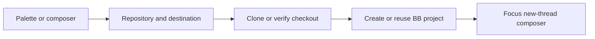

# Clone Repository

Clone a GitHub repository and open its BB project. The new-chat composer keeps
its prompt, mentions and attachments when its project changes.

Open **Clone repository…** from the command palette, the new-chat composer's
`+` menu, or `Cmd+Option+Shift+C`. Shortcuts can be rebound in BB settings.

1. Select a repository or paste a GitHub URL or `owner/repo`.
2. Check the destination. The default is `~/git/<repo>`; subfolders are allowed.
3. Choose **Clone and open** or **Open existing project**.

Discovery shows the first page before loading the remaining repositories.
Search covers loaded results; the footer reports incomplete loading.
Pasted repository names work without waiting for discovery.

The plugin uses the primary Mac host, its GitHub CLI login and SSH access.
It resolves the Mac login-session SSH agent through launchctl without reading keys.
`gh api` supplies discovery; Git performs cloning without an interactive shell.
SSH keeps repository access separate from the GitHub API token's permissions.
The shared dialog serves both launchers without separate popup behaviour.
The existing `ghcl` shell command stays independent.

Existing folders must be exact checkouts with a matching GitHub origin.
A failed project registration keeps the checkout. **Retry opening** reuses it.
No prompt is sent, dependencies installed or project setup scripts run.

Run `bb clone-repository status` to check Mac host execution and GitHub discovery.
It prints a count without repository identities and does not clone anything.

Build, install and verification procedures are in the [workspace guide](../README.md).
