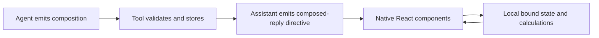

# Composed replies prototype

Native React components in BB assistant messages. OpenUI and json-render compose
new interfaces from the same eight primitives. The model does not emit executable
JavaScript or select a finished calculator.



## Use

Read the exact language contract before generating a response:

```sh
bb composed-replies-prototype contract openui
bb composed-replies-prototype contract json-render
```

Call `composition_reply({format, source, title})` in a fresh agent session.
Include its returned `::composed-reply{id="..."}` directive on its own line.
A tool result alone does not render the interface.

For CLI publication, write that input object to the invoking thread's storage:

```sh
bb composed-replies-prototype publish /absolute/thread-storage/input.json
```

## Components and calculations

`Stack`, `Text`, `NumberInput`, `Slider`, `Select`, `Metric`, `Table` and
`BarChart` render directly inside BB. Fonts and colours inherit BB theme tokens.
Charts use CSS bars, fixed screen-size labels and explicit units. Charts accept
nonnegative values and equal-length labels and values.

OpenUI uses its real parser, renderer and reactive state. `$variables` contain
literal defaults. Derived values use inline arithmetic or ordinary named
expressions, never derived `$variables`. JSON uses json-render's real renderer,
state bindings and registered arithmetic functions. Computations support
`add`, `sub`, `mul`, `div`, `min`, `max`, `ceil` and `floor`.

Both representations share React controls and visual components. The runtime
bounds source size, component count, nesting, arrays and numeric results. It
rejects queries, mutations, unregistered computations and component cycles.
Controls, chart values and table cells validate resolved values. A local error
boundary contains invalid runtime values.

Interactions stay local. Control values reset on navigation or remount.
No generated network calls, actions or arbitrary JavaScript run in the host.

## Delivery and HTML

The public BB directive slot receives complete directive attributes and a
message reference. This prototype publishes complete documents. It does not
receive ongoing neighbouring model tokens. OpenUI's incremental parser support
is distinct from live BB transport support.

Keep `visual-replies-prototype` installed for custom HTML applications. Its
sandboxed HTML path is independent of this plugin.

## Verification

```sh
pnpm test
pnpm typecheck
pnpm build
```

The tests verify real control-to-metric-to-chart updates in both libraries,
invalid graph and computation rejection, bounded input and numeric results.
SDK pin 0.6.15 uses the shared workspace's installed contract. Live BB can have a
newer SDK; builds report that mismatch.
