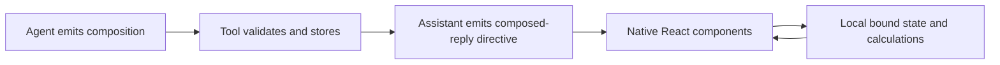

# Composed replies prototype

Native React components in BB assistant messages. OpenUI and json-render compose
new interfaces from the same twenty-nine primitives. The model does not emit executable
JavaScript or select a finished calculator.



## Agent routing

The plugin contributes native-first routing instructions at provider session
construction. The tool description advertises layouts, icons, workflows, diagrams and comparisons.
BB discovers the usage skill under the manifest's `./skills` root.
New sessions receive these instructions; existing sessions retain their
constructed instructions until a provider restart. Disabling the plugin removes
its instruction contribution. Global BB preferences are unchanged.

## Use

Read the exact language contract before generating a response:

```sh
bb composed-replies-prototype contract openui
bb composed-replies-prototype contract json-render
```

Call `composition_reply({format, source, title})` in a fresh agent session.
Include its returned `::composed-reply{id="..."}` directive on its own line.
A tool result alone does not render the interface.

For CLI publication, write that input object to the invoking thread's storage:

```sh
bb composed-replies-prototype publish /absolute/thread-storage/input.json
```

## Components and calculations

`Stack`, `Text`, `NumberInput`, `Slider`, `Select`, `Metric`, `Table` and
`BarChart`, `Grid`, `Stat`, `LineChart` and `StackedBarChart` render directly inside
BB. `Box`, `Row`, `Icon`, `Heading`, `Caption`, `Divider` and `Chip` compose
visual explanations and compact diagrams. Fonts and colours inherit BB theme tokens.
Charts use CSS bars, fixed screen-size labels and explicit units. Bar and stacked charts accept
nonnegative values. Line charts accept signed values. Charts require equal-length
labels and values in each series. Grids adapt to container width. Statistics show
signed changes without labelling increases as good or bad.

OpenUI uses its real parser, renderer and reactive state. `$variables` contain
literal defaults. Derived values use inline arithmetic or ordinary named
expressions, never derived `$variables`. JSON uses json-render's real renderer,
state bindings and registered arithmetic functions. Computations support
`add`, `sub`, `mul`, `div`, `min`, `max`, `ceil` and `floor`.

Both representations share React controls and visual components. The runtime
bounds source size, component count, nesting, arrays and numeric results. It
rejects queries, mutations, unregistered computations and component cycles.
Controls, chart values and table cells validate resolved values. A local error
boundary contains invalid runtime values.

`Checkbox` binds boolean state. `TextInput` binds short text or multiline notes.
`Details` reveals supporting content. `ResetButton` restores all declared defaults
and closes disclosures by remounting the composition.

Interactions stay local. Control values reset on navigation or remount.
`Image` loads its declared HTTPS URL. `RichText` links open declared HTTPS URLs.
URLs reject embedded credentials. No generated actions or arbitrary JavaScript
run in the host.

## Delivery and HTML

The public BB directive slot receives complete directive attributes and a
message reference. This prototype publishes complete documents. It does not
receive ongoing neighbouring model tokens. OpenUI's incremental parser support
is distinct from live BB transport support.

Keep `visual-replies-prototype` installed for custom HTML applications. Its
sandboxed HTML path is independent of this plugin.

## Layout primitives

`Box` groups children with optional borders and muted surfaces. `Row` wraps
horizontal children. `Icon` selects from fifteen fixed symbols. An empty icon
label makes it decorative; a label gives it an accessible name. `Heading` and
`Caption` provide text hierarchy. `Divider` separates sections; `Chip` labels
categories. Spacing uses a four-pixel scale with values from zero to three.
Style properties use named options rather than arbitrary CSS.

`IconLabel` keeps a decorative icon beside wrapping text. Grid boxes stretch
to equal heights in each row and stack in narrow containers.

`Flow(nodes, edges)` represents downward processes with explicit relationships.
It supports splits, joins and edge labels. Straight connectors share branch
lines and use one arrowhead per destination. Captions wrap at eleven pixels;
row spacing grows to fit their height. Node IDs must be unique. Edges must
reference existing nodes and form an acyclic graph. Graphs allow twelve nodes
and eighteen edges. Dense parallel layers scroll inside the diagram. Each edge
also appears in an expandable textual connection list.

## Content primitives

`RichText` supports paragraphs, ordered and unordered lists, bold, emphasis,
inline code and HTTPS links. It treats raw HTML as text and does not implement
full Markdown. `Image` requires alternative text and provides a loading-failure
state. `Steps` exposes ordered pending, current and completed stages. `Progress`
shows a labelled value and maximum, with values bounded from zero to that maximum.

## Prompt cost

Routing instructions and the tool definition contribute about 313 tokens.
The usage skill and full catalogue are read on demand. Estimated text sizes
use `o200k_base`; provider wrappers and skill catalogue metadata are additional.
These counts are prompt estimates, not billing measurements. Ten additions
contribute 404 OpenUI contract tokens or 940 JSON contract tokens. The full
contract is read on demand; after reading it, the conversation retains its tokens.

| Text | Estimated tokens |
| --- | ---: |
| Routing instructions | 180 |
| Tool name, description and parameter schema | 133 |
| Usage skill file | 454 |
| Full OpenUI contract | 1,697 |
| Full json-render contract | 3,179 |

## Verification

```sh
pnpm test
pnpm typecheck
pnpm build
```

The tests verify real control-to-metric-to-chart updates in both libraries,
invalid graph and computation rejection, bounded input and numeric results.
Shared dependencies use the workspace catalogue. `bb plugin types --check`
compares literal manifest values and reports `catalog:` as a version mismatch.
Check `dist/app.meta.json` after building to confirm the resolved SDK version.
