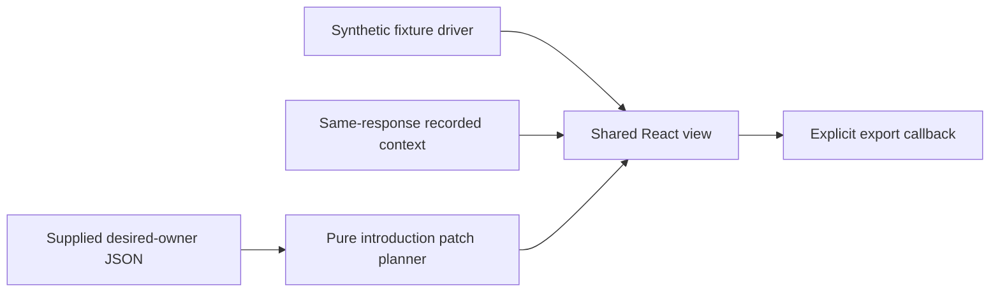

# Context inspector foundation

Internal fixture-driven React view and pure patch planner. Interfaces are private
and changeable. The integration driver owns live reads and host registration.

## Internal integration

- `observation.ts` exports `RecordedContext`, inferred from the installed SDK's
  `threads.context` result, `Target`, `Observation`, `ObservationState`,
  `sameTarget` and `describeObservation`.
- `view.tsx` exports `ContextInspectorView`, `ContextInspectorViewProps` and
  `FixtureContextInspector`. The driver supplies `target`, `state` and `ownerText`.
  Optional props are `synthetic`, `ownerUnavailable`, `savedIntroduction` and
  `onExportPatch`. Mark unavailable owner reads explicitly. Do not substitute
  synthetic owner JSON for a failed read.
- `patch-preview.ts` exports `previewIntroduction(ownerText, introduction)` and
  `PatchPreview`. Successful results contain `desiredJson`, `patch`, `previous`
  and `introduction`. This changes only the desired `bb-guide.introduction`
  value. Other valid scalar settings retain their values. JSON formatting is
  normalised. The complete replacement patch includes exact original lines.
- `fixtures.ts` exports `fixtures`, `fixtureTarget` and `fixtureOwner`. Every
  fixture identity and token value is synthetic.

## Limits

The foundation has no server backend, RPC, CLI, settings writes, retained history,
agent tools, skills or instruction contribution. Its initial manifest has no app
entry. Integration wiring is a separate concern.

The SDK response supplies usage and optional categories. It does not supply file
inclusion evidence. Category labels cannot establish source inclusion. Missing
provider identity remains unknown. The view accepts category detail from the same
response only, withholds known session or count conflicts, and hides responses
whose target differs. Drivers must also discard superseded requests for the same
target. The view does not merge independent snapshots.

The desired owner is global. Current saved values do not establish historical
session state. Preview and export do not reconcile settings or change existing
session content. No token savings are calculated or claimed. The export callback
owns download behaviour and private storage. No automatic writes occur.

## Checks

`test` runs Vitest, including plain React fixture interaction tests and application
of generated patches to temporary synthetic owner files. `typecheck` runs tsc.
No BB instance, credentials or provider session is required.

The package uses workspace catalogue dependencies. `bb plugin new` invokes npm
installation, so this foundation uses a minimal manually authored package.
The existing scaffold conflict is recorded in `../docs/sdk-frictions.md` under
"Plugin scaffold and build traps". Live installation and reload are separate.
