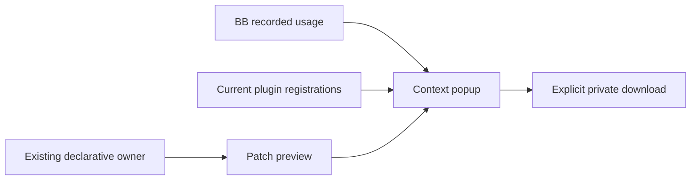

# Context Inspector

Context Inspector shows recorded session usage, current plugin capabilities and
a reviewable future configuration edit. Its interfaces are private and changeable.

Open **Context** beside an existing thread's composer, or choose
**+ → Inspect context**. Refresh reads recorded data. It does not launch provider
diagnostics or send a prompt.

**Overview** leads with usage and available category bars. **Sources** groups
current registrations by plugin and filters by plugin, label or capability ID.
**Configure** shows the supported setting and its patch after an edit.
Session IDs, host and timestamps sit under **Session details**.

## Recorded context

The popup shows reported or estimated usage and available categories. Missing
category detail stays unavailable. Conflicting category counts or known provider
sessions are withheld. A target change discards old responses and draft previews.

Current plugin registrations appear separately. They identify tool and skill
owners, including disabled plugins. They do not establish historical session
inclusion. The list omits descriptions and stops at 200 registrations. External
MCP tools and instruction bodies are outside this inventory.

## Future configuration

The first supported preview changes `bb-guide.introduction` in
[plugin-config.json](../../../.config/bb/plugin-config.json). The popup compares
the desired value with the current saved value. Other valid settings retain their
values. JSON formatting is normalised in the generated patch.

Choose the introduction value and select **Export private patch** to download a
patch for local review. Export does not change files, reconcile settings, stage
changes or remove prior conversation content. The patch contains existing owner
values; keep it private.

The owner reader accepts no caller-supplied path. It reads only the server-local
home's `.config/bb/plugin-config.json`, refuses symlinks and files over 256 KiB,
and requires the selected workspace to use the server's primary host.
Unsupported remote targets show an unavailable preview.

The existing owner reconciler applies all managed drift. Review its complete plan
before applying configuration through the [maintenance procedure](../../../docs/bb.md#plugin-setup).
Saved values do not prove which configuration an existing session received.
Activation depends on BB construction and provider behaviour.

## Installation and checks

The workspace [setup procedure](../README.md#setup) installs this independent
plugin. [plugins.json](../../../.config/bb/plugins.json) owns its enabled state.
The inspector contributes no agent tools, skills or instructions.

Run `pnpm test`, `pnpm typecheck` and `pnpm build` in this package.
Tests cover patch application to temporary files, malformed owner refusal,
conflicting snapshots, unavailable reads, stale targets and SDK registration.

The **Context inspector fixtures** navigation panel uses labelled synthetic
observations. Its plain React view needs no BB hooks, provider or credentials.
It demonstrates rendering and previews, not native Claude or Codex attachment.

## Limits

BB supplies usage and optional categories, not a complete historical construction
manifest. Category labels cannot prove file or plugin inclusion. The inspector
calculates no predicted token savings. It retains no history and writes no
configuration. Native harness inspection and arbitrary contribution toggles are
separate capabilities.
