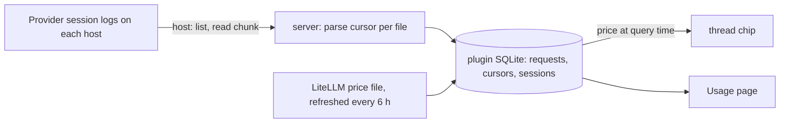

# Cost

Cost estimates what Claude Code, Codex and Pi requests would cost at API list prices.
Subscription plans do not bill these amounts. The figures show usage in API terms.

## Use

- The thread header chip shows the thread's estimate. Hover over it for the split by token type and model.
  Click it to open the Usage page at that thread.
- The **Usage** page in the navigation rail shows the last 7, 30 or 90 days. Pick the period in the page header.
  - A summary: the total, this month against your plans, the daily average, requests and the unpriced share.
  - Daily columns stacked by provider. Hover over or focus a column for its split.
  - **Threads**: each BB thread, and each directory used outside BB, such as a terminal CLI session.
  - **Projects**: BB projects with their threads. Usage outside BB joins the project whose checkout contains its directory.
    The deepest checkout wins. Checkouts two segments deep or shallower, such as a home directory, never match.
  - **Models**: cost by model, with a bar for the split between cache reads, cache writes, input and output.
  - **Insights**: the median, mean and 90th-percentile thread, how concentrated spend is, a histogram of thread costs,
    and a scatter of cost against length. Length is requests, turns or peak context. A table gives the median cost and
    cost per request in each length band, and another compares providers.
  - **Days**: every day's figures as a table.
- The header's **With sub-threads** switch folds each sub-thread into the thread that started it, across every view.
- The thread card plots each request's cost over the thread's life and compares its last tenth of requests with its first.
- `bb cost backfill` reads all history. `bb cost status` shows progress. The [skill](skills/cost/SKILL.md) lists every command.

## How it reads usage

Provider logs are the source, not BB events: each log line names its model, and the logs outlive BB's event retention.

| Provider | Files | One request | Key |
| --- | --- | --- | --- |
| Claude Code | `<config dir>/projects/**/*.jsonl` | `assistant` line with `message.usage` | `message.id` + `requestId` |
| Codex | `$CODEX_HOME/sessions/**`, `archived_sessions/` | `token_usage_record` line; model from the last `turn_context` | `response_id` |
| Pi | `~/.pi/agent/sessions/**` | assistant `message` with `usage` | `responseId` |

- A request seen twice counts once, and its larger copy wins. Claude Code rewrites lines as output streams in.
  Forks and resumes repeat requests under the same keys.
- Codex counts cached and written tokens inside `input_tokens`. The plugin subtracts them.
- Each file keeps a byte cursor. The requests of a chunk and its cursor commit in one transaction, so a scan resumes where it stopped.
- Each session keeps the working directory its log names, so usage outside BB groups by directory.
- Turns are messages that start work. Claude Code turns are user lines with text, not tool results, command echoes or meta lines.
  Codex turns are `task_started` events with no parent turn. Pi turns are user messages.
- Peak context is the largest prompt any request sent: uncached input plus cache reads and writes.
- Sessions map to threads through each thread's `thread/identity` events. Claude Code config directories come from threads' resolved environments and the `claudeConfigDirs` setting.

## Pricing

The plugin stores token counts and prices them when read, so a new price file re-prices history.

- Cache writes split by lifetime. A 1-hour write uses LiteLLM's `_above_1hr` rate, or twice input where that rate is missing.
- A request past a model's long-context threshold uses the long-context rates for all its tokens. The threshold is 200k or 272k tokens.
- Fast mode uses OpenAI's `_priority` rates or Anthropic's `fast` multiplier.
- Models missing from the price file count as unpriced tokens rather than $0.

The price file is downloaded from LiteLLM's GitHub. A file with fewer than 50 usable chat models is rejected, and the last good copy stays in use.
A tampered file can only change the estimates.

## Colours

Each provider has one colour in fixed order: Claude Code, Codex, Pi. BB has no categorical chart palette, so the
plugin defines its own with `light-dark()`, checked with the dataviz palette validator against both surfaces.
Token types use one ink at four strengths, so they never read as providers.

## Settings

| Setting | Use |
| --- | --- |
| `claudeConfigDirs` | Extra Claude Code config directories, one per line. `~` and whole-segment `*` work. |
| `plans` | Subscription prices as `Name = monthly dollars`, one per line, for the plan-value multiple. |

## Limits

- Live updates follow a thread going idle, and a scan runs every 15 minutes. A new host starts from the past day until a backfill.
- Codex `.jsonl.zst` archives are not read.
- Day boundaries follow the BB server's local time zone.
