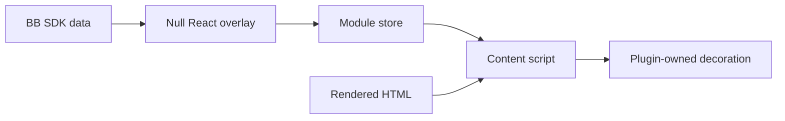

# Decorate stock BB through plugins

Use plugin content scripts for small UI additions when no suitable SDK slot exists.
Keep stock BB installed. Content scripts change rendered HTML, not BB application files.
The ignored `spikes/bb-patched/` core-patch experiment is discarded historical research.
Core patches require explicit user authorisation.

Prefer an SDK slot when it provides the required placement and behaviour.
For DOM decoration, register `app.contentScripts.register({ id, mount })`.
Content scripts cannot call React hooks. For API data, mount a null
`experimental_appOverlay` that uses `useSdk` or `useRpc` and updates a module store.

1. Inspect running BB's markup and verify the installed SDK contract.
2. Scope selectors to the affected surface. Keep native links and event handlers.
3. Observe redraws with `MutationObserver`. Write only when the decoration changes.
4. Remove owned nodes, classes, subscriptions and timers on disposal. Abort pending requests.
5. Test redraws, navigation and disposal. Check the live UI after build and reload.

Treat selectors and internal row-ID formats as version-dependent contracts.
Fail by omitting an unknown decoration. Never invent timestamps or infer them
from when a message first appears in the browser.
Hide native icons with an owned class instead of replacing React-owned nodes.
Remove that class on disposal. Retain explicit editor-target icons.

## Examples

- [Account badges](../claude-profiles/ui/badges/rows.ts) decorate sidebar provider icons.
  Their [bridge](../claude-profiles/ui/badges/bridge.tsx) supplies account data through RPC.
- [External Links](../external-links/README.md) adds browser buttons and distinguishes file-preview icons.
- [Chat Timestamps](../chat-timestamps/README.md) joins recorded times to rendered row IDs through the SDK.

Use the [workspace checks and reload procedure](../README.md) for each plugin.
Record missing extension points in [SDK frictions](sdk-frictions.md).
