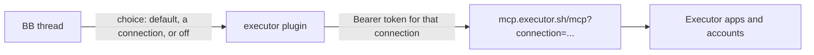
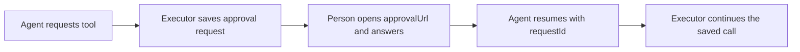

# Executor

Give BB threads the tools from your [Executor](https://executor.sh) scoped
connections. BB signs in once per connection, so Claude threads on any account,
Codex and other providers share the same tools with no MCP config in each agent.
Each thread uses the default connection, another connection, or none.

Executor is the catalogue. Its Connect page defines each scoped connection: the
apps it allows, the account each app runs as, and which tools. This plugin
passes Executor's own MCP tools through with an `executor_` prefix
(`executor_search`, `executor_execute`, ...).

## Use

1. In Executor, open **Connect**, create or pick a scoped connection, and copy
   its MCP URL. Hosted (`mcp.executor.sh`) and self-hosted Executors both
   work: the plugin reads every endpoint from the server's OAuth metadata.
2. In BB, press `⌥E` and paste the URL, or press `a` and fill it in. The name
   is optional. **Add and sign in** selects the connection for the thread or
   draft and starts its sign-in. Open the sign-in page, approve, and the browser
   returns to BB. The first connection becomes the default. Settings → Executor
   has the same form.
3. Before starting a thread, use the composer chip or `⌥E` to choose:
   `d` default, `1`-`9` a connection, `o` off. The choice applies before the
   agent receives tools. Off disables Executor tools only.
4. In a thread, the header chip names its connection. Click it or press `⌥E`
   to switch. Picking a signed-out connection starts its sign-in.

New drafts start with the configured default. Sending successfully or leaving
the composer resets its choice; a failed send keeps it. Enter, Cmd/Ctrl+Enter
and the normal send button carry the choice with the submission. The server
saves it at the dispatch checkpoint before starting the agent. Existing threads
keep their saved choices.
Other plugins that submit the draft directly do not carry this choice.

Settings → Executor also signs a connection out, makes it the default, or
removes it (press **Remove** twice). **Use a code** signs in with a device code
instead, for a browser that cannot reach BB, such as BB on another machine.
Rebind `⌥E` in Settings → Keyboard.

## Model



- **Connection**: a name and the MCP URL from Executor's Connect page. The
  plugin keeps its `connection` and optional `elicitation_mode=browser`
  parameters, which Executor binds the sign-in to.
- **Sign-in**: OAuth authorization code with PKCE (S256). The browser returns
  to BB's own loopback route, `/api/v1/plugins/executor/http/oauth/callback`,
  which accepts a navigation with no `Origin` and checks a single-use `state`
  and, per RFC 9207, the issuer. **Use a code** runs the device grant instead.
  A gateway in front of an endpoint shows as a redirect, and the plugin names
  it: a self-hosted Executor behind an access proxy may keep
  `device-authorization` behind sign-in, which leaves only the browser flow.
  Executor API keys are not used: they ignore connection limits.
- **Thread choice**: kept in plugin storage. This selector is a routing preference,
  not a security boundary. An agent with BB CLI or RPC access can change it.
  Connections with the same approval mode share tool schemas. Model and browser
  modes use separate tool names, schemas and instructions. Turning a thread off
  also removes the tools from its next session.

## Behaviour

- Tokens live in one secret setting, `vault` (a 0600 file BB never sends to a
  browser). Refresh tokens rotate, and each new one is saved before any other
  refresh. Access tokens refresh a minute before they expire.
- A 401 means Executor ran nothing, so the plugin refreshes and retries once.
  Any other failure is never retried, because a retry could repeat side
  effects. Calls time out after 330 s, above Executor's 5-minute program limit.
- Tool schemas and instructions are cached separately for model and browser
  approval modes. The plugin reloads when either changes, including changes
  that keep the same tool names. Loading never waits on the network.
- MCP `2026-07-28` (stateless) through `@modelcontextprotocol/client`, with
  fallback to older revisions. Each result's JSON goes to the agent once.

## Approvals

Approval delivery is optional per connection. Existing URLs use Executor's
model mode. The agent presents an approval request and submits your answer
with `executor_resume`.

For browser delivery:

1. Copy the scoped connection URL from Executor's Connect page.
2. Append `&elicitation_mode=browser` when the URL already has a query, or
   `?elicitation_mode=browser` for a plain `/mcp` URL.
3. Add it as a separate connection in Settings → Executor and sign in.
   Executor fixes approval mode in the new OAuth grant. Editing an issued
   grant's URL does not change its mode.
4. Select the browser connection. If a tool requests approval or input, open
   its `approvalUrl`, sign in to Executor and answer there. Desktop and phone
   use the same web flow, subject to the deployment's sign-in requirements.

Browser connections expose `executor_browser_*` tools. Their resume tool takes
only `requestId` and collects the answer saved in the browser. Model connections
keep `executor_*` tools and their existing schemas. A tool from the wrong mode
fails before reaching Executor. Start a new turn after changing approval modes
so the agent receives the matching tools and instructions.



Browser mode changes where approval appears. App tool policies determine which
actions request approval. It does not require approval for every write or stop
connection switching. An agent that can operate the signed-in browser may also
submit approval. BB does not show its own approval form. Native elicitation mode
is unsupported.

## Checks

```zsh
pnpm test        # core: fake Executor with OAuth and MCP over the real SDK; ui: BB slot harness
pnpm typecheck
pnpm build
```
