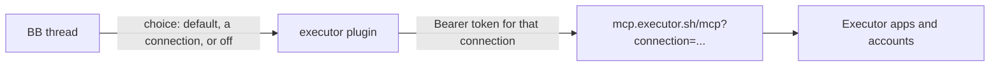

# Executor

Give BB threads the tools from your [Executor](https://executor.sh) scoped
connections. BB signs in once per connection, so Claude threads on any account,
Codex and other providers share the same tools with no MCP config in each agent.
Each thread uses the default connection, another connection, or none.

Executor is the catalogue. Its Connect page defines each scoped connection: the
apps it allows, the account each app runs as, and which tools. This plugin
passes Executor's own MCP tools through with an `executor_` prefix
(`executor_search`, `executor_execute`, ...).

## Use

1. In Executor, open **Connect**, create or pick a scoped connection, and copy
   its MCP URL. Hosted (`mcp.executor.sh`) and self-hosted Executors both
   work: the plugin reads every endpoint from the server's OAuth metadata.
2. In BB, open **Settings → Executor**, add it with a name, and press
   **Add and sign in**. Open the sign-in page, approve, and the browser returns
   to BB. The first connection becomes the default.
3. Before starting a thread, use the composer chip or `⌥E` to choose:
   `d` default, `1`-`9` a connection, `o` off. The choice applies before the
   agent receives tools. Off disables Executor tools only.
4. In a thread, the header chip names its connection. Click it or press `⌥E`
   to switch. Picking a signed-out connection starts its sign-in.

New drafts start with the configured default. Sending successfully or leaving
the composer resets its choice; a failed send keeps it. Enter, Cmd/Ctrl+Enter
and the normal send button carry the choice with the submission. The server
saves it at the dispatch checkpoint before starting the agent. Existing threads
keep their saved choices.
Other plugins that submit the draft directly do not carry this choice.

Settings → Executor also signs a connection out, makes it the default, or
removes it (press **Remove** twice). **Use a code** signs in with a device code
instead, for a browser that cannot reach BB, such as BB on another machine.
Rebind `⌥E` in Settings → Keyboard.

## Model



- **Connection**: a name and the MCP URL from Executor's Connect page. The
  plugin keeps only its `connection` parameter, which is what Executor binds a
  sign-in to.
- **Sign-in**: OAuth authorization code with PKCE (S256). The browser returns
  to BB's own loopback route, `/api/v1/plugins/executor/http/oauth/callback`,
  which accepts a navigation with no `Origin` and checks a single-use `state`
  and, per RFC 9207, the issuer. **Use a code** runs the device grant instead.
  A gateway in front of an endpoint shows as a redirect, and the plugin names
  it: a self-hosted Executor behind an access proxy may keep
  `device-authorization` behind sign-in, which leaves only the browser flow.
  Executor API keys are not used: they ignore connection limits.
- **Thread choice**: kept in plugin storage, not thread metadata, so an agent
  cannot move its own thread to a broader connection. All connections expose
  the same tools, so a change applies on the thread's next call with no restart.
  Turning a thread off also removes the tools from its next session.

## Behaviour

- Tokens live in one secret setting, `vault` (a 0600 file BB never sends to a
  browser). Refresh tokens rotate, and each new one is saved before any other
  refresh. Access tokens refresh a minute before they expire.
- A 401 means Executor ran nothing, so the plugin refreshes and retries once.
  Any other failure is never retried, because a retry could repeat side
  effects. Calls time out after 330 s, above Executor's 5-minute program limit.
- The tool list is cached. The plugin reloads itself once when it first learns
  the list or the list changes; it never waits on the network while loading.
- MCP `2026-07-28` (stateless) through `@modelcontextprotocol/client`, with
  fallback to older revisions. Each result's JSON goes to the agent once.

## Approvals

Executor asks before tools its apps mark as needing approval. The result has
`status: "approval-required"`, and the agent must ask you before it calls
`executor_resume`. BB does not yet show its own approval form.

## Checks

```zsh
pnpm test        # core: fake Executor with OAuth and MCP over the real SDK; ui: BB slot harness
pnpm typecheck
pnpm build
```
