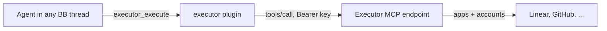

# Executor

Give every BB thread your [Executor](https://executor.sh) tools through one
connection. BB holds the API key once. Claude threads on any account, Codex and
other providers all get the same tools, with no MCP config in each agent.

Executor is the catalogue: add apps and accounts in its dashboard. This plugin
only passes Executor's own MCP tools through, prefixed `executor_`
(`executor_search`, `executor_describe`, `executor_execute`, ...).

## Set up

1. In Executor, create an API key limited to your organization.
2. Store it in BB. Paste it into the prompt, not the command line, so it stays
   out of shell history:

   ```zsh
   read -rs "key?Executor API key: " && bb plugin config executor set token "$key"; unset key
   ```

3. With a full-account key, also set the organization's endpoint:
   `bb plugin config executor set url https://mcp.executor.sh/org/<org>/mcp`.
4. `bb plugin list` shows `executor` as `running` once Executor accepts the key.
   Until then it shows `needs-configuration` with the reason, and retries.

New threads get the tools. A running thread keeps the tools it started with.

## Design



- MCP `2026-07-28` (stateless) through `@modelcontextprotocol/client`, with
  fallback to older revisions.
- The tool list is read once per plugin load. Run `bb plugin reload executor`
  after Executor changes its tool set or after changing settings.
- Calls time out after 330 s, above Executor's 5-minute program limit. A call is
  never retried once it reaches Executor, because a retry could repeat side
  effects. The one retry is an expired legacy session (HTTP 404), where nothing
  ran.
- Executor returns each result twice, as JSON and as its text. The agent gets
  the JSON once.

## Approvals

Executor asks before tools its apps mark as needing approval. The result has
`status: "approval-required"`, and the agent must ask you before it calls
`executor_resume`. The agent relays that request; BB does not yet show its own
approval form.

## Checks

```zsh
pnpm test        # in-process fake Executor over the real MCP SDK
pnpm typecheck
pnpm build
```
