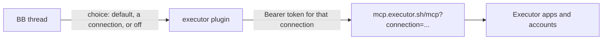

# Executor

Give BB threads the tools from your [Executor](https://executor.sh) scoped
connections. BB signs in once per connection, so Claude threads on any account,
Codex and other providers share the same tools with no MCP config in each agent.
Each thread uses the default connection, another connection, or none.

Executor is the catalogue. Its Connect page defines each scoped connection: the
apps it allows, the account each app runs as, and which tools. This plugin
passes Executor's own MCP tools through with an `executor_` prefix
(`executor_search`, `executor_execute`, ...).

## Model



- **Connection**: a name and the MCP URL from Executor's Connect page. The
  plugin keeps only its `connection` parameter, which is what Executor binds a
  sign-in to.
- **Sign-in**: OAuth device authorization. You approve a code at
  `app.executor.sh/device`; no callback reaches BB, so it works when BB runs on
  another machine. Executor API keys are not used: they ignore connection limits.
- **Thread choice**: kept in plugin storage, not thread metadata, so an agent
  cannot move its own thread to a broader connection. All connections expose
  the same tools, so a change applies on the thread's next call with no restart.
  Turning a thread off also removes the tools from its next session.

## Behaviour

- Tokens live in one secret setting, `vault` (a 0600 file BB never sends to a
  browser). Refresh tokens rotate, and each new one is saved before any other
  refresh. Access tokens refresh a minute before they expire.
- A 401 means Executor ran nothing, so the plugin refreshes and retries once.
  Any other failure is never retried, because a retry could repeat side
  effects. Calls time out after 330 s, above Executor's 5-minute program limit.
- The tool list is cached. The plugin reloads itself once when it first learns
  the list or the list changes; it never waits on the network while loading.
- MCP `2026-07-28` (stateless) through `@modelcontextprotocol/client`, with
  fallback to older revisions. Each result's JSON goes to the agent once.

## Approvals

Executor asks before tools its apps mark as needing approval. The result has
`status: "approval-required"`, and the agent must ask you before it calls
`executor_resume`. BB does not yet show its own approval form.

## Checks

```zsh
pnpm test        # in-process fake Executor: OAuth device flow plus MCP over the real SDK
pnpm typecheck
pnpm build
```
