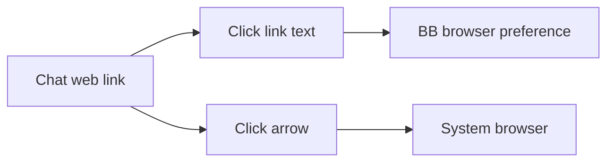

# External Links

Chat web links have a separate arrow button that opens the system browser.
Ordinary link clicks follow BB's existing browser preference. File and relative
app links retain their own actions.

The plugin uses BB content scripts to decorate timeline Markdown anchors.
It observes streamed content and URL changes, and removes its buttons on disable.
The selectors depend on BB's DOM markers and may need updating after BB changes.
On desktop, BB's window-open handler sends the arrow action to the system browser.
On web clients, the action opens a separate browser tab.

Build, test, install and reload through the [workspace guide](../README.md).
