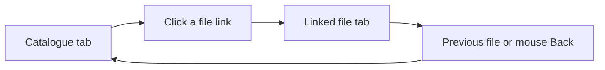

# File History

Previous file and Next file buttons appear beside the thread file-preview path.
Mouse Back and Forward navigate visited file tabs when the pointer is over that
panel. At either end, mouse navigation stays in the panel. Outside the file
panel, BB retains its normal navigation.

History starts when the plugin loads. It follows file-tab visits, drops closed
tabs and clears when the app route changes or the plugin reloads. It selects
existing native tabs, which retain BB's own file scroll state. Visiting another
file after going back drops forward history. Duplicate filenames remain distinct.

The plugin uses a content script because the SDK exposes no native file-history
controller or header slot. It depends on the thread panel's DOM markers, active
tab buttons, file icon and preview header. Unknown markup omits the controls.
The script removes its controls and listeners on disable.

Mouse navigation requires standard browser Back and Forward button events.
Mouse software that sends keyboard shortcuts uses BB's existing shortcut handling.
Events inside embedded HTML documents do not reach the outer panel.

Build, test, install and reload through the [workspace guide](../README.md).
