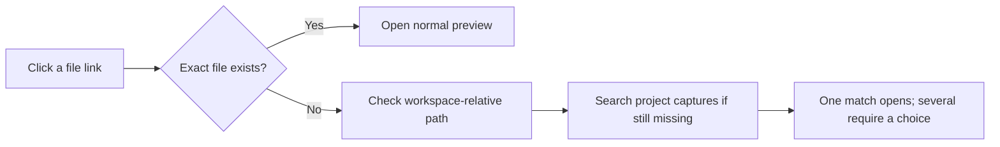

# File Links

Missing file links in Markdown previews resolve against the workspace and the
project's thread captures. The Markdown file and its images stay in place.

## Behaviour

- Existing absolute and document-relative destinations take precedence.
- A missing leading-slash path is also checked relative to the workspace.
- Capture searches preserve the reference's folder suffix. They cover active,
  visible threads in the current project on the same host.
- Duplicate matches open a keyboard-accessible chooser. Escape cancels and
  returns focus to the original link.
- Cancel stops a pending lookup. Changing documents or disabling the plugin
  aborts it. Failed or incomplete searches open nothing.
- Web links, editor links, downloads, modifier clicks and unsupported anchors
  retain BB's handling. Line-number fragments retain their requested range.

Existence checks use a host-side file stat. They do not walk folders or read
file contents. Permission and connection failures stop the lookup.

The plugin wraps BB's normal Markdown preview through `fileOpener` and `Original`.
If a Markdown extension is pinned to a different opener, right-click its file
link and choose **Open with > File Links**, or select File Links under
**Settings > File openers**.

## Scope

The preview needs a project environment. Capture lookup uses the nearest
registered workspace containing the document on the same host. A document in
another project therefore searches its own project's captures. Conflicting
project registrations for the same workspace stop the lookup. Chat links and documents opened directly from thread storage
use BB's existing behaviour. Archived and hidden threads are excluded.

Searches stop with an incomplete-search message when a listing is truncated or
the project reaches 1,000 threads. They do not select a match from partial results.
Searches run on demand without a persistent index or stored link associations.

Discovered captures open through SDK host-file targets. BB declines a
thread-storage preview target owned by a different thread. Remote-host behaviour
requires separate verification; the local-host flow is verified.

## Development

Use the workspace's [build, installation and reload procedure](../README.md).
Run `pnpm test`, `pnpm typecheck` and `pnpm build` in this directory.
