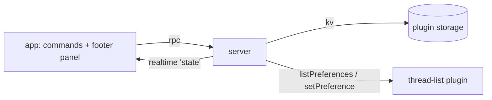

# Focus

A focus view for the BB sidebar. It shows only the projects you pick and moves
the rest into **More**. Turning the view off puts the sidebar back as it was.

## Use

| Action | How |
| --- | --- |
| Turn the view on or off | `⌘⇧F`, `Turn on`/`Turn off` in the footer panel, or the palette: "Focus: turn the focus view on or off" |
| Add or remove projects | Footer eye button, then tick projects. Ticking with the view off turns it on |
| Always show a project in every view | `pin` on its row in the footer panel, or the palette: "Focus: always show this project (toggle)" |
| Add the current project | Palette: "Focus: add this project to the focus view" |

Ticked projects stay ticked while the view is off, so turning it back on
restores the same view. With nothing ticked, `⌘⇧F` ticks the current project.
Rebind `⌘⇧F` in Settings → Keyboard.

A view also moves threads outside any project into More. Pinned threads stay
visible, because the thread list cannot hide the Pinned group.

## Design

- The built-in `thread-list` plugin owns the sidebar layout. Focus writes its
  `hiddenGroups` preference; hidden groups render inside More.
- Turning a view on records the current `hiddenGroups`. Turning it off writes them back,
  so groups hidden before the view stay hidden after it. Sections hidden before
  the view stay hidden during it.
- Picked and always-shown projects live in plugin storage in `bb.db` on this
  machine, so client project names never enter the dotfiles.
- The pure state lives in [src/focus.ts](src/focus.ts). The server re-reads the
  project list on every change, so a project created during a view is hidden on
  the next change.

## Verification

Run `pnpm test`, `pnpm typecheck` and `pnpm build` in this directory. After
`bb plugin reload focus`, start and end a view and compare
`bb thread-list prefs get hiddenGroups` before and after.
