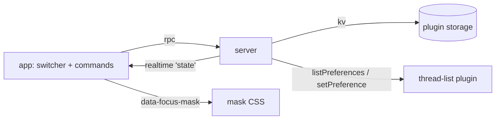

# Focus

A focus view for the BB sidebar. It shows only the projects you pick and moves
the rest into **More**. Turning the view off puts the sidebar back as it was.

## Use

| Action | How |
| --- | --- |
| Open the switcher | `⌘⇧F`, the footer eye button, or the palette: "Focus: switch set" |
| Choose a set | Press its number, or use the arrows and Enter. `0` turns Focus off |
| Swap between Off and your last set | Press `⌘⇧F` twice |
| Edit a set | Highlight it and press `e`, or click Edit. Esc returns to the list |
| Create a set | Choose New set |
| Add the current project to the running set | Palette: "Focus: add this project to the running set" |

Focus starts with an empty **Demo** set. Rebind `⌘⇧F` in Settings → Keyboard.

**Hide More and Pinned** is a per-set mask. It removes the More trigger and the
Pinned group with CSS. It does not cover thread search or `@` mentions, whose
rows expose no stable hook, so those still show real names.

A set also moves threads outside any project into More.

## Design

- The built-in `thread-list` plugin owns the sidebar layout. Focus writes its
  `hiddenGroups` preference; hidden groups render inside More.
- Turning a set on records the current `hiddenGroups`. Switching sets keeps that
  record, and turning Focus off writes it back, so groups hidden before the view
  stay hidden after it. Sections hidden before the view stay hidden during it.
- Sets live in plugin storage in `bb.db` on this machine, so client project names
  never enter the dotfiles.
- The switcher omits `aria-modal`. BB's `modalOpen` context would otherwise block
  the second `⌘⇧F`.
- The pure state lives in [src/focus.ts](src/focus.ts) and the list's keys in
  [src/keys.ts](src/keys.ts). The server re-reads the project list on every
  change, so a project created during a view is hidden on the next change.

## Verification

Run `pnpm test`, `pnpm typecheck` and `pnpm build` in this directory. After
`bb plugin reload focus`, turn a set on and off and compare
`bb thread-list prefs get hiddenGroups` before and after.
