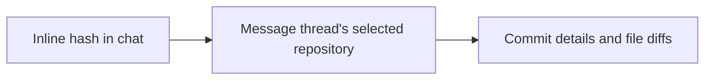
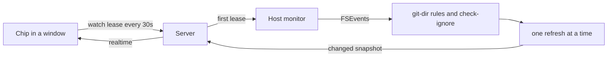
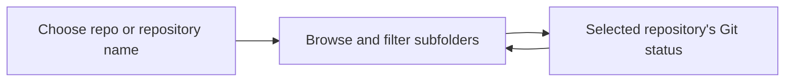
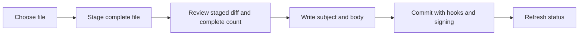
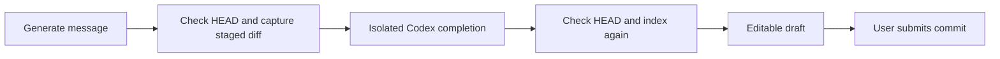

# Git Glance

A header chip shows the thread checkout's branch, ahead/behind counts and the
number of changed files. Click it or press `Alt+G` to open a pop-up with:

- pull, push and fetch, with git's own progress and a hint when one fails
- a branch switcher on the branch name: filter, then switch, or track a remote branch
- stashes, each openable for its files, with apply, pop and hold-to-drop
- whole-file stage and unstage controls, with a staged-only commit composer
- discard for unstaged edits and untracked paths, held, clicked twice or pressed twice
- branch, upstream, stash count and any merge or rebase in progress
- conflicted, staged, unstaged and untracked files with line counts
- an inline diff for each file, in BB's diff viewer
- the last 30 commits with a lane graph; filled nodes are not on any remote.
  Click a commit for its message, author and changed files, each with a diff.
- diffs use BB's own viewer, which is built on Pierre diffs

On the New thread screen, `Alt+G` opens the pop-up for the picked project's
default checkout. That screen shows no chip.

Keys in the pop-up: `↑`/`↓` or `j`/`k` move, `↵` opens a diff, `p` pulls,
`⇧P` pushes, `f` fetches, `b` switches branch, `R` resynchronises, `l` opens
lazygit, and `q` or `esc` closes. On a file row `d` arms discard and a second `d` confirms; on a
file row `Space` stages or unstages the complete file; on a
stash row `a` applies and `g` pops.

`+` expands to a large two-pane view, `_` restores the pop-up, and the size is remembered. The lists sit
on the left; the selected file's side-by-side diff, or a stash or commit with
its files, fills the right, and the selection follows the arrow keys. Rebind `Alt+G`
in Settings → Keyboard. For anything else, press `l` to open lazygit through its
own plugin.

## Commit hashes in chat

Click a hash shown as inline code to open its message, author, files and diffs.
Enter and Space work too. Git Glance uses the message thread's selected repository,
including the dotfiles fallback. Opening a hash does not fetch or switch branches.

- Candidates contain 7-64 hexadecimal characters and at least one letter.
- Commands, code blocks, existing links and ordinary text retain their normal behaviour.
- Commits outside the recent history list open if they exist in the local repository.
- Missing or ambiguous hashes show Git's error. Use a longer hash or open **Git status**
  to choose another repository, then click the hash again.
- Repository selection persists per thread. Hash clicks do not infer repositories from nearby paths.

The inline-code decoration uses BB's content-script API. It depends on BB's rendered
timeline markup and removes its attributes and listeners when the plugin unloads.

## Live updates

- A window leases each thread it shows. The server keeps one host watch per
  checkout while any lease lives; unrenewed leases expire after 75 seconds.
- The host watches the git dir, the common dir for linked worktrees, and the
  work tree minus its ignored top-level entries. In the git dir, lock files,
  objects and logs never trigger a refresh. In the work tree,
  `git check-ignore` drops ignored paths.
- Refreshes run one at a time; changes during a run queue one more. A snapshot
  is sent only when it differs from the last one.
- Reads run with `GIT_OPTIONAL_LOCKS=0` and `diff.autoRefreshIndex=false`, so
  they never write the index. A refresh therefore cannot trigger the watcher
  again or block an agent's commit.
- After a realtime reconnect or window focus, the app renews its leases, which
  returns a fresh snapshot.

## Pull, push and fetch

- Pull is `git pull --ff-only`. Diverged branches disable it: rebase or merge in
  lazygit instead.
- Push publishes a branch with no upstream to `origin`, or to the only remote.
- Opening the pop-up fetches, unless a fetch or other operation ran in the last
  two minutes.
- Counts use cached remote data. The pop-up shows when Git Glance last fetched
  successfully in this server session. Before that, it shows **Remote not checked**.
- Failed automatic and manual fetches warn in the header and beside the sync
  controls, with **Retry fetch** and error details. The warning survives local
  operations and clears after a successful fetch.
- **Watching files** describes local file and ref updates, separately from remote checks.
- One operation runs per checkout. Click the running button to cancel it.
- Git never prompts. Credential helpers and a running ssh-agent work; anything
  that needs a prompt fails with a hint to authenticate in a terminal.

## Destructive actions

Every mutating action is one typed operation: one runs per checkout at a time,
with progress, a result line and cancel.

- Discard saves unstaged edits as a git blob first, named in the result, so
  `git cat-file -p <blob>` recovers them. Untracked paths move to the Trash.
- Discard checks the file's live status first; a stale row discards nothing.
- Stash actions name the stash by sha and look up `stash@{n}` when they run, so
  a stash pushed or dropped meanwhile can never redirect a drop.

## Repository discovery

When the checkout has no repository, the header chip offers **Choose repo**.
**Choose repository** opens a folder browser rooted at the thread checkout.
The repository name in Git status opens the same browser.

- Search filters the current folder's immediate subfolders.
- Git rows select a repository. Their arrow browses inside it.
- Ordinary folders open for deeper browsing. Breadcrumbs return to an ancestor.
- **Use this repository** selects the displayed folder's repository.
- **Use thread checkout** restores the thread's default repository.
- Selection is saved per thread and checkout. It changes Git Glance's reads,
  watches and actions; the thread's working directory stays the same.
- The selected path appears above the branch. Selection waits for running Git
  operations to finish. Stale actions fail instead of targeting another repo.
- Browsing stays inside the checkout and omits symlink directories and `.git`.
- The `l` shortcut opens lazygit only for the thread's default repository.

The home-directory checkout has no enclosing repository, so the plugin falls
back to the bare dotfiles repository at `~/git/dotfiles`, as `lgdf` does.

Run `pnpm test`, `pnpm typecheck`, and `pnpm build` from this directory.

## Staging and commits

Use **Stage** or **Unstage** beside a file or in the expanded detail pane.
The `Space` key applies the same action on a focused file row. Staging uses the
complete working file, including edits outside any existing staged version.
Unstaging preserves working files. Renames restore both index paths.
Unborn repositories support staging, unstaging and their first commit.
Untracked files appear individually. Directory, conflict and submodule index
actions are refused. Ignored files are never force-added.

`c` or **Commit staged changes** opens an inline message field. Its first line must
contain a subject; further lines provide the body. The review shows the complete
staged-file count, including files outside the 400-row display limit.
The commit includes the complete index, including changes staged elsewhere.
It never stages files automatically or includes unstaged edits.

- Enter submits. Shift+Enter inserts a newline. Primary modifier plus Enter also submits. Escape closes
  the form and retains the draft.
- Drafts persist in this browser's local storage, scoped by host and resolved
  worktree Git directory. Closing, failure and cancellation retain them.
  Confirmed success clears the submitted draft.
- Empty indexes, conflicts and active repository operations prevent commits.
  Continue merge or rebase operations and answer signing prompts in a terminal.
- HEAD and index content must match the review before execution. Use
  **Review index again** after external changes. External writers can still race
  the preflight check; Git's native locks remain authoritative.
- Normal Git hooks, clean filters and signing run. Commit hooks have a ten-minute
  timeout. Failure output remains visible. No retries or hook bypass occur.
- Cancellation reconciles HEAD before reporting failure. If HEAD changes, review
  history before retrying because the commit may have completed.
- Host operations serialise by resolved Git directory, including root aliases.
  Linked worktrees retain separate indexes. Background reads never refresh index
  stat entries; dotfiles clean-only churn is excluded through filtered diffs.
- Bulk and hunk actions are unavailable. The display cap cannot define complete
  bulk scope, and the SDK diff viewer provides no staging-selection callback.

## AI message drafts

**Generate message** explicitly sends the complete staged diff and file summary to installed Codex.
The button replaces the message only after successful generation. Edit it before submitting the commit.
Generation never stages files or commits. Failure, cancellation and stale responses preserve the draft.
Edits, close and repository changes cancel generation. Duplicate clicks cannot start another request.

Settings → Installed plugins → Git Glance exposes:

- `messageModel` defaults to `gpt-6-luna`. Model availability depends on the host's Codex account.
- `codexExecutable` defaults to `codex` on the host's PATH. Set an absolute executable path when needed.
  This value names one executable; it accepts no shell arguments.

Codex must already be installed and signed in on the repository's host.
The plugin uses Codex authentication without reading credential files itself.
It passes prompts through stdin and arguments directly, without a shell.
The process runs outside the repository in `/tmp`, with `--ephemeral`, `--ignore-user-config`,
`--ignore-rules`, `--strict-config`, `--skip-git-repo-check` and `--sandbox read-only`.
It disables instruction discovery, user hooks, configured MCP servers, plugins, apps, shell execution,
agents, skill search, image tools and web search through verified CLI configuration.
The read-only sandbox remains active. No bypass flags are used.

- Generation refuses staged patches above 64 KiB or summaries above 16 KiB. It never sends a partial patch.
- Git reads have ten-second limits. Codex has a sixty-second limit and a 256 KiB combined output cap.
  Cancellation terminates its process group, then kills remaining processes after 500 milliseconds.
- HEAD and index fingerprints must match the review before capture, before completion and after completion.
  External writers can still race these checks; a changed fingerprint discards the response.
- Binary content is omitted by Git's textual patch. Binary file paths and summary remain visible to the model.
- Codex errors show a retry hint. Authentication and model access must be fixed through Codex itself.
- CLI flags and configuration were verified with Codex 0.163.0.
  Unsupported CLI configuration fails rather than enabling user configuration.

`gpt-6-luna` passed a synthetic completion smoke test. This does not establish globally lowest pricing.
CLI behaviour follows [OpenAI's non-interactive documentation](https://learn.chatgpt.com/docs/non-interactive-mode).
