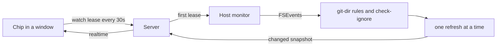

# Git Glance

A header chip shows the thread checkout's branch, ahead/behind counts and the
number of changed files. Click it or press `Alt+G` to open a pop-up with:

- pull, push and fetch, with git's own progress and a hint when one fails
- a branch switcher on the branch name: filter, then switch, or track a remote branch
- stashes, each openable for its files, with apply, pop and hold-to-drop
- discard for unstaged edits and untracked paths, held or pressed twice
- branch, upstream, stash count and any merge or rebase in progress
- conflicted, staged, unstaged and untracked files with line counts
- an inline diff for each file, in BB's diff viewer
- the last 30 commits with a lane graph; filled nodes are not on any remote.
  Click a commit for its message, author and changed files, each with a diff.
- diffs use BB's own viewer, which is built on Pierre diffs

Keys in the pop-up: `↑`/`↓` or `j`/`k` move, `↵` opens a diff, `p` pulls,
`⇧P` pushes, `f` fetches, `b` switches branch, `R` resynchronises, and `q` or
`esc` closes. On a file row `x` arms discard and a second `x` confirms; on a
stash row `a` applies and `g` pops.

`z` expands to a large two-pane view, and the size is remembered. The lists sit
on the left; the selected file's side-by-side diff, or a stash or commit with
its files, fills the right, and the selection follows the arrow keys. Rebind `Alt+G`
in Settings → Keyboard. For anything else, open lazygit with its own plugin.

## Live updates

- A window leases each thread it shows. The server keeps one host watch per
  checkout while any lease lives; unrenewed leases expire after 75 seconds.
- The host watches the git dir, the common dir for linked worktrees, and the
  work tree minus its ignored top-level entries. In the git dir, lock files,
  objects and logs never trigger a refresh. In the work tree,
  `git check-ignore` drops ignored paths.
- Refreshes run one at a time; changes during a run queue one more. A snapshot
  is sent only when it differs from the last one.
- Status runs with `GIT_OPTIONAL_LOCKS=0`, so it never writes the index. A
  refresh therefore cannot trigger the watcher again or block an agent's commit.
- After a realtime reconnect or window focus, the app renews its leases, which
  returns a fresh snapshot.

## Pull, push and fetch

- Pull is `git pull --ff-only`. Diverged branches disable it: rebase or merge in
  lazygit instead.
- Push publishes a branch with no upstream to `origin`, or to the only remote.
- Opening the pop-up fetches, unless a fetch or other operation ran in the last
  two minutes.
- One operation runs per checkout. Click the running button to cancel it.
- Git never prompts. Credential helpers and a running ssh-agent work; anything
  that needs a prompt fails with a hint to authenticate in a terminal.

## Destructive actions

Every mutating action is one typed operation: one runs per checkout at a time,
with progress, a result line and cancel.

- Discard saves unstaged edits as a git blob first, named in the result, so
  `git cat-file -p <blob>` recovers them. Untracked paths move to the Trash.
- Discard checks the file's live status first; a stale row discards nothing.
- Stash actions name the stash by sha and look up `stash@{n}` when they run, so
  a stash pushed or dropped meanwhile can never redirect a drop.

## Repository discovery

The home-directory checkout has no enclosing repository, so the plugin falls
back to the bare dotfiles repository at `~/git/dotfiles`, as `lgdf` does.

Run `pnpm test`, `pnpm typecheck`, and `pnpm build` from this directory.
