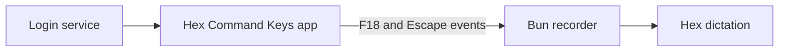
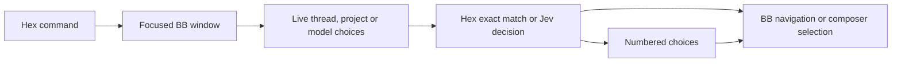

# Handsfree

Hex voice commands control the focused BB window. A Voice header control shows brief
results and retains failures. Clicking opens activity, command help and numbered matches.
New drafts provide the same control beside the composer actions.

## Command pedal

The left pedal sends F18. Focus BB, hold the pedal, speak a command, then release.
The Voice header shows recording feedback and the recognised text. Thread, project
and model searches select a single match directly. Multiple matches offer choices
in BB. Select with a click, Enter or "choose two".
Other commands use the same BB actions as always-listening Hex commands.
The centre pedal remains Right Option for dictation; the right pedal remains Enter.

The recorder uses Hex's selected microphone and local dictation model. Hex must
be running. Hex suppresses its command recogniser during programmatic recording;
always-listening commands resume afterwards. Changing apps cancels recording.
Changing the BB thread or project rejects the recorded command. Recordings cancel
after sixty seconds. Escape cancels a held recording.

Install or rebuild from this directory with `pnpm pedal:install`. The installer
builds `~/Applications/Hex Command Keys.app` and installs the login service
`local.bb.command-pedal`. Enable that app in macOS Input Monitoring. Keyboard
navigation and popup dismissal also require System Events Accessibility permission.

The login service launches the signed keyboard app, which starts the Bun recorder.
The app sends F18 and Escape events through a pipe to the recorder. Input Monitoring
belongs to Hex Command Keys. Keep Bun disabled in Input Monitoring. Rebuilding the
ad-hoc signed app changes its identity; remove and add the app again if macOS
rejects its saved permission.



- `pnpm pedal:status` shows launchd state.
- `pnpm pedal:restart` restarts the recorder after permission or source changes.
- `pnpm pedal:stop` stops it for this login session. Run `pnpm pedal:install` to enable it again.

The login service runs independently of agent sessions and restarts after failure.
Reinstall after changing the Bun runtime path. Its logs are
`~/.local/state/hex/pedal.log` and `pedal-error.log`. Shared command outcomes use
`voice.jsonl`. Logs contain recognised speech. The temporary browser helper is
not required.

## Use

1. Enable Commands in Hex. Release the Right Alt dictation pedal before speaking a command.
2. Say `open BB`, then `voice help`.
3. Say a command from the card. Hold Right Alt to dictate task text.
4. Release Right Alt, wait for the text, then press the Enter pedal to send.

| Say | Action |
| --- | --- |
| `go to the login thread` | Match a thread by title and project |
| `next thread` / `previous thread` | Use BB's configured navigation shortcuts |
| `next unread` | Open the oldest unread stopped thread, including text questions and errors |
| `show threads` | Show up to nine recently updated threads as numbered choices |
| `show git` / `show usage` | Open Git status for the selected thread or usage for all agent accounts |
| `close popup` / `close pop up` / `close voice monitor` | Close voice controls and send Escape to dismiss the top popup |
| `who needs me` / `next waiting` | Show threads with pending questions or approvals |
| `next finished` | Show unread successful results |
| `new thread` | Open a draft in the selected project |
| `show projects` / `list projects` | Show numbered projects for a new draft |
| `select project kb` / `switch project to kb` | Open a draft in that project |
| `new thread in dotfiles` | Match a project and open its draft |
| `use Sonnet` | Match a model offered by the selected agent |
| `choose two` | Select a numbered voice match or native question answer |
| `voice help` | Open the monitor command list |
| `voice monitor` / `voice history` / `show voice` | Open recognition, dictation and BB activity |
| `archive this thread` / `archive thread` | Archive the selected thread |
| `confirm archive` / `cancel archive` | Answer an archive confirmation |
| `unarchive last thread` / `restore last thread` | Restore the most recent voice archive |

"Choose" uses BB's active choice panel. A focused voice picker owns its choices.
Otherwise the focused pane's native question panel receives the option number.
Returning to the composer makes old voice choices inactive. Selecting an answer
keeps the question open; submit it separately. Missing options do not select from
another panel. Hidden, disabled and unfocused question panels reject selection.

Choices take keyboard focus. Enter selects the highlighted match while the card
has focus. Returning to the composer restores BB's Enter and arrow keys.
Escape closes
the card and restores composer focus. Outside the card, BB handles both pedals.
Routine results appear in the header for four seconds. Failures stay visible
until another command succeeds. Choices and archive confirmation open temporary prompts. Completing or cancelling
a prompt closes it. A monitor opened explicitly stays open when a prompt completes.
Requested help opens the command list. Failures remain available in Activity without opening it automatically.

`take me to …` and `can I go to …` also search threads. `next conversation` and
`previous conversation` also navigate. Use `next thread` or `go to next thread`
without `the`. Hex can reject `go to the next thread` as an ambiguous command
sequence because `go to the` is itself a valid captured command.

Project selection opens a new draft; it does not move an existing conversation.
The monitor keeps fifty recent BB results in memory, including heard search targets.
Reloading clears this history. Hex's diagnostic logs have separate retention.

Activity reads the latest 256 KiB of Hex's `live.ndjson` on the BB server every
750 ms. It shows the last capture state, transcript, and fifty native attempts.
Recording and transcription feedback expires after thirty seconds without a
state update. This file records events; its presence does not prove Hex is running.
Unmatched speech appears only when requested and does not count as a failed command.
Each attempt exposes the heard text, matched command, context and result.
`Handler returned` records Hex's handler outcome. BB action results appear separately.
Missing or unreadable logs show `Hex diagnostics unavailable on this BB server`.

The monitor opens beside the header or draft control. It is an in-app surface.
A detached desktop window requires support from BB's desktop window API.
Navigation requests report the observed destination when the selected thread changes.

Each spoken BB request writes one outcome to `~/.local/state/hex/voice.jsonl`.
Search records include heard words, matching method, candidate choices, Jev
answers and scores, and timing. Failed searches record `no-match`; timeouts
record `error`. Navigation records `requested` until the window changes.
BB diagnostics record observed destinations with the command request ID.
An observation expires after three seconds; a missing observation does not
prove that navigation completed.

Idle threads archive immediately. Running or queued work and child threads require
confirmation. Changing the selected context or issuing another command cancels
the pending confirmation. Archive targets the selected thread without title matching.

The server retains ten voice archives across plugin reloads. Repeated restore
commands reverse those archives in order. Each restore includes the threads that
BB archived with the parent. Partial restores retain the remaining threads for retry.
If saving recovery fails after an archive, the server keeps it in memory and
asks you to restore before closing BB. Unavailable storage blocks new archives.
Restoration opens the conversation; it does not restart stopped work or restore
retired workspaces. BB keeps running turns and terminals for a 30-second archive grace period.

Model selection changes the next message. It does not switch agent providers or
interrupt a running turn. A draft retains its text until the user submits it.
The thread matcher offers the 200 most recently updated visible, unarchived
threads. Attention lists show up to nine threads.

`next unread` skips the selected thread, archived and hidden threads, and ongoing
work. It uses BB's unread state and orders replies by attention time, oldest first.
Opening a thread follows BB's read behaviour; it does not archive the conversation.

`show git` and `show usage` use the existing header buttons. Repeated commands
keep the view open. Missing controls report that the view is unavailable.
`close popup`, `close pop up` and `close voice monitor` close voice controls and send Escape through Hex. BB and the
focused popup own dismissal and focus restoration. Nested popups close one layer
at a time.

Thread searches compare titles separately from project and provider labels.
Literal thread searches also compare joined words, so `kbsync` matches `KB sync`.
Clear literal matches navigate immediately. Reordered words, singular/plural
forms and one small spelling error offer up to three matches.
Approximate matches require at least two words and one exact word. They
navigate automatically when only one match remains. Multiple matches require
selection. Descriptions without close word matches use Jev.



## Development SDK

The active choice-panel API requires the local BB SDK in `~/git/getbb`.
Build that SDK before installing this workspace:

```sh
cd ~/git/getbb
pnpm exec turbo run build build:types --filter=@get-bb/plugin-sdk
```

The desktop must include `experimental_useChoicePanels` before loading this plugin.
To build with the checkout's CLI, run from `~/git/getbb`:

```sh
env -u BB_CLI pnpm bb:dev plugin build ~/src/bb-plugins/handsfree
```

`BB_CLI` redirects CLI entrypoints to the installed binary. Unset it for source builds.

## Install and verify

Run from `~/src/bb-plugins`:

```sh
pnpm install
pnpm --filter bb-plugin-handsfree test
pnpm --filter bb-plugin-handsfree typecheck
pnpm --filter bb-plugin-handsfree build
bb plugin install path:~/src/bb-plugins/handsfree
```

After edits, build the plugin and run `bb plugin reload handsfree`.

## Local command interface

Hex invokes the installed BB CLI with a JSON command. The CLI waits for the
focused window's reply. It does not depend on a fixed HTTP port.

`POST /api/v1/plugins/handsfree/http/command` provides the same interface for
local testing. BB's local HTTP authentication rejects untrusted browser origins.

```sh
bb handsfree command '{"action":"help"}'
bb handsfree command '{"action":"list","kind":"model"}'
```

The command schemas live in [contracts.ts](contracts.ts).
List replies carry a context identifier. Selection and choice requests must
return it unchanged. A changed thread, project or provider rejects stale choices.
Only one window claims each request. Unclaimed requests expire without replay;
plugin reload cancels pending requests. No focused window produces an explicit error.

Tests cover command ownership, expiry, stale context, drafts, model selection,
attention filters and pedal behaviour. Live checks cover BB navigation and the
Hex command registry. Spoken recognition requires a microphone check.
