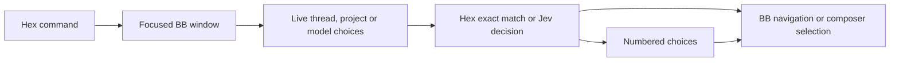

# Handsfree

Hex voice commands control the focused BB window. A Voice card shows the selected
thread, project, model, command help and numbered matches.

## Use

1. Enable Commands in Hex. Release the Right Alt dictation pedal before speaking a command.
2. Say `open BB`, then `voice help`.
3. Say a command from the card. Hold Right Alt to dictate task text.
4. Release Right Alt, wait for the text, then press the Enter pedal to send.

| Say | Action |
| --- | --- |
| `go to the login thread` | Match a thread by title and project |
| `next thread` / `previous thread` | Use BB's configured navigation shortcuts |
| `who needs me` / `next waiting` | Show threads with pending questions or approvals |
| `next finished` | Show unread successful results |
| `new thread` | Open a draft in the selected project |
| `show projects` / `list projects` | Show numbered projects for a new draft |
| `select project kb` / `switch project to kb` | Open a draft in that project |
| `new thread in dotfiles` | Match a project and open its draft |
| `use Sonnet` | Match a model offered by the selected agent |
| `choose two` | Select a numbered voice match |
| `voice help` | Show the command card |
| `archive this thread` / `archive thread` | Archive the selected thread |
| `confirm archive` / `cancel archive` | Answer an archive confirmation |
| `unarchive last thread` / `restore last thread` | Restore the most recent voice archive |

Enter selects the highlighted voice match while choices are open. Escape closes
the card and restores composer focus. Outside the card, BB handles both pedals.
The card labels Enter as send, queue or steer from BB's current setting.

Project selection opens a new draft; it does not move an existing conversation.
The Voice card keeps ten recent results in memory, including heard search targets.
Reloading clears this card history. Hex's diagnostic logs have separate retention.
Navigation requests report the observed destination when the selected thread changes.

Idle threads archive immediately. Running or queued work and child threads require
confirmation. Changing the selected context or issuing another command cancels
the pending confirmation. Archive targets the selected thread without title matching.

The server retains ten voice archives across plugin reloads. Repeated restore
commands reverse those archives in order. Each restore includes the threads that
BB archived with the parent. Partial restores retain the remaining threads for retry.
Restoration opens the conversation; it does not restart stopped work or restore
retired workspaces. BB keeps running turns and terminals for a 30-second archive grace period.

Model selection changes the next message. It does not switch agent providers or
interrupt a running turn. A draft retains its text until the user submits it.
The thread matcher offers the 200 most recently updated visible, unarchived
threads. Attention lists show up to nine threads.



## Install and verify

Run from `~/src/bb-plugins`:

```sh
pnpm install
pnpm --filter bb-plugin-handsfree test
pnpm --filter bb-plugin-handsfree typecheck
pnpm --filter bb-plugin-handsfree build
bb plugin install path:~/src/bb-plugins/handsfree
```

After edits, build the plugin and run `bb plugin reload handsfree`.

## Local command interface

Hex invokes the installed BB CLI with a JSON command. The CLI waits for the
focused window's reply. It does not depend on a fixed HTTP port.

`POST /api/v1/plugins/handsfree/http/command` provides the same interface for
local testing. BB's local HTTP authentication rejects untrusted browser origins.

```sh
bb handsfree command '{"action":"help"}'
bb handsfree command '{"action":"list","kind":"model"}'
```

The command schemas live in [contracts.ts](contracts.ts).
List replies carry a context identifier. Selection and choice requests must
return it unchanged. A changed thread, project or provider rejects stale choices.
Only one window claims each request. Unclaimed requests expire without replay;
plugin reload cancels pending requests. No focused window produces an explicit error.

Tests cover command ownership, expiry, stale context, drafts, model selection,
attention filters and pedal behaviour. Live checks cover BB navigation and the
Hex command registry. Spoken recognition requires a microphone check.
