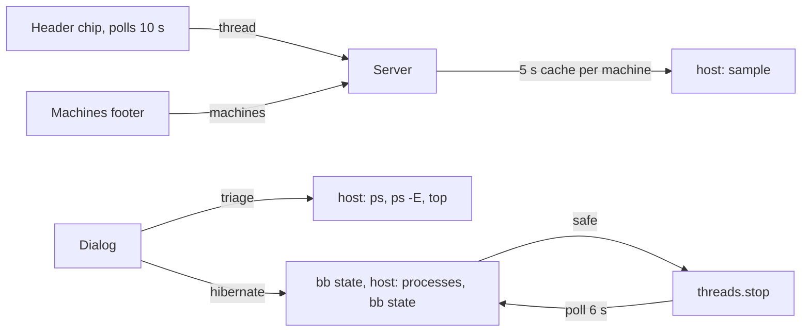

# Machine Health

A header chip shows the health of the thread's machine. Click it or press
`Alt+H` to open a dialog with the machine's vitals, memory bars, top apps and
the bb threads you can hibernate. The **Machines** sidebar footer lists every
enrolled machine at once.

## Chip

- Memory, CPU and disk always show, each as an icon and a figure. On macOS
  memory is the fill of the compressor's binding arm (`21%`); `▲` marks warn or
  critical kernel pressure. On Linux, RAM% stands in.
- An unplugged low battery and a due reboot join them. A compact viewport keeps
  memory and any reading that is not ok.
- A reading that needs a look turns its figure and icon amber or red. The
  chip's border takes the worst reading's tone. The tooltip names every reading
  and the memory state.
- bb caps the header slot at 256 px. The chip clips at that width.
- A remote machine shows `⇄` and its name.

| Reading | Warn | Critical |
| --- | --- | --- |
| Memory (macOS) | slots 60% or segments 70% | slots 80%, segments 85% or pressure 4 |
| RAM (Linux only) | 85% | 95% |
| CPU | 80% | 95% |
| Disk (`$HOME`) | 90% | 95% |
| Battery, unplugged | 20% | 10% |
| Reboot | always | - |

The reboot marker reads `/var/run/reboot-required` on Debian and Ubuntu. On
NixOS it compares the booted kernel, initrd and modules with
`/run/current-system`.

## Dialog

1. Vitals: host, uptime, memory state, RAM, CPU, disk, battery, SSH and the
   sample age. macOS RAM% counts reclaimable pages, so it reads about 90% on a
   healthy Mac; the memory row is the signal.
2. Memory: the slots and segments bars with their amber and red lines, swap,
   wired memory and the next action.
3. bb threads on this machine, ranked by the footprint of each provider process
   tree. Tick idle threads and hibernate them.
4. Top apps by summed footprint. Expand an app to end one process with SIGTERM.
   Processes in a thread's provider tree, bb's own processes, recognised Codex
   app-server roots and bridge-worker descendants offer no End.

Memory, threads and apps need macOS. A Linux machine shows vitals only. Press `r`
to refresh and `Esc` to close. `Q` also closes outside text fields.

## Hibernate

Hibernate calls `threads.stop` on the threads you tick. bb keeps the transcript
and resumes the session on the next message. Nothing hibernates automatically.

Before each stop the plugin checks again, in this order:

1. bb state: the thread is on the machine being triaged, is idle, has no
   queued message, pending question or background agent, and is not archived.
2. The machine: the thread's provider process still runs and has no live
   descendants.
3. bb state again. The process read takes a second or more, and a message
   sent meanwhile starts a turn before any child process exists.

A thread whose bb status is idle can still own running work. An idle thread's
`claude` process was seen running `zsh -c` → `git commit` → `hk` → a 1.9 GB
`nix eval`. A stop would have killed the commit. The plugin refuses such a
thread and names the command, for example
`running git commit -m wip (+2 more processes)`. The dialog shows the same
reason before you tick.

The check fails closed. An unreadable machine, or a thread with no provider
process there, is refused. A thread whose Claude session runs a stdio MCP server
or a channel plugin is always refused, because that server is a live
descendant. The telegram channel's `bun server.ts` is one such server.

After the stops, the server polls the machine every 750 ms for up to 6 s. Each
thread reports `hibernated`, `stopped but still running`, `refused` or
`failed`. Ticking more than one thread asks for confirmation.

### Unverified: does a stop free the Claude process?

`threads.stop` is documented as releasing the thread's loaded runtime. No one
has yet seen it end an idle thread's `claude` process. Run this test once:

1. Pick an idle Claude thread with a finished turn and no running tools. Copy
   its thread id from `bb thread list`.
2. Find its provider process. The `awk` prints only the pid, never the
   environment:

   ```sh
   ps -E -axo pid=,command= | awk -v id="BB_THREAD_ID=<thread-id>" 'index($0, id) { print $1 }'
   ps -o pid,ppid,command -p <pid>
   ```

   The process whose parent is `bb-provider-bridge-worker.mjs` is the provider.
3. Open the dialog in that thread with `Alt+H`. Tick the thread and press
   **Hibernate selected**.
4. Expect `1 hibernated`, and `ps -p <pid>` prints no process. `stopped but still
   running` that persists after a minute means a stop does not free it.
5. Send the thread a message. The session resumes with its transcript.

Codex threads without a `BB_THREAD_ID` mapping are not listed. A process command
cannot establish which thread owns it. Recognised `codex app-server` roots,
including absolute executable paths and daemon commands, and their descendants
refuse End even without a thread mapping. Bridge workers and their descendants
have the same protection. Thread attribution takes priority when available.

## Design



- **Sample.** One host call reads CPU, RAM, disk, battery, SSH, reboot and, on
  macOS, the compressor counters. Each probe fails soft, so one failure costs
  only its own figure. Every chip, window and split pane shares one sample per
  machine for 5 s. Polls run only while the window is visible.
- **CPU.** The worker keeps the last `os.cpus()` tick counters and diffs
  against them. A cold call, or a baseline older than 60 s, measures a 250 ms
  window.
- **Compressor.** One `sysctl` call without `-n`, so each line names its key
  and a missing key zeroes only its own field. If either limit reads 0 (Linux,
  or a blocked `sysctl`), the machine has no gauge rather than a false `OK 0%`.
- **Footprint.** `top -l 1 -stats pid,mem` reads `phys_footprint` for every
  process in about 0.8 s, without root. RSS swings as pages move in and out of
  the compressor: the `nix eval` above read 273 MB RSS and 2.9 GB footprint.
  Sums over-count shared pages, so rankings are reliable and totals approximate.
- **Thread attribution.** bb's Claude provider runs one `claude` process per
  thread, a child of `bb-provider-bridge-worker.mjs`, with `BB_THREAD_ID` in its
  environment. The host reads `ps -E`, keeps only `BB_THREAD_ID` and drops the
  rest of the environment, secrets included. Thread terminals inherit the same
  variable but hang off the daemon and survive a stop, so they are not counted.
- **End process.** The host signals a pid only if it still runs the command
  shown. It refuses provider-tree processes, bb's own processes, pid 1 and
  itself. Protection uses the current process table and ancestry, including
  provider roots with no footprint reading or thread mapping.
- **Tools.** The host runs tools with `LC_ALL=C` and a `PATH` of the system
  dirs, then `/run/current-system/sw/bin` (NixOS keeps `ss` there on the rpi5),
  then the inherited `PATH`. Tools never see the worker's other variables.

The pure core lives in `src/` with `node:test` tests; `host.ts`, `server.ts`,
`app.tsx` and `dialog.tsx` are thin shells. `contracts.ts` fails to compile if
a zod schema drifts from a core type.

## Shortcuts

| Command | Default |
| --- | --- |
| Toggle machine health | `Alt+H` |
| Toggle full hostname | none; `Alt+Shift+H` is BB's previous thread |

`Alt+M` is BB's model cycle, so the dialog uses `Alt+H`. Rebind in Settings →
Keyboard. The hostname mode is stored per window.

## Gaps

- bb gives no thread-to-process mapping. Attribution relies on `BB_THREAD_ID`
  and the bridge worker's script name, which are internal.
- The only header slot is per thread, so split panes on one machine show one
  chip each.
- The sidebar footer item is an icon button with a disclosure; no surface gives
  an always-visible fleet line.
- No plugin API raises an OS notification. memwatch stays a launchd daemon for
  banners and its headless-Chrome kill.
- One bb state read passes between the final process check and the stop.
  Work that starts in that gap without a new turn dies with the stop.
- The host can only send signals, so it cannot quit an app gracefully as
  `pclose` does.
- Archived threads whose provider process still runs are refused, so their
  memory stays held until bb ends the process.
- Not yet verified live: a remote machine and the Linux and NixOS branches
  (fixtures only).

## Development

Run `pnpm test`, `pnpm typecheck` and `pnpm build` from this directory. The
host test that reads `ps` and `top` skips under the agent sandbox, which
refuses `ps`. Install with `bb plugin install path:~/src/bb-plugins/machine-health`.
