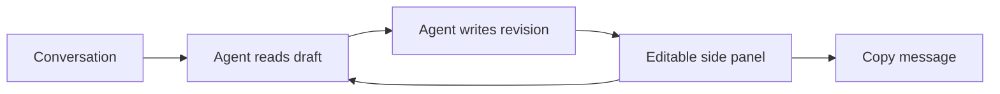

# Message Drafts

Edit one saved message per thread beside the conversation.

1. Open **Open message draft** in the command palette, or **Message draft** in the thread side-panel menu.
2. Type in the editor, or choose **Edit as message draft** on a chat message or selected text, then **Use message**.
3. Ask the agent to revise the draft in chat. Press **Copy message** when ready.

Edits autosave to plugin storage. Local recovery keeps pending edits across panel closure or reload.
The editor checks the saved draft every 800 ms while mounted. Local typing uses no model tokens.
Conflicting writes preserve the saved version and leave local edits available to copy.
**Load saved version** discards unsaved edits after the user copies anything they need.
Undo history lasts for the mounted editor session. Drafts contain at most 16000 characters.
Drafts stay in local BB state and outside Git. Copying does not send a message.

## Agent tools

- `draft_read {}` returns this thread's text and revision.
- `draft_write { text, revision }` saves only when the revision matches. It returns the new revision or a conflict.

Tool definitions and a short usage instruction enter agent context. Draft text enters context only through explicit tool reads and writes.
New tool registrations take effect when BB next constructs the provider session.

## Verification

Run `pnpm test`, `pnpm typecheck` and `pnpm build` in this directory.
