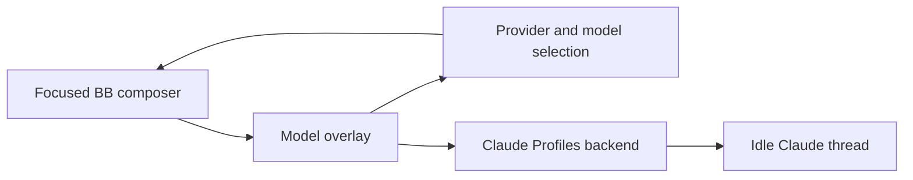

# Model Favourites

Search BB's live model catalogue, star favourite models, and switch the focused composer. Requires BB 0.46 or later.

## Use

1. Press **Alt+F**, or click the star beside the prompt.
2. Search by model or provider. Favourites appear first.
3. Click a model to select it, or click its star to save it.

Provider filters narrow the list. The Favourites filter shows only starred models.
Click a filled star to remove that model. Up to nine models fit in shortcut slots.
Removing a model leaves the other slot numbers unchanged.

Stars save provider and model only. Accounts, effort and tier stay separate.
Selecting a model preserves the current effort when supported, otherwise uses
its default effort. Unsupported service tiers fall back to Default. The footer
shows BB's current selection and controls its effort and tier directly.

The overlay reads the focused composer's live selection. It works in existing
threads and new-thread composers. Switching changes the next turn and preserves
the draft. The plugin never sends a prompt.

| Action | Shortcut |
| --- | --- |
| Open switcher | Alt+F |
| Next favourite | Alt+Shift+F |
| Previous favourite | Assign in BB Keyboard settings |
| Select favourite 1-9 | Assign in BB Keyboard settings |
| Move between visible models | Up / Down inside the overlay |
| Select focused model or first search result | Enter |
| Select saved slot | 1-9 when search is empty, or outside the search field |
| Close and return to the composer | Escape, or Q outside text fields |

The search field receives focus when the switcher opens. With an empty search,
a saved slot number selects its favourite. Digits in an existing search and
numbers without a saved slot type normally. Filters leave slot numbers unchanged.

Unavailable favourites remain visible with a reason. Cycling skips unavailable
models. Stars persist in BB plugin storage and update across open views.

## Claude accounts

The overlay includes an account selector when the current composer uses Claude
Code. It delegates discovery and switching to the enabled `claude-profiles`
plugin through BB's typed plugin RPC. It stores no account credentials or profile
selection itself.

Choose an account after a thread's first message provisions its environment.
Finish the turn and clear queued messages before switching. The account backend
validates the target login, preserves the native conversation and refuses unsafe
switches. Account changes leave the model and draft intact. The refresh button
reloads account discovery and the backend's saved selection.

**Native login** means Claude Profiles has no explicit selection for this thread.
It does not claim to identify the inherited CLI login. Choosing a named account
establishes an explicit thread selection.

Codex models work in the picker. Codex account switching is outside this version.
Missing Claude Profiles does not prevent model selection.



## Development

Run `pnpm install` from the workspace. From this directory:

```sh
pnpm test
pnpm typecheck
pnpm build
bb plugin reload model-favourites
```

Use `pnpm dev` for rebuild and reload on save.

Tests cover model-only favourites, persistence, concurrent stars, stable slots,
availability, cycling, search, keyboard selection, draft preservation, effort,
tier and account integration. The SDK harness uses account responses without
accessing credentials or making model requests.

Desktop and phone layouts, star removal, Enter selection, Escape focus and the
cycle shortcut are verified against the installed BB UI. Native Claude
continuation is documented in the account plugin's [proof](../claude-profiles/SPIKE.md).
The account switch UI is verified through the SDK harness. A live switch through
this overlay requires an unarchived Claude composer and is not repeated on
existing archived chats.
