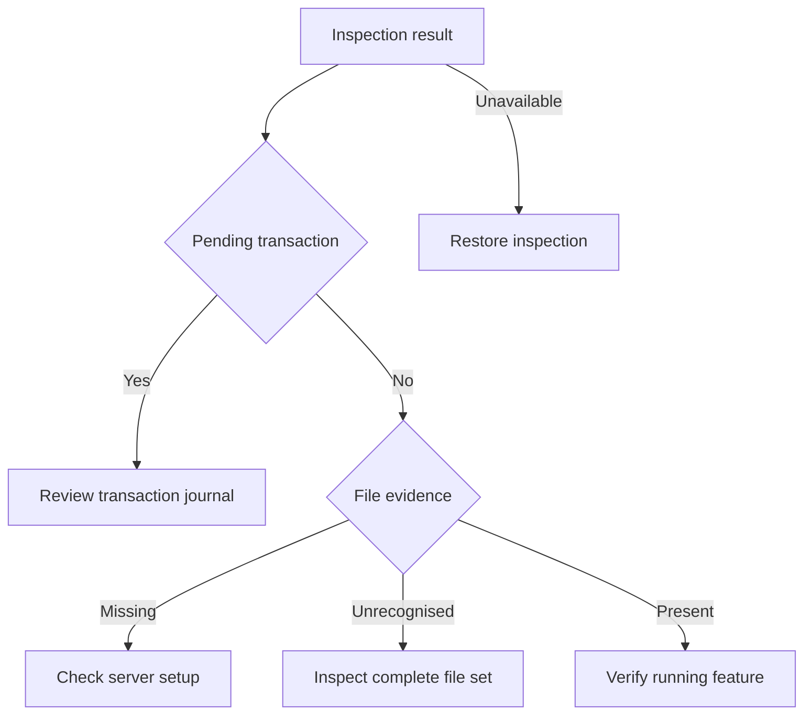

# Patches

Open **Patches** from BB's command palette to inspect desktop patch files.
Expand a patch for its evidence. Use **Refresh** to collect another observation.
Arrow keys move between patches. Enter expands details. Escape closes the popover.


## Next step

The popover shows guidance below the patch rows without requiring expansion.
Missing files require checking the server setup. Restarting cannot install them.
File matches require a live feature check because activation remains unknown.
Pending transactions take priority over normal installation advice.
Unknown files require inspection before another change.



**Copy diagnostic request** copies the observation and a read-only investigation request.
Paste it into a BB chat to check deployment, candidate evidence and the connected server.
The button does not run commands or start an agent.
The request asks for a concrete handover plan before installation or activation.
It is not a repair or activation command.

Deployment inspection uses `bb-deploy status`. A prepared candidate is not an active server.
The [deployment guide](../../../docs/remote-access.md#bb-user-server-deployments)
owns candidate activation and the initial server handover.
The [patch manager](../workflows-patch/README.md) only admits disposable desktop transactions.
Its desktop recipes do not authorise changes to the live application.

Workflow activity requires server activation after verified installation.
Session options also requires desktop view activation.
Activation runs when BB is idle and needs a subsequent feature acceptance check.
A machine reboot is not part of this procedure.

## Evidence

The inspector checks `/Applications/bb.app` on BB's primary host.
It checks Workflow activity and Session options against the combined profile.
Only a complete recognised file tuple establishes file presence.
Mixed or unknown tuples show **Cannot verify**.

**Files present** describes installed files. Live behaviour stays **Not checked**.
The plugin cannot identify loaded server code or inspect prepared server packages.
The desktop installation can differ from the connected server.
Connection loss and refresh hide previous results until another inspection completes.

The plugin never applies patches, activates packages or restarts BB.
Inspection runs on demand. It does not poll or store reports.

## Requirements

The primary host must run macOS and have the local
[patch manager](../workflows-patch/README.md) at
`~/src/bb-plugins/workflows-patch/scripts/bb_patch.py`.
The host uses `/usr/bin/python3` with fixed arguments and a twelve-second timeout.
Missing prerequisites produce an unavailable state.

## Development

Follow the [workspace guide](../README.md) for dependency installation and plugin setup.

```sh
pnpm --dir patch-health test
pnpm --dir patch-health typecheck
pnpm --dir patch-health build
bb plugin install path:~/src/bb-plugins/patch-health --yes
```

Reinstall after manifest changes so BB refreshes declared icons and app metadata.
