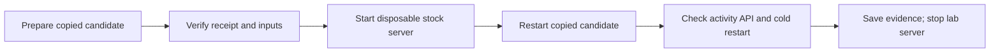

# Patches

Open **Patches** from BB's command palette to inspect desktop patches and rehearse a repair.
Expand a patch for its file evidence. **Refresh** collects another observation.
Arrow keys move between patches. Enter expands details. Escape closes the popover.

## Repair rehearsal

1. Select **Prepare test copy** to copy the installed CLI package and verify both patches offline.
2. Select **Run test** to restart the disposable server against separate test data.
3. Read the result. Open **Test details** for checks and logs.



The lab uses a private temporary directory, separate HOME, data and loopback port.
It inherits no provider credentials. It does not dispatch provider work.
The runner has no live activation command. It never changes deployment pins or restarts the current BB.
A machine reboot is not required.

Closing the popover leaves the host worker running. Reopening reads the saved operation.
Progress polling runs only while an open popover watches an active operation.
Interrupted tests offer **Stop test copy**. Recovery checks process identity before signalling a recorded lab process.
It never automatically restarts interrupted work. Prepare a fresh rehearsal after inspection.
An identity mismatch refuses signals and requires manual inspection.

```sh
bb patches status
bb patches prepare
bb patches rehearse --id <reviewed-operation-id> --revision <reviewed-revision>
```

The CLI and UI use the same host-owned record. Stale revisions refuse actions.
The private pointer lives at `~/.local/state/bb-patch-lab/current.json`.
A stale `create.lock` requires inspection of the recorded operation before manual removal.
Temporary lab directories remain available for evidence and system cleanup.

## Evidence limits

Offline checks cover both patch recipes. Restart checks cover copied stock and candidate servers.
The activity API check uses synthetic database records, then checks terminal records after a cold restart.
It does not prove workflow execution, notification delivery or session options reaching a provider worker.
The result states that the current BB has not changed and needs no restart.
It states that installing fixes is unavailable.
**Test details** keeps the current BB feature checks marked **Not checked**.
This experimental runner does not establish live maintenance admission or production supervision.

The [patch manager](../workflows-patch/README.md) owns recipes and verification.
The [deployment guide](../../../docs/remote-access.md#bb-user-server-deployments)
owns activation and the initial server handover. A prepared candidate is not an active server.

## Desktop inspection

The inspector checks `/Applications/bb.app` on BB's primary host against the combined profile.
Only a complete recognised file tuple establishes file presence.
Mixed or unknown tuples show **Cannot verify**.
**Files present** describes installed files. Live behaviour stays **Not checked**.
The desktop installation can differ from the connected server.
Connection loss hides inspection results until another observation completes.
Desktop inspection never applies patches or changes the application.

## Requirements

The primary host must run macOS and have the local
[patch manager](../workflows-patch/README.md) under `~/src/bb-plugins/workflows-patch/scripts/`.
Inspection uses `/usr/bin/python3` with fixed arguments and a twelve-second timeout.
Rehearsal requires mise-managed Node and `npm:bb-app` with an exact supported recipe.
Preparation reads installed versions. It does not install dependencies.
Missing prerequisites produce an unavailable state.

## Development

Follow the [workspace guide](../README.md) for dependency installation and plugin setup.

```sh
pnpm --dir patch-health test
pnpm --dir patch-health typecheck
pnpm --dir patch-health build
bb plugin install path:~/src/bb-plugins/patch-health --yes
```

Reinstall after manifest changes so BB refreshes declared icons and app metadata.
