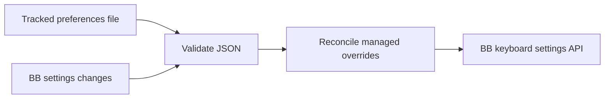

# Declarative keyboard preferences

This headless plugin applies `~/.config/bb/preferences.json` through BB's public SDK.
The file lives on the BB server machine and wins over UI edits to its shortcuts.
Only `thread.previous` and `thread.next` are supported.

## Install on a BB server

1. Check out the dotfiles, including `~/.config/bb/preferences.json` and this workspace.
2. Install workspace dependencies with `pnpm --dir ~/src/bb-plugins install --frozen-lockfile`.
3. Run `pnpm --dir ~/src/bb-plugins/preferences install:bb`.

The installation script builds, installs and applies preferences. It accepts the
`BB_CLI` path supplied inside BB, or `bb` on PATH. Repeating installation reloads
this plugin. BB must be running. Node and pnpm must be available on PATH.

## Ownership

Each entry manages one command and platform. Omit `platform` to manage the
cross-platform override. Omitted shortcut modifiers default to false.
Use `"shortcut": null` to disable a command explicitly.

File changes and settings-change events trigger reconciliation. Managed entries
replace UI edits. Other command/platform overrides remain unchanged.
Removing a managed entry deletes its override. BB then uses any remaining
platform fallback or its built-in default.

Reconciliation compares values independently of JSON property order. Unchanged
overrides skip settings writes, so settings-change events settle without another write.

Ownership persists in plugin-scoped storage so removal works after restart.
Ownership is recorded before settings updates so an interrupted apply can recover.
Invalid or missing files leave existing shortcuts and ownership intact.
Errors appear in `bb plugin logs preferences`.

Run `bb preferences apply` to apply the file explicitly. A failed apply returns
exit code 1. The background service also reapplies after its connection returns.

Disable with `bb plugin disable preferences`. Disabling stops watching and
settings reconciliation but keeps applied shortcuts. Enable with
`bb plugin enable preferences` to reapply the file.
To restore defaults, remove entries while the plugin is enabled before uninstalling.
Uninstalling deletes ownership history and keeps already applied shortcuts.

## Verification

Run `pnpm test`, `pnpm typecheck` and `pnpm build` in this directory.
The workspace and the engine floor use SDK 0.6.37. The used API passes
typecheck, build and live verification.

Live checks cover UI edits, atomic file replacement, invalid JSON, removed entries
after restart, disable/enable, reload and preservation of unmanaged shortcuts.
No database files enter source control.
